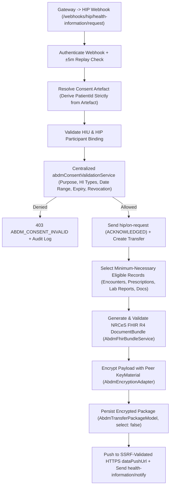

# ABDM Health Information Provider (HIP) Architecture

> **Status:** `FOUNDATION_IMPLEMENTED_LIVE_EXCHANGE_DISABLED` (`liveExchangeEnabled: false`)  
> **Primary Service:** `apps/api/src/modules/abdm/services/abdm-hip.service.ts`

## 1. Role Separation
HealthBridge India strictly isolates **HIP** (records provider) responsibilities from **HIU** (records consumer) responsibilities:
- `AbdmHipService` handles inbound verified Health Information Requests (`/api/v1/abdm/webhooks/hip/health-information/request`), minimum-necessary record selection, FHIR R4 `DocumentBundle` packaging, encryption via `AbdmEncryptionAdapter`, package persistence (`AbdmTransferPackageModel`), outbound push to `dataPushUrl`, and HIP acknowledgements (`hip/on-request`, `health-information/notify`).
- HIP endpoints never share unrestricted write permissions with HIU import pipelines.

## 2. End-to-End HIP Workflow

## 3. Core Security Controls
- **Zero Trust in Client Patient IDs:** The patient subject is always derived from the verified `AbdmConsentArtefactModel` (`artefact.patientId`).
- **Minimum-Necessary Selection:** Only record categories explicitly listed in the granted consent's `hiTypes` and falling within `[dateRange.from, dateRange.to]` are queried and packaged.
- **No Plaintext PHI in Operational Logs/Metadata:** `AbdmTransferPackageModel` stores hashes (`bundleSha256`, `encryptedPayloadSha256`) and hides ciphertext with `select: false`; `AuditLogModel` records transaction/correlation metadata only.
- **SSRF & HTTPS Enforcement:** `AbdmHieV3Client.validateDataPushUrl(...)` enforces HTTPS and blocks loopback, RFC 1918 private networks, and link-local addresses in sandbox/production.
