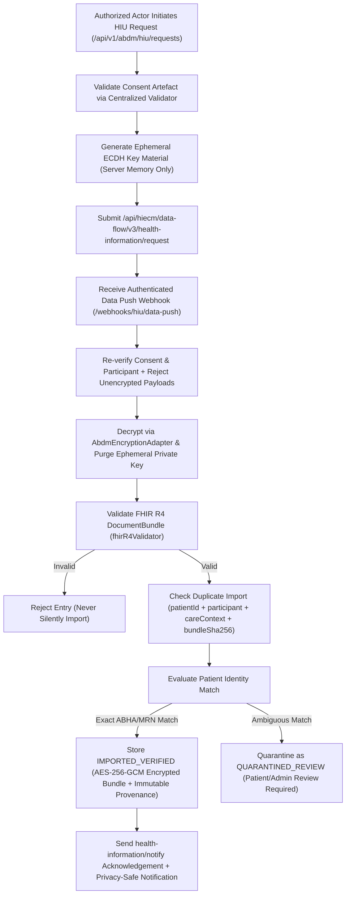

# ABDM Health Information User (HIU) Architecture

> **Status:** `FOUNDATION_IMPLEMENTED_LIVE_EXCHANGE_DISABLED` (`liveExchangeEnabled: false`)  
> **Primary Service:** `apps/api/src/modules/abdm/services/abdm-hiu.service.ts`

## 1. Role Separation & Authorization Preconditions
`AbdmHiuService` governs external health information retrieval and strictly enforces:
1. **ABHA Link != Consent:** Possessing a verified `AbhaLinkModel` or linked care context (`AbdmLinkedHealthRecordModel`) NEVER authorizes HIU data retrieval.
2. **Centralized Consent Enforcement:** Every `initiateHealthInfoRequest` and every incoming `receiveDataPushCallback` validates the referenced `AbdmConsentArtefactModel` through `abdmConsentValidationService.validateAbdmConsentAccess(...)` (`allowPatientSelfAccess: false`).
3. **Read-Only External Records:** Imported records stored in `AbdmImportedRecordModel` carry `readOnly: true` and `immutable: true` on provenance fields. Clinicians (`DOCTOR`) have strictly read-only access to verified records under active consent and zero edit/delete endpoints.

## 2. HIU Retrieval & Validation Pipeline

