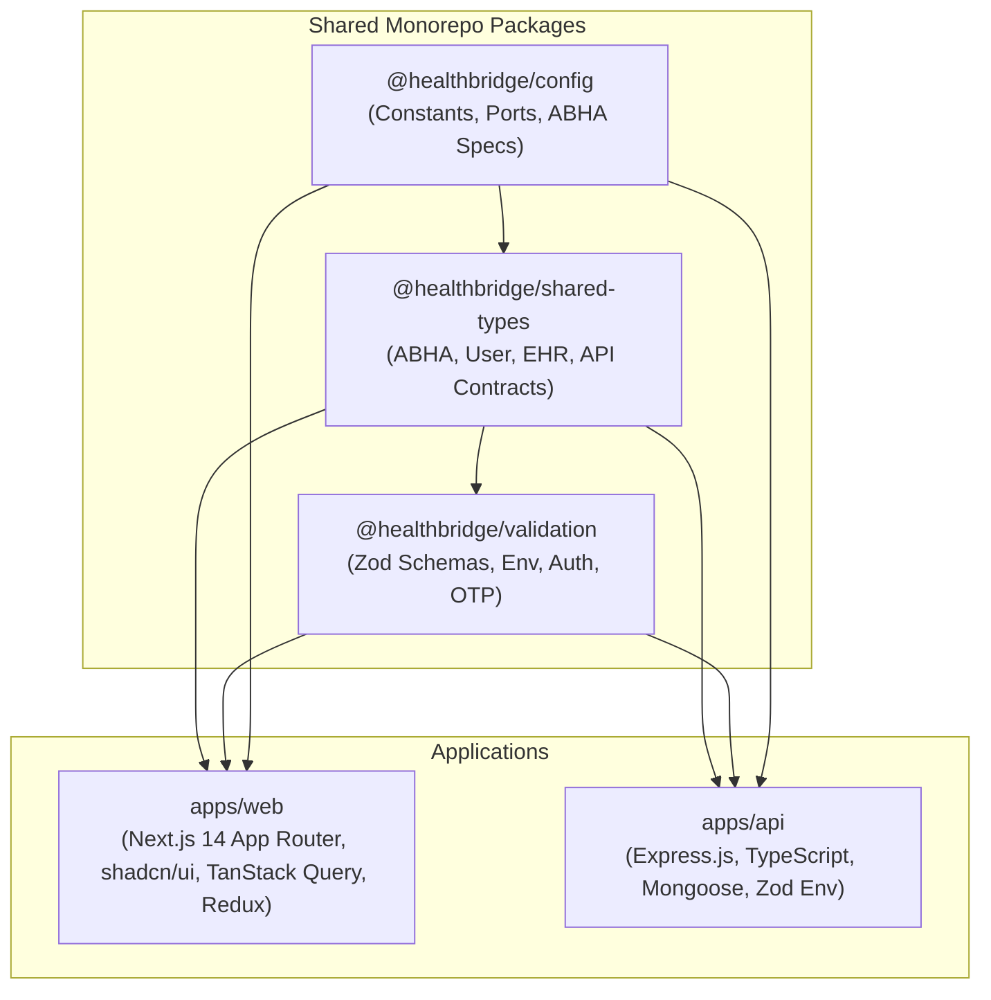
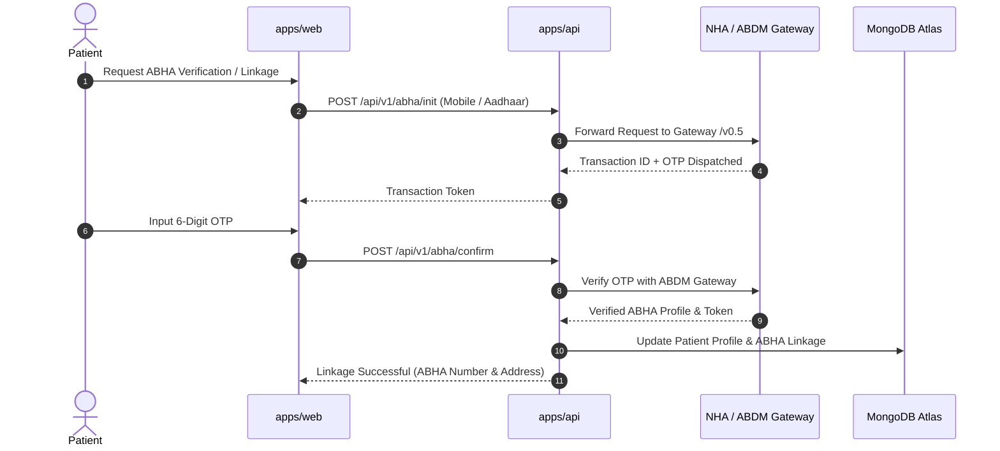
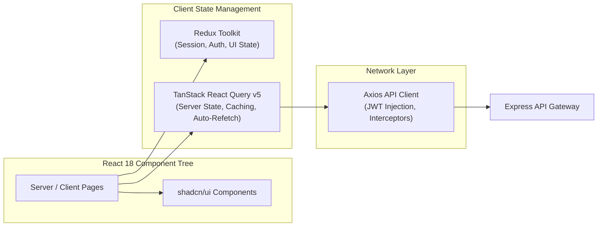

# HealthBridge India — Technical Architecture Specification

> **Platform:** HealthBridge India  
> **Vision:** One Nation One Health Record — ABHA Integrated Healthcare Platform  
> **Classification:** Confidential / Architectural Blueprint  
> **Author:** Senior Full-Stack Architect & DevOps Team  

---

## 1. Executive Architectural Vision

HealthBridge India is architected as an enterprise-grade digital healthcare super-platform designed to deliver seamless, longitudinal electronic health records across India. The system aligns natively with the **National Health Authority (NHA)** guidelines under the **Ayushman Bharat Digital Mission (ABDM)**.

The architecture addresses three mission-critical tenets:
1. **Patient Sovereignty:** Complete user ownership over medical history through consent-driven ABHA data exchange.
2. **Federated Interoperability:** FHIR R4 standardized data exchange between Health Information Providers (HIP) and Health Information Users (HIU).
3. **Resilience & Scalability:** Monorepo architecture enabling unified typing, atomic changes, and isolated microservice or serverless evolution.

---

## 2. Monorepo Design & Package Topology

The repository leverages **pnpm Workspaces** for lightning-fast disk-deduplicated package resolution and boundary enforcement.



### Monorepo Boundaries:
- **`apps/web`**: Consumer-facing web application and healthcare provider portal built on Next.js 14 with App Router, Turbopack, Tailwind CSS, and shadcn/ui.
- **`apps/api`**: RESTful API Gateway and Core Backend Service built with Express.js and TypeScript, handling business orchestration, data persistence, and security controls.
- **`packages/shared-types`**: Pure TypeScript contracts ensuring 100% compile-time type safety across network boundaries.
- **`packages/validation`**: Runtime validation layer powered by Zod, ensuring zero invalid payloads penetrate backend domain logic or frontend forms.
- **`packages/config`**: Global constants, system defaults, ABHA endpoints, and shared configuration primitives.

---

## 3. ABDM / ABHA Integration Topology

HealthBridge India is built to operate across all three ABDM milestones:



- **Milestone 1 (M1):** ABHA creation, verification, and profile authentication (Mobile OTP, Aadhaar OTP, Demographics).
- **Milestone 2 (M2):** Health Information Provider (HIP) capability — generating and securely binding Electronic Health Records (OPD, Discharge summaries, Lab reports) to ABHA.
- **Milestone 3 (M3):** Health Information User (HIU) capability — consent request manager, electronic consent artifact verification, and encrypted FHIR data ingestion.

---

## 4. Backend Layered Architecture (`apps/api`)

The backend follows a strict **Layered Clean Architecture**:

```
Request ➡️ Security Middleware ➡️ Router ➡️ Controller ➡️ Service ➡️ Database (Mongoose)
          (Helmet, CORS, Cookie)            (Validation) (Business)  (MongoDB Atlas)
```

1. **Routing Layer (`src/modules/*/*.routes.ts`):** Defines clean REST paths, attaches route-specific guards.
2. **Controller Layer (`src/modules/*/*.controller.ts`):** Handles HTTP request parameter unpacking, initiates schema validation, and delegates to services. Never writes SQL/NoSQL queries directly.
3. **Service Layer (`src/modules/*/*.service.ts`):** Implements pure business logic, domain rules, and external integrations (ABDM, SMS, Email).
4. **Data Access Layer (`src/config/database.ts`):** Manages Mongoose ODM schemas, connection pooling, indexing, and transactions.
5. **Centralized Error & Response Pipeline (`src/middleware/error-handler.ts`):**
   - Catches both operational `AppError` and non-operational runtime errors.
   - Formats uniform `ApiResponse<T>` objects with ISO timestamps.
   - Suppresses internal stack traces in non-development environments.

---

## 5. Database Architecture (`MongoDB Atlas`)

- **Connection Management:** Connection pool configured with `maxPoolSize: 10`, `minPoolSize: 2`, `serverSelectionTimeoutMS: 5000`.
- **Fault-Tolerant Bootstrap:** Database errors during local startup are caught and logged without aborting HTTP server availability, enabling the health check endpoint to report database connectivity states (`connected`, `connecting`, `disconnected`).
- **Graceful Teardown:** Listens for `SIGTERM` and `SIGINT` to safely drain active connections and close Mongoose connection pool before process termination.
- **Security:** Connection strings are passed purely through validated environment variables (`MONGODB_URI`). No hardcoded credentials exist anywhere in source code.

---

## 6. Frontend State & Data-Fetching Architecture (`apps/web`)



- **Server Cache:** **TanStack React Query v5** handles server synchronization, caching, query deduplication, background re-fetching, and optimistic updates.
- **Client Cache:** **Redux Toolkit** manages local application state (active user session, auth tokens, modal states).
- **Design System:** Built using **shadcn/ui** and **Tailwind CSS** with full accessible contrast tokens and CSS variables.

---

## 7. Security & Compliance Blueprint

- **DISHA Compliance:** Ensures patient health data is encrypted both at rest (AES-256) and in transit (TLS 1.3).
- **Transport Security:** Strict `Helmet` policy enforcing CSP, XSS filter, No-Sniff, and frameguard headers.
- **Authentication:** Stateless JSON Web Tokens (JWT) using short-lived access tokens (15m) and secure, HTTP-only, SameSite refresh tokens (7d).
- **Input Sanitization:** Every HTTP request body, query parameter, and route parameter is validated using Zod prior to execution.

