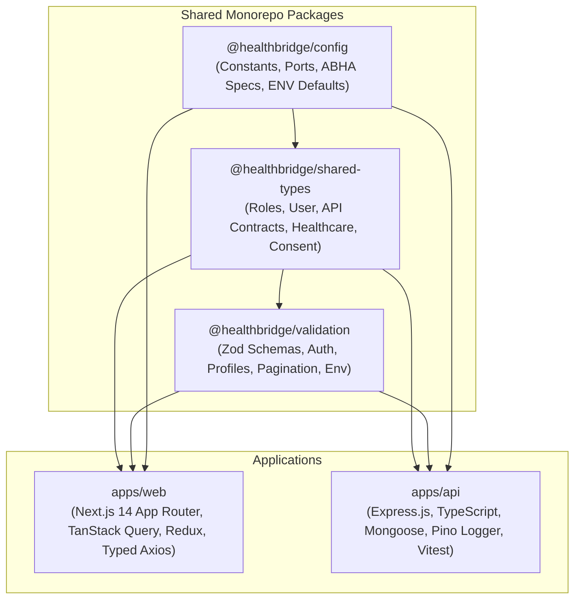
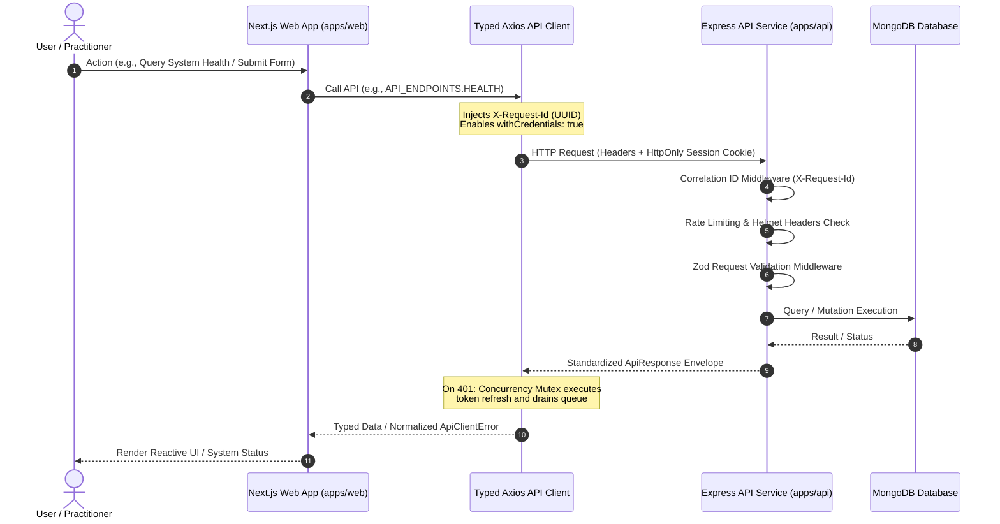
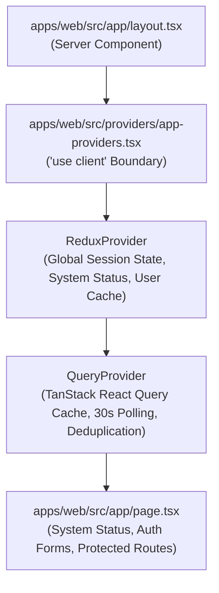

# HealthBridge India — Technical Architecture Specification

> **Platform:** HealthBridge India  
> **Vision:** One Nation One Health Record — ABHA Integrated Healthcare Platform  
> **Classification:** Enterprise Architectural Blueprint  
> **Author:** Senior Full-Stack Architect & DevOps Team

---

## 1. Executive Architectural Vision

HealthBridge India is architected as an enterprise-grade digital healthcare platform designed to deliver seamless, longitudinal electronic health records across India. The system aligns natively with the **National Health Authority (NHA)** guidelines under the **Ayushman Bharat Digital Mission (ABDM)**.

The architecture addresses three mission-critical tenets:

1. **Patient Sovereignty:** Complete user ownership over medical history through consent-driven ABHA data exchange under DISHA privacy principles.
2. **Federated Interoperability:** FHIR R4 standardized data exchange between Health Information Providers (HIP) and Health Information Users (HIU).
3. **Resilience & Scalability:** Monorepo architecture enabling unified typing, atomic changes, and isolated service evolution.

---

## 2. Monorepo Design & Package Topology

The repository leverages **pnpm Workspaces** for lightning-fast disk-deduplicated package resolution and boundary enforcement.

### Monorepo Boundaries:

- **`apps/web`**: Consumer-facing web application and healthcare provider portal built on Next.js 14 with App Router, Tailwind CSS, shadcn/ui, TanStack Query v5, and Redux Toolkit.
- **`apps/api`**: RESTful API Gateway and Core Backend Service built with Express.js, TypeScript, Mongoose, and Pino logger.
- **`packages/shared-types`**: Pure TypeScript contracts ensuring 100% compile-time type safety across network boundaries (`roles.ts`, `api.ts`, `user.ts`, `auth.ts`, `healthcare.ts`, `appointment.ts`, `consent.ts`).
- **`packages/validation`**: Runtime validation layer powered by Zod, ensuring zero invalid payloads penetrate backend domain logic or frontend forms (`auth.schema.ts`, `user.schema.ts`, `profile.schema.ts`, `appointment.schema.ts`, `pagination.schema.ts`, `env.schema.ts`).
- **`packages/config`**: Global constants, system defaults, ABHA endpoints, ports, and client-safe environment constants (`constants.ts`, `env.ts`, `index.ts`, `tsconfig.base.json`).

---

## 3. Frontend-Backend Communication Layer

The frontend-backend bridge is designed around security, resiliency, and zero-trust authentication:

### Key Communication Safeguards:

1. **HttpOnly Cookie Propagation:** Auth tokens (`hb_access_token`, `hb_refresh_token`) are strictly transmitted via HttpOnly, SameSite, Secure cookies. Zero tokens are stored in browser `localStorage`.
2. **Refresh Concurrency Mutex:** If an access token expires while multiple queries are in-flight, only a single refresh call (`POST /api/v1/auth/refresh`) is issued. Concurrent requests are queued and replayed upon rotation.
3. **Loop Circuit Breaker:** Refresh requests and login requests are tagged with non-retry markers (`_retry: true`) to prevent infinite redirection loops.
4. **End-to-End Tracing:** The Axios client assigns `X-Request-Id` using browser `crypto.randomUUID()`, which is validated by backend middleware and persisted in Pino logs and response headers.
5. **Centralized Error Normalization:** Backend errors (400, 401, 403, 404, 409, 422, 429, 500) and client-side network disconnects/timeouts are transformed into `ApiClientError` instances with status codes, error codes, and field validation details.

---

## 4. Frontend State & Provider Topology

The Next.js 14 frontend separates concerns across server components and client-side reactive state:

- **Query Client Singleton:** Managed via `useState(() => new QueryClient(...))` in `query-provider.tsx` to prevent instance recreation during Next.js client component re-renders.
- **Redux Store Singleton:** Managed via `useRef<AppStore>()` in `redux-provider.tsx` with slices for `auth` and `system`.

---

## 5. Security & DISHA Compliance Highlights

- **Zero Credential Enumeration:** Password reset and login endpoints return uniform responses regardless of whether the account exists.
- **Role Verification:** Multi-role access control (`PATIENT`, `DOCTOR`, `PHARMACY`, `LABORATORY`, `ADMIN`) is validated server-side. Public administrator self-registration is strictly rejected.
- **Data Redaction:** Passwords, tokens, OTPs, ABHA numbers, and clinical record bodies are stripped from logs by Pino serializers.
- **Database Index Protection:** Automatic index synchronization is disabled in production runtime (`autoIndex: false`) to safeguard active healthcare workloads.
