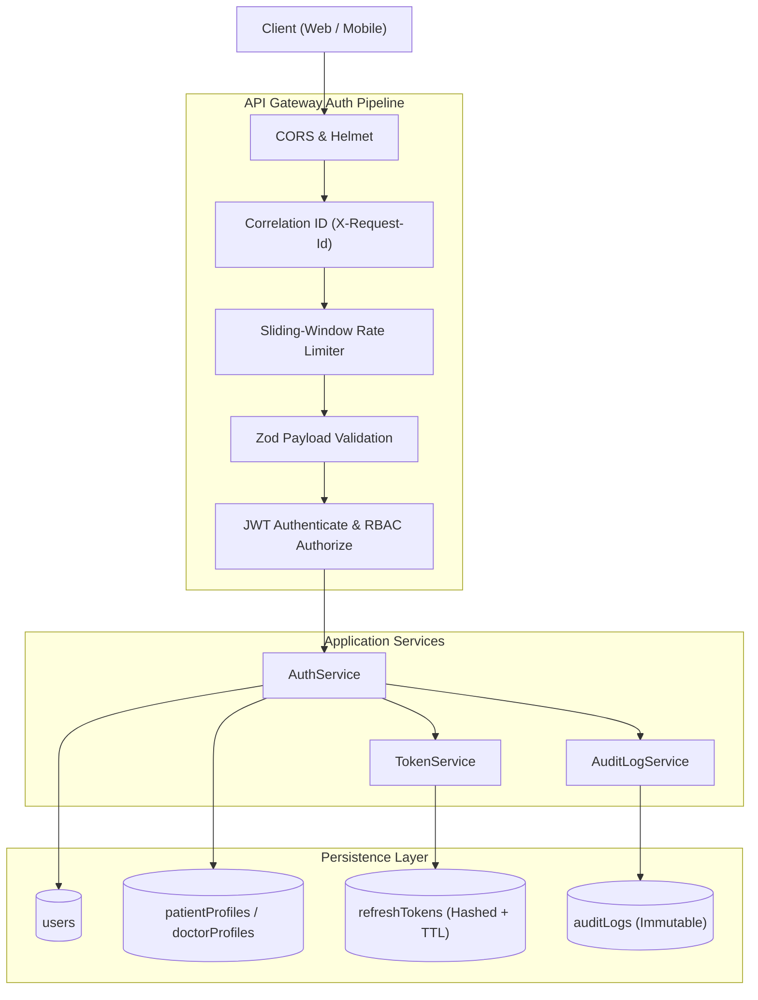
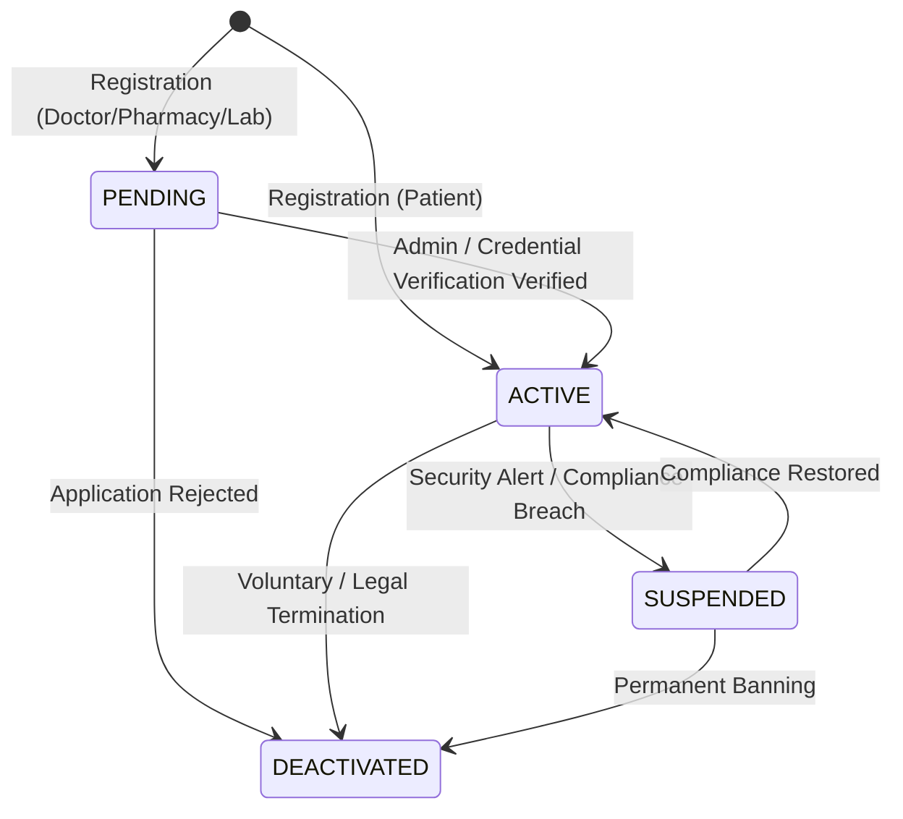
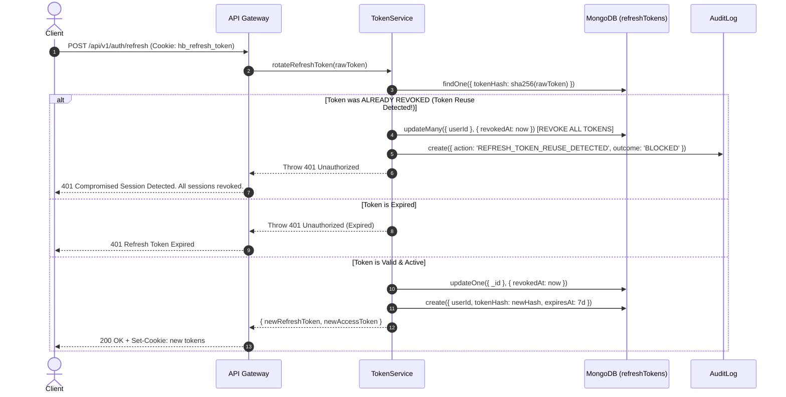

# HealthBridge India — Authentication & Identity Architecture

> **Platform:** HealthBridge India  
> **Classification:** Technical Specification / Identity & Access Management (IAM)  
> **Standard:** Ayushman Bharat Digital Mission (ABDM) & DISHA Compliant  

---

## 1. Authentication Architecture Overview

HealthBridge India enforces a defense-in-depth authentication framework built upon **Stateless JWT Access Tokens**, **Cryptographically Hashed Refresh Tokens**, **Role-Based Access Control (RBAC)**, and **Strict HTTP-Only Cookie Transport**.



---

## 2. Supported Roles & Registration Workflows

The platform supports 5 primary user roles with distinct credential verification rules:

| Role | Initial Status | Verification Workflow | Associated Profile |
| :--- | :--- | :--- | :--- |
| **`PATIENT`** | `ACTIVE` | Immediate activation upon mobile/email verification; can link ABHA. | `PatientProfileModel` |
| **`DOCTOR`** | `PENDING` | Requires NMC / State Medical Council registration check before activation. | `DoctorProfileModel` |
| **`PHARMACY`** | `PENDING` | Requires State Drug Controller retail license verification. | `PharmacyProfileModel` |
| **`LABORATORY`**| `PENDING` | Requires NABL / Clinical Establishment diagnostic license verification. | `LaboratoryProfileModel`|
| **`ADMIN`** | `ACTIVE` | Restricted: Requires cryptographic `ADMIN_REGISTRATION_KEY`. Public registration forbidden. | `AdminProfileModel` |

### Account Status State Machine



---

## 3. Token Lifecycle & Refresh Token Rotation

### Token Specifications

| Token Type | Lifespan | Storage / Transport | Encoding / Signature |
| :--- | :--- | :--- | :--- |
| **Access Token** | 15 Minutes | `hb_access_token` cookie (`httpOnly`, `sameSite: lax`) | HMAC-SHA256 JWT (`iss`, `aud`, `sub`, `role`, `jti`) |
| **Refresh Token** | 7 Days | `hb_refresh_token` cookie (`httpOnly`, `sameSite: lax`) | 40-byte random hex, stored in MongoDB as SHA-256 hash |
| **Reset Token** | 1 Hour | One-time URL parameter / VerificationToken collection | 32-byte random hex, stored in MongoDB as SHA-256 hash |

### Refresh Token Rotation with Reuse Detection

Every time an access token is refreshed, the presenting refresh token is immediately invalidated and replaced with a fresh token. If an attacker attempts to replay an already-revoked refresh token, HealthBridge India's **Compromise Containment Pipeline** triggers:



---

## 4. HTTP-Only Cookie Configuration

Cookies are configured to protect sessions against Cross-Site Scripting (XSS) and Cross-Site Request Forgery (CSRF):

```typescript
{
  httpOnly: true,                               // Inaccessible to document.cookie (blocks XSS)
  secure: process.env.NODE_ENV === 'production', // HTTPS-only in production
  sameSite: 'lax',                              // Prevents CSRF on external navigation
  path: '/',
  maxAge: 15 * 60 * 1000                         // 15m for access token, 7d for refresh
}
```

---

## 5. Password Management & Session Revocation

- **One-Time Cryptographic Tokens:** Reset tokens are generated via `crypto.randomBytes(32)` and hashed using SHA-256 before storage.
- **Zero User Enumeration:** Calling `POST /api/v1/auth/forgot-password` with any email always responds with:  
  `"If an account with this email exists, password reset instructions have been sent."`
- **Global Session Invalidation:** Upon successful password reset, all active refresh tokens for the user account are immediately revoked across all devices.

---

## 6. Verification Workflows

- **Email Verification:** Account registration issues an `EMAIL_VERIFICATION` token with a 24-hour expiration window.
- **Phone Verification:** SMS OTP integration framework configured with rate-limiting (3 requests / 15 minutes) and 6-digit numeric codes.

---

## 7. Local Testing Commands

Execute the automated authentication test suite covering all 16 security test scenarios:

```bash
# Run from repository root:
pnpm test:auth

# Or from apps/api:
pnpm --filter @healthbridge/api test:auth
```

