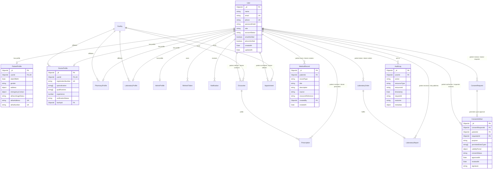

# HealthBridge India — Database Architecture Specification

> **Platform:** HealthBridge India  
> **Vision:** One Nation One Health Record — ABHA Integrated Healthcare Platform  
> **Classification:** Technical Architecture Specification / Database Design  
> **Author:** Senior Database Architect & Healthcare Backend Engineering Team  
> **Storage Engine:** MongoDB Atlas (Mongoose ODM v8, TypeScript, Zod)

---

## 1. Executive Architectural Blueprint

HealthBridge India's database layer is engineered as a secure, distributed, multi-tenant healthcare data repository aligned natively with the **Ayushman Bharat Digital Mission (ABDM)** and **Digital Information Security in Healthcare Act (DISHA)** standards.

### Key Architectural Principles:

1. **Separation of Identity & Domain Profiles:** The `users` collection maintains core authentication and authorization credentials. Specific roles (`PATIENT`, `DOCTOR`, `PHARMACY`, `LABORATORY`, `ADMIN`) extend into dedicated profile collections linked via strict 1:1 foreign references.
2. **Patient-Centric Data Ownership:** Clinical records, encounters, prescriptions, and lab reports are strictly partitioned by `patientId`. Cross-provider access is governed exclusively through cryptographically auditable ABDM consent artifacts.
3. **Purpose-Specific & Time-Bound Consent:** Consent is not a simple Boolean flag. Access to medical data requires an active, purpose-specific, time-delimited `ConsentArtifact`. Expired or revoked consent automatically invalidates data read authorization.
4. **Append-Only Auditing:** The `auditLogs` collection is tamper-evident and immutable at the application layer, logging every read, write, and consent verification without capturing sensitive medical content, plaintext passwords, or tokens.
5. **Zero Credential Exposure:** Sensitive credential hashes (`passwordHash`) are marked with `select: false` and stripped via serialization transforms. Plaintext passwords are never persisted.

---

## 2. Entity-Relationship Diagram (ERD)



---

## 3. Collections & Responsibilities

| Domain         | Collection Name      | Purpose & Responsibilities                                                           | Mongoose Model           |
| :------------- | :------------------- | :----------------------------------------------------------------------------------- | :----------------------- |
| **Identity**   | `users`              | Core credentials, authentication status, global roles, and contact info              | `UserModel`              |
| **Profile**    | `patientProfiles`    | Demographics, emergency contacts, ABHA linkage, and KYC addresses                    | `PatientProfileModel`    |
| **Profile**    | `doctorProfiles`     | Medical council registration, specializations, credentials, and hospital affiliation | `DoctorProfileModel`     |
| **Profile**    | `pharmacyProfiles`   | Retail/hospital pharmacy licenses and physical facility link                         | `PharmacyProfileModel`   |
| **Profile**    | `laboratoryProfiles` | NABL / diagnostic laboratory license and testing affiliation                         | `LaboratoryProfileModel` |
| **Profile**    | `adminProfiles`      | Platform administrative levels, RBAC privileges, and audit authority                 | `AdminProfileModel`      |
| **Healthcare** | `facilities`         | Health Facility Registry (HFR) entities (hospitals, clinics, centers)                | `FacilityModel`          |
| **Healthcare** | `medicalRecords`     | Canonical clinical documents (OP consults, discharge summaries, wellness notes)      | `MedicalRecordModel`     |
| **Healthcare** | `encounters`         | Inpatient, outpatient, emergency, or virtual consultation sessions                   | `EncounterModel`         |
| **Healthcare** | `prescriptions`      | Drug orders, dosage, frequencies, validity limits, and fulfillment status            | `PrescriptionModel`      |
| **Healthcare** | `appointments`       | Clinic visit scheduling, slot allocations, and status tracking                       | `AppointmentModel`       |
| **Healthcare** | `labOrders`          | Diagnostic requisition items ordered by registered practitioners                     | `LaboratoryOrderModel`   |
| **Healthcare** | `labReports`         | Published diagnostic findings, test observation metrics, and report files            | `LaboratoryReportModel`  |
| **Consent**    | `consentRequests`    | Inbound consent inquiries from HIUs specifying purpose, data types, and expiry       | `ConsentRequestModel`    |
| **Consent**    | `consentArtifacts`   | Signed, purpose-specific, time-delimited ABDM consent grants                         | `ConsentArtifactModel`   |
| **Security**   | `refreshTokens`      | Hashed long-lived refresh tokens with automated MongoDB TTL purging                  | `RefreshTokenModel`      |
| **Security**   | `auditLogs`          | Append-only security and data-access audit trails (HIPAA/DISHA compliant)            | `AuditLogModel`          |
| **Security**   | `notifications`      | In-app user notifications for appointments, lab results, and consents                | `NotificationModel`      |

---

## 4. Indexing Strategy & Query Optimization

Indexes are calibrated for high-throughput query patterns while eliminating redundant write overhead:

```typescript
// 1. users: Unique normalized lookups & role-based queries
users.index({ email: 1 }, { unique: true });
users.index({ phone: 1 }, { unique: true });
users.index({ role: 1, accountStatus: 1 });

// 2. patientProfiles: 1:1 user linkage & ABHA address lookups
patientProfiles.index({ userId: 1 }, { unique: true });
patientProfiles.index({ abhaAddress: 1 }, { unique: true, sparse: true });
patientProfiles.index({ abhaNumber: 1 }, { unique: true, sparse: true });

// 3. doctorProfiles: NMC / State Medical Council verification
doctorProfiles.index({ userId: 1 }, { unique: true });
doctorProfiles.index({ registrationNumber: 1 }, { unique: true });
doctorProfiles.index({ specialization: 1, verificationStatus: 1 });

// 4. medicalRecords: Chronological patient health record timeline retrieval
medicalRecords.index({ patientId: 1, recordType: 1, createdAt: -1 });

// 5. appointments: Doctor calendar conflict checks & patient schedules
appointments.index({ doctorId: 1, scheduledAt: 1, status: 1 });
appointments.index({ patientId: 1, scheduledAt: 1 });

// 6. consentArtifacts: Real-time authorization lookup for EHR access
consentArtifacts.index({
  patientId: 1,
  requesterId: 1,
  consentStatus: 1,
  'validityPeriod.to': 1,
});

// 7. refreshTokens: Automatic document purging via MongoDB TTL
refreshTokens.index({ tokenHash: 1 }, { unique: true });
refreshTokens.index({ expiresAt: 1 }, { expireAfterSeconds: 0 });

// 8. auditLogs: Compliance timeline filtering
auditLogs.index({ timestamp: -1, actorId: 1 });
auditLogs.index({ resourceType: 1, resourceId: 1, timestamp: -1 });
```

---

## 5. Referential Integrity & Data Ownership

1. **Document Embedding vs. Referencing:**
   - **Embedded:** Transient, strictly sub-component entities that lack standalone lifecycle are embedded (e.g. `Address`, `EmergencyContact`, `PrescribedMedication`, `LabObservation`).
   - **Referenced (`ObjectId`):** Independent business entities (`User`, `Facility`, `PatientProfile`, `MedicalRecord`) use normalized `ObjectId` references to enable clean access control and prevent unbounded document growth.
2. **Cascading Safety:**
   - Users are soft-deactivated via `accountStatus: 'DEACTIVATED'`. Permanent cascading deletion of clinical data is strictly forbidden under DISHA regulations.
3. **Data Ownership Model:**
   - Every clinical entity contains a `patientId` foreign key. No query may fetch medical records, prescriptions, or reports without validating that the requesting session matches either the patient directly or holds an active, valid `ConsentArtifact`.

---

## 6. Security, Compliance & Data Privacy (DISHA / ABDM / HIPAA)

- **Zero Plaintext Credentials:** Passwords are never stored in plaintext. They are salted and hashed using bcrypt (cost factor 10+) prior to database write.
- **Query Projection Isolation:** `passwordHash` is configured with `select: false` on the Mongoose schema, ensuring `find()` queries do not return it unless explicitly overridden for authentication verification.
- **Append-Only Auditing:**
  - Application middleware blocks `updateOne`, `updateMany`, `findOneAndUpdate`, and `deleteOne` operations on the `auditLogs` collection.
  - A schema validator ensures that sensitive keys (`password`, `token`, `secret`) are rejected if submitted in audit metadata.
- **Cryptographic ABDM Consent:** Consent verification evaluates three conditions:
  $$\text{IsAuthorized} = (\text{status} = \text{'ACTIVE'}) \land (\text{now} \ge \text{validity.from}) \land (\text{now} \le \text{validity.to})$$

---

## 7. Migration & Schema Versioning Strategy

1. **Explicit Schema Versioning:** Critical clinical documents store a `schemaVersion: number` (default `1`).
2. **Non-Breaking Field Expansions:** New attributes must provide schema defaults (`default: ...`) to ensure backward compatibility with older documents.
3. **Automated Index Syncing:** Indexes are maintained declaratively in Mongoose schema definitions and checked via test runners.

---

## 8. Verification & Seed Workflow

### Running Database Unit & Integration Tests

```bash
# Execute the comprehensive test suite
pnpm test:db
# or from apps/api:
pnpm --filter @healthbridge/api test:db
```

### Seeding Synthetic Demo Records

```bash
# Populate demo doctor, patient, pharmacy, lab, admin, and clinical records
pnpm seed
# or from apps/api:
pnpm --filter @healthbridge/api seed
```

### Synthetic Demo Credentials (Local / Non-Production):

- **Administrator:** `admin.demo@healthbridge.local` | `DemoSecure#2026`
- **Doctor:** `dr.priya.sharma@healthbridge.local` | `DemoSecure#2026`
- **Patient:** `ramesh.patel@healthbridge.local` | `DemoSecure#2026`
- **Pharmacy:** `pharmacy.demo@healthbridge.local` | `DemoSecure#2026`
- **Laboratory:** `lab.demo@healthbridge.local` | `DemoSecure#2026`
