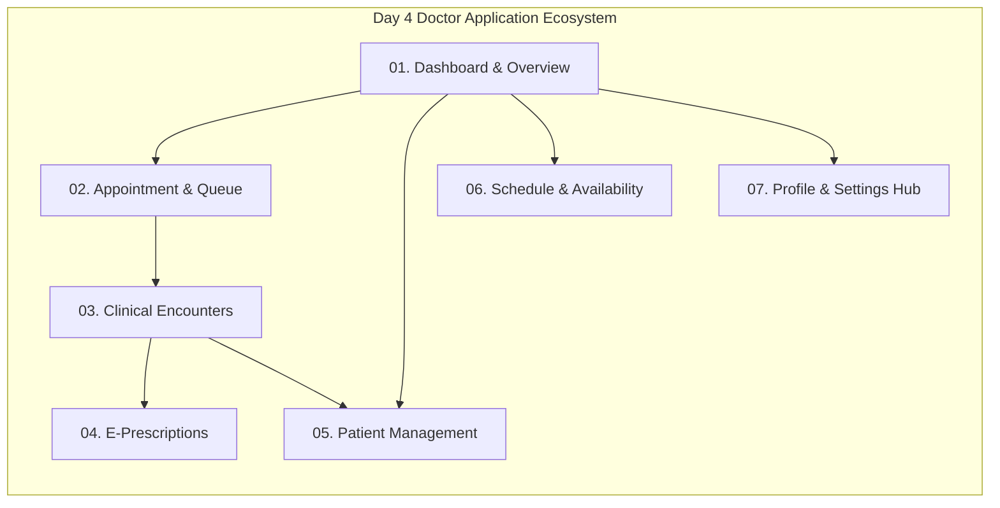
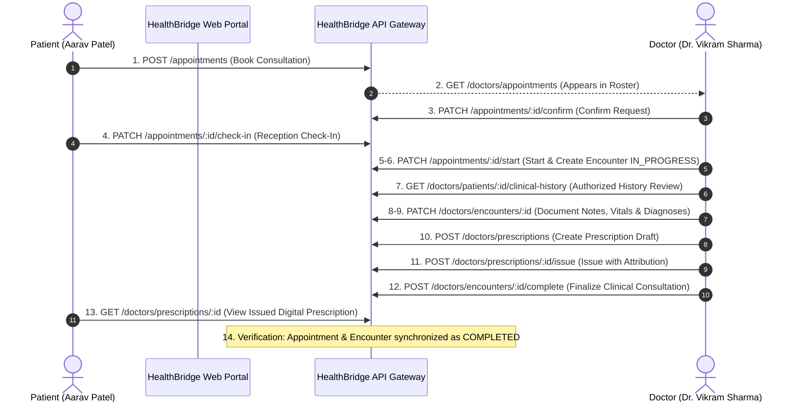

# HealthBridge India — Day 4 Doctor Module Completion Report
**Status:** COMPLETED & AUDITED  
**Milestone:** Day 4 (Doctor Clinical Experience & Workflow Integration)  
**Execution Lead:** Principal Full-Stack Engineer, Healthcare Security Architect & Senior QA Automation Engineer  

---

## 1. Executive Summary

Day 4 of the HealthBridge India development plan focused on constructing the complete, end-to-end Doctor Clinical Experience. Building upon the shared foundation and Patient experience delivered in Days 1–3, Day 4 engineered eight interconnected clinical modules. The clinician workspace bridges appointment booking, triage queues, structured consultation note documentation, electronic prescribing, longitudinal medical history access, schedule calendar management, and professional security governance.

All 8 doctor modules are fully operational, unified with ABDM consent enforcement, covered by automated integration tests, and validated through an automated 14-step end-to-end clinical workflow test.

---

## 2. Day 4 Module Delivery Matrix



### Module 01: Doctor Dashboard & Professional Overview
- **Web Routes:** `/doctor/dashboard`
- **API Endpoints:** `GET /api/v1/doctors/dashboard/summary`, `GET /api/v1/doctors/appointments/today`, `GET /api/v1/doctors/appointments/upcoming`
- **Key Features:** Real-time KPI statistics (today's appointments, completed encounters, pending queue, active prescriptions), quick action launchpads, daily schedule calendar preview, responsive clinical widgets.

### Module 02: Doctor Appointment Management & Patient Queue
- **Web Routes:** `/doctor/appointments`, `/doctor/appointments/:id`, `/doctor/appointments/today`, `/doctor/appointments/upcoming`, `/doctor/appointments/history`, `/doctor/queue`
- **API Endpoints:** `GET /api/v1/doctors/appointments`, `GET /api/v1/doctors/appointments/:id`, `PATCH /api/v1/doctors/appointments/:id/confirm`, `PATCH /api/v1/doctors/appointments/:id/reject`, `PATCH /api/v1/doctors/appointments/:id/check-in`, `PATCH /api/v1/doctors/appointments/:id/start`, `PATCH /api/v1/doctors/appointments/:id/complete`, `PATCH /api/v1/doctors/appointments/:id/cancel`, `GET /api/v1/doctors/queue`
- **Key Features:** Full appointment lifecycle management, atomic state transitions, daily queue ordering with priority calculation and waiting duration, automated appointment cancellation policies.

### Module 03: Doctor Clinical Encounter Management System
- **Web Routes:** `/doctor/encounters`, `/doctor/encounters/new`, `/doctor/encounters/:id`, `/doctor/encounters/:id/edit`
- **API Endpoints:** `GET /api/v1/doctors/encounters/summary`, `GET /api/v1/doctors/encounters`, `POST /api/v1/doctors/encounters`, `GET /api/v1/doctors/encounters/:id`, `PATCH /api/v1/doctors/encounters/:id`, `POST /api/v1/doctors/encounters/:id/save-draft`, `POST /api/v1/doctors/encounters/:id/complete`
- **Key Features:** Structured clinical documentation (chief complaints, HPI, examination findings, LOINC vital signs, ICD-10 diagnoses, assessment and treatment plans), auto-save draft functionality, concurrency conflict protection, immutable lock on finalized encounters.

### Module 04: Doctor Prescription Creation & E-Prescription Management
- **Web Routes:** `/doctor/prescriptions`, `/doctor/prescriptions/new`, `/doctor/prescriptions/:id`, `/doctor/prescriptions/:id/edit`, `/doctor/medications`
- **API Endpoints:** `GET /api/v1/doctors/prescriptions/summary`, `GET /api/v1/doctors/prescriptions`, `POST /api/v1/doctors/prescriptions`, `GET /api/v1/doctors/prescriptions/:id`, `PATCH /api/v1/doctors/prescriptions/:id`, `POST /api/v1/doctors/prescriptions/:id/issue`, `POST /api/v1/doctors/prescriptions/:id/discontinue`, `GET /api/v1/doctors/prescriptions/:id/document`, `GET /api/v1/medication-catalog`
- **Key Features:** Multi-item Rx builder, searchable medication catalog with brand/generic mappings, dosage/route/frequency validators, attending clinician attribution confirmation, printable digital prescription documents with security watermarks, immutable finalized prescriptions.

### Module 05: Doctor Patient Management & Longitudinal Clinical History
- **Web Routes:** `/doctor/patients`, `/doctor/patients/:id`, `/doctor/patients/:id/history`, `/doctor/patients/:id/records`, `/doctor/patients/:id/encounters`, `/doctor/patients/:id/prescriptions`, `/doctor/patients/:id/lab-reports`
- **API Endpoints:** `GET /api/v1/doctors/patients`, `GET /api/v1/doctors/patients/:id`, `GET /api/v1/doctors/patients/:id/history`, `GET /api/v1/doctors/patients/:id/records`, `GET /api/v1/doctors/patients/:id/encounters`, `GET /api/v1/doctors/patients/:id/prescriptions`, `GET /api/v1/doctors/patients/:id/lab-reports`, `POST /api/v1/doctors/patients/:id/consent-requests`, `GET /api/v1/doctors/patients/:id/clinical-history`
- **Key Features:** Authorized patient roster, unified chronological health timeline, diagnostic laboratory report views with abnormal flag highlighting, medical records explorer, ABDM electronic consent enforcement and request initiation.

### Module 06: Doctor Schedule & Availability Management System
- **Web Routes:** `/doctor/schedule`, `/doctor/schedule/weekly`, `/doctor/schedule/availability`, `/doctor/schedule/blocked-dates`, `/doctor/schedule/settings`
- **API Endpoints:** `GET /api/v1/doctors/schedule`, `PUT /api/v1/doctors/schedule`, `GET /api/v1/doctors/schedule/overview`, `GET /api/v1/doctors/schedule/availability`, `GET /api/v1/doctors/schedule/calendar`, `GET /api/v1/doctors/schedule/blocked-dates`, `POST /api/v1/doctors/schedule/blocked-dates`, `DELETE /api/v1/doctors/schedule/blocked-dates/:blockId`, `GET /api/v1/doctors/schedule/overrides`, `POST /api/v1/doctors/schedule/overrides`, `DELETE /api/v1/doctors/schedule/overrides/:overrideId`, `GET /api/v1/doctors/schedule/facilities`
- **Key Features:** Weekly recurring slot windows, slot generation algorithms, consultation duration and break buffer management, blocked date and leave manager with automated conflict detection, calendar views (day, week, month), multi-facility affiliation configuration.

### Module 07: Doctor Profile, Professional Settings, Security Audit & Module Integration
- **Web Routes:** `/doctor/profile`, `/doctor/settings`, `/doctor/settings/professional`, `/doctor/settings/practice`, `/doctor/settings/security`, `/doctor/settings/sessions`, `/doctor/settings/notifications`
- **API Endpoints:** 11 dedicated doctor profile and settings endpoints mounted under `/api/v1/doctors/me/...` and `/api/v1/doctors/...`.
- **Key Features:** Immutable verification badge enforcement, credential document management with review states, active session enumeration and termination, password rotation with entropy checking, mandatory security notification policy, complete 14-step clinical workflow integration verification.

---

## 3. 14-Step Clinical Workflow Integration Results

The full end-to-end clinical workflow connecting patients and doctors was verified through an automated integration test suite (`tests/integration/doctor-clinical-workflow.test.ts`):



| Step | Operation | Result | Verification Detail |
|---|---|---|---|
| **01** | Patient books appointment | **PASSED** | Appointment created with status `SCHEDULED`, queue token assigned |
| **02** | Doctor views appointment in roster | **PASSED** | Roster lists consultation with patient demographics and facility |
| **03** | Doctor confirms appointment | **PASSED** | Status transitions to `CONFIRMED`, patient notification generated |
| **04** | Patient checks in at clinic reception | **PASSED** | Status transitions to `CHECKED_IN`, queue sequence assigned |
| **05 & 06** | Doctor starts consultation | **PASSED** | Status updates to `IN_PROGRESS`, clinical encounter document linked |
| **07** | Doctor accesses authorized history | **PASSED** | Longitudinal chart retrieved with active consent verification |
| **08 & 09** | Doctor documents clinical findings | **PASSED** | Vitals, ICD-10 diagnoses, and clinical notes saved |
| **10** | Doctor creates linked prescription draft | **PASSED** | Prescription saved in `DRAFT` status with medication catalog lines |
| **11** | Doctor issues verified prescription | **PASSED** | Status transitions to `ACTIVE`, digital attribution confirmed |
| **12** | Doctor completes encounter | **PASSED** | Encounter marked `COMPLETED` and locked; appointment updated |
| **13** | Patient views issued prescription | **PASSED** | Patient accesses digital prescription with verification details |
| **14** | Status synchronization check | **PASSED** | Both appointment and encounter verified in `COMPLETED` state |

---

## 4. Healthcare Security, Compliance & Data Integrity Audit

A comprehensive healthcare security audit was executed across all doctor endpoints:

### 4.1 Authentication & RBAC Enforcement
- All clinical endpoints strictly require a valid JWT Access Token.
- Endpoints enforce `authorize(['DOCTOR'])`. Requests originating from `PATIENT` or unauthenticated roles are rejected with `403 FORBIDDEN` or `401 UNAUTHORIZED`.
- Unauthorized doctors cannot access clinical encounters owned by other physicians (tested and verified with `404/403`).

### 4.2 Clinical Immutability & Anti-Tampering
- **Finalized Encounters:** Once an encounter is finalized (`COMPLETED`), all draft modification requests (`PATCH /api/v1/doctors/encounters/:id`) are strictly rejected with `400 Bad Request`.
- **Issued Prescriptions:** Once a prescription is issued (`ACTIVE`), modifications to medications or diagnoses are rejected with `400 Bad Request`. To modify therapy, doctors must issue a replacement or discontinue.

### 4.3 Fail-Closed Consent Enforcement
- Accessing patient longitudinal health records (`/clinical-history`, `/history`, `/records`) requires an active appointment, an ongoing encounter, or an active ABDM electronic consent artifact.
- When consent is expired, revoked, or absent, the API responds with `403 Forbidden` (`Access denied: You lack verified clinical authorization, active appointment, or patient consent`).

### 4.4 Mandatory Security Notifications Policy
- System governance mandates that `securityAlerts.inApp` and `securityAlerts.email` cannot be disabled by any user, including doctors. The backend service enforces this rule regardless of incoming request payload values.

---

## 5. Quality Gate Verification

| Metric | Target | Result | Status |
|---|---|---|---|
| **TypeScript Compilation** | 0 errors across 5 workspace projects | 0 errors | **PASSED** |
| **ESLint Static Analysis** | 0 warnings / 0 errors across all projects | 0 warnings | **PASSED** |
| **Backend Test Suites** | 26 test files passing | 26 passed | **PASSED** |
| **Backend Total Tests** | $\ge 280$ integration & unit tests | 295 passed (0 failed) | **PASSED** |
| **Production Web Build** | Next.js 14 App Router production bundle | 57/57 pages built | **PASSED** |

---

## 6. Doctor Portal Navigation & Route Catalog

The doctor navigation sidebar has been updated to provide immediate access to all 10 core Day 4 doctor modules:

```
├── /doctor/dashboard              (Overview KPI stats, feeds, and calendar preview)
├── /doctor/appointments           (Appointment management roster & filters)
├── /doctor/queue                  (Daily patient check-in queue)
├── /doctor/encounters             (Clinical encounters workspace)
├── /doctor/prescriptions          (E-Prescription management)
├── /doctor/medications            (Medication catalog browser)
├── /doctor/patients               (Authorized patient directory)
├── /doctor/schedule               (Clinical schedule & availability)
├── /doctor/profile                (Professional profile & credentials dossier)
└── /doctor/settings               (Settings Hub & configuration sub-pages)
    ├── /professional              (Profile editing & document upload)
    ├── /practice                  (Practice & facility bindings)
    ├── /security                  (Password rotation & audit log)
    ├── /sessions                  (Active session management)
    └── /notifications             (Multi-channel preferences)
```

---

## 7. Known Limitations & Next Steps

1. **Document Storage Driver:** Credential uploads are currently processed with secure local filesystem storage. Integration with AWS S3 / Google Cloud Storage encrypted buckets with presigned URLs is planned for Day 5.
2. **Push Notifications:** Notification preferences are persisted in the database; real-time web push (FCM) integration will be activated in upcoming infrastructure phases.
3. **ABDM Gateway Live Sync:** Electronic consent validation currently utilizes the local MongoDB consent engine conformant with the ABDM M1/M2/M3 schemas; live National Health Authority (NHA) Sandbox gateway integration will be attached during external integration milestones.

