# HealthBridge India — Day 5 Pharmacy Module Completion Report

## 1. Executive Summary

Day 5 of the HealthBridge India platform development focused on the complete design, implementation, verification, and end-to-end integration of the **Pharmacy Subsystem**. The module enables licensed pharmacies to manage inventory, dispense prescription medications safely, procure stock from approved vendors, fulfill pickup and delivery orders, dispatch critical operational notifications, and manage staff credentials and security settings.

Across Tasks 01 through 07, the engineering team implemented **20 interconnected modules**, established **6 complete business workflows**, passed **186 automated integration tests** with 100% success rate, verified 0 TypeScript compiler errors across all monorepo packages, and successfully built all 97 Next.js production routes.

---

## 2. Inventory of Implemented Day 5 Modules (20/20)

| # | Module | Scope & Functionality |
|---|---|---|
| 1 | **Pharmacy Dashboard** | Operational KPIs (pending orders, low stock count, daily dispensing volume, revenue metrics), quick navigation, recent activity stream. |
| 2 | **Pharmacy Profile Foundation** | Facility identity, drug license registration, address coordinates, contact details. |
| 3 | **Medicine Catalogue** | Centralized national medicine catalogue integration, generic-brand mappings, therapeutic classifications, schedule categorization (Schedule H, Schedule X). |
| 4 | **Batch Inventory Management** | Batch-level stock tracking with unique lot numbers, manufacturing and expiry dates, MRP, purchase prices, and storage conditions. |
| 5 | **Stock-In & Stock Adjustment** | Audited stock-in operations, physical stock count reconciliations, shrinkage/damage write-offs with mandatory reason codes. |
| 6 | **Inventory Transaction Ledger** | Immutable append-only transaction ledger (`InventoryTransactionModel`) recording every stock movement with before/after balances. |
| 7 | **Expiry & Low-Stock Alerts** | Automated monitoring engine flagging batches nearing expiry (<30/60/90 days) and items falling below calculated reorder thresholds. |
| 8 | **Prescription Verification** | Cryptographic verification of doctor prescriptions, doctor registration verification, authenticity validation, and status tracking. |
| 9 | **Medicine Matching & Dispensing** | Matching prescribed medicines with available batch inventory, substitution validation, dosage instructions, and dispensing confirmation. |
| 10 | **Partial Dispensing** | Regulatory compliant partial dispensing workflows for scarce medications, tracking remaining quantities and generating partial receipts. |
| 11 | **Supplier Management** | Vendor profiles, GSTIN verification, contact management, payment terms, and vendor performance tracking. |
| 12 | **Purchase Requisitions & Orders** | Purchase order creation, itemized line items, automated cost calculations, tax computations, and manager approval gates. |
| 13 | **Goods Receiving** | Multi-step goods receipt notes (GRN), invoice matching, batch quantity verification, damaged item rejection. |
| 14 | **Purchase Invoice Tracking** | Supplier invoice recording, due date tracking, payment status reconciliation. |
| 15 | **Stock Replenishment Engine** | Automated replenishment suggestions based on sales velocity, lead times, safety stock levels, and supplier minimum order quantities. |
| 16 | **Pharmacy Order Management** | Unified order processing pipeline handling orders converted from verified prescriptions or counter requests. |
| 17 | **Patient Order Tracking** | Patient-facing and dispensary-facing order status tracking (`PENDING` -> `CONFIRMED` -> `PREPARING` -> `READY_FOR_PICKUP` -> `COMPLETED`). |
| 18 | **Pickup & Fulfillment Workflows** | In-store pickup verification with patient verification codes, packaging confirmation, and receipt generation. |
| 19 | **Notification Center** | Centralized in-app and multi-channel notification engine (Email, SMS, WhatsApp) for alerts and order events. |
| 20 | **Staff Management & Security** | Granular staff roles and permissions, session tracking, instant device revocation, operating hours engine, zero self-approval licensing. |

---

## 3. Synthesis of Core Workflows (Workflows A — F)

```mermaid
flowchart TD
    subgraph Workflow A: Procurement & Stocking
        A1[Reorder Suggestion] --> A2[Purchase Order Created]
        A2 --> A3[Supplier Delivery]
        A3 --> A4[Goods Receiving / GRN]
        A4 --> A5[Batch Stock-In & Ledger Update]
    end

    subgraph Workflow B: Prescription Verification & Dispensing
        B1[Prescription Received] --> B2[Authenticity Verified]
        B2 --> B3[Batch Matching FIFO]
        B3 --> B4[Clinical Review & Dispense]
        B4 --> B5[Inventory Auto-Deduction]
    end

    subgraph Workflow C: Order Fulfillment
        C1[Order Created from Prescription] --> C2[Dispensary Preparation]
        C2 --> C3[Ready for Pickup Notification]
        C3 --> C4[Patient Counter Verification]
        C4 --> C5[Order Completed & Receipt Issued]
    end

    subgraph Workflow D: Security & Staff Lifecycle
        D1[Staff Invited by Owner] --> D2[Staff Accepts & Activates]
        D2 --> D3[Role-Based Operation]
        D3 --> D4[Account Suspension / Invalidation]
    end
```



- **Workflow A (Procurement):** Low-stock detection generates purchase recommendations. Purchasing officers raise POs to verified suppliers. Upon physical arrival, GRN inspection validates batch numbers, expiry dates, and costs, automatically updating inventory balances and recording immutable ledger transactions.
- **Workflow B (Dispensing):** Doctors issue digital prescriptions. Pharmacies verify authenticity via cryptographic checks. Pharmacists select matching inventory batches using FEFO (First-Expired, First-Out), review warnings for Schedule H/X medications, and execute dispensing. Stock is atomically decremented with transaction ledger logging.
- **Workflow C (Partial Dispensing):** When batch inventory is insufficient to satisfy the full prescription course, the system records partial dispensing, decrements stock accurately, updates remaining quantities, and allows subsequent completion when stock is replenished.
- **Workflow D (Order & Counter Pickup):** Verified prescriptions are converted into trackable orders. Dispensary staff prepare medications, packaging generates automated patient notifications via SMS/email, and the order is handed over at the counter following verification of the patient's collection code.
- **Workflow E (Stock Alerts & Expiry):** Continuous background analytics classify stock into expiration risk categories (expired, expiring in 30 days, expiring in 90 days) and generate reorder notifications when current stock falls below minimum safety levels.
- **Workflow F (Staff Access & Isolation):** Pharmacy owners invite staff with assigned roles (`PHARMACIST`, `INVENTORY_STAFF`, etc.). Sessions are tracked with device fingerprints. Suspending or revoking staff immediately flushes refresh tokens. All API routes enforce multi-tenant isolation, preventing cross-pharmacy data access.

---

## 4. Verification & Quality Gate Results

### 1. Cumulative Integration Test Suite
All 7 integration test suites covering the Day 5 subsystem passed with 100% compliance:

```
Test Files  7 passed (7)
Tests       186 passed (186)
Duration    2.48s
```

| Test Suite | Tests | Status | Execution Time |
|---|:---:|:---:|:---:|
| `pharmacy-dashboard.test.ts` | 17 | PASSED | 1.1s |
| `pharmacy-inventory-system.test.ts` | 42 | PASSED | 1.8s |
| `pharmacy-dispensing-workflow.test.ts` | 28 | PASSED | 1.4s |
| `pharmacy-procurement-system.test.ts` | 33 | PASSED | 1.6s |
| `pharmacy-order-fulfillment.test.ts` | 21 | PASSED | 1.2s |
| `notification-system.test.ts` | 14 | PASSED | 0.9s |
| `pharmacy-settings-staff.test.ts` | 31 | PASSED | 1.8s |
| **Total** | **186** | **ALL PASSED** | **2.48s** |

### 2. Monorepo Type Check
Command: `pnpm type-check` across all 5 workspace projects:
- `@healthbridge/config`: Clean (0 errors).
- `@healthbridge/shared-types`: Clean (0 errors).
- `@healthbridge/validation`: Clean (0 errors).
- `@healthbridge/api`: Clean (0 errors).
- `@healthbridge/web`: Clean (0 errors).

### 3. Next.js Production Build
Command: `pnpm --filter @healthbridge/web build`
- **Result:** Successfully compiled 97 production routes.
- **Zero static/SSR build errors.**
- All 9 pharmacy settings pages (`/pharmacy/settings/*`) verified with optimal bundle sizes.

---

## 5. Architectural Invariants Enforced

1. **Zero Self-Approval Invariant:** Pharmacy administrators cannot bypass statutory verification by submitting `verificationStatus` or `documentSubmissionStatus` mutations. Any attempt is rejected with `403 Forbidden`.
2. **Immutable Transaction Ledger:** Every stock alteration (stock-in, dispensing, adjustment, return) writes an append-only entry to `InventoryTransactionModel`. Records cannot be updated or deleted.
3. **FEFO Allocation Preference:** Dispensing interfaces prioritize batches nearing expiration to minimize clinical waste while strictly blocking expired medication dispensing.
4. **Tenant Isolation:** Cross-tenant access is rejected with `404 Not Found` across all queries, preventing resource enumeration.
5. **Immediate Session Termination:** Staff suspension or revocation immediately invalidates all active JWT refresh tokens in `RefreshTokenModel`.

---

## 6. Handoff & Milestone Transition to Day 6

With Day 5 fully completed and verified, the HealthBridge India development roadmap advances to **Day 6: Laboratory & Diagnostic Subsystem**.

### Day 6 — Task 01 Milestone Preview:
**Task 01: Laboratory Dashboard Architecture, Lab Profile, Test Catalogue and Lab Order Queue Foundation**
- Laboratory dashboard KPIs (pending samples, tests in progress, critical results, turnaround times).
- Lab profile management, accreditation registration (NABL / ICMR), and pathologist-in-charge credentials.
- Diagnostic test catalogue management (LOINC-aligned test definitions, specimen types, reference ranges).
- Doctor and patient lab order intake queue foundation.
