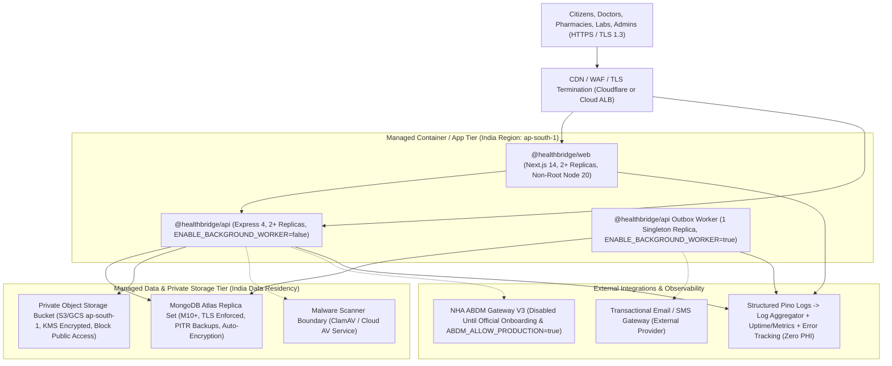

# HealthBridge India — Production Architecture

## 1. Architecture Overview (Aligned With Existing Stack)

The production architecture preserves the exact existing pnpm monorepo stack (**Next.js 14** + **Express 4** + **MongoDB/Mongoose** + **SSE** + **Durable MongoDB Outbox Worker**) without introducing unnecessary middleware or rewriting working services.

---

## 2. Hosting & Infrastructure Evaluation

| Component | Recommended Option (India Region `ap-south-1`) | Why Chosen Over Alternatives |
| --- | --- | --- |
| **Frontend (`@healthbridge/web`)** | Containerized Next.js (`apps/web/Dockerfile`) on AWS ECS Fargate / Cloud Run / Render, or Vercel Pro with India edge | Direct Docker compatibility (`apps/web/Dockerfile`), predictable pricing, custom CSP/security headers preserved in `next.config.mjs`. |
| **Backend (`@healthbridge/api`)** | Containerized Node 20 (`apps/api/Dockerfile`) behind HTTPS ALB (`TRUST_PROXY_HOPS=1`) | Native SSE (`/api/v1/notifications/stream`) requires long-lived HTTP connections; serverless functions break SSE streams. |
| **Background Outbox Worker** | Dedicated single container using the exact same `apps/api/Dockerfile` with `ENABLE_BACKGROUND_WORKER=true` | Prevents duplicate polling across horizontally scaled API replicas while reusing the existing durable MongoDB outbox without requiring Redis on Day 1. |
| **Database** | MongoDB Atlas M10+ Dedicated Replica Set (`ap-south-1` Mumbai) | Required for ACID multi-document transactions, automated Continuous Cloud Backup (PITR), India data residency, TLS 1.2+, and IP allowlisting / VPC peering. |
| **Redis (Future Scale Trigger)** | **Not required initially**; introduce managed Redis only when scaling API horizontally for shared distributed rate-limiting & cross-replica SSE fan-out | Avoids premature operational complexity while clearly identifying the scale threshold (>1 API replica serving concurrent SSE/rate-limit buckets). |
| **Medical Document Storage** | Private S3 / GCS bucket (`ap-south-1`, SSE-KMS, public access blocked) accessed strictly via backend signed-token endpoints | Current Base64 document storage works for low-volume MVP/testing; external encrypted object storage is required before high-volume clinical document traffic. |
