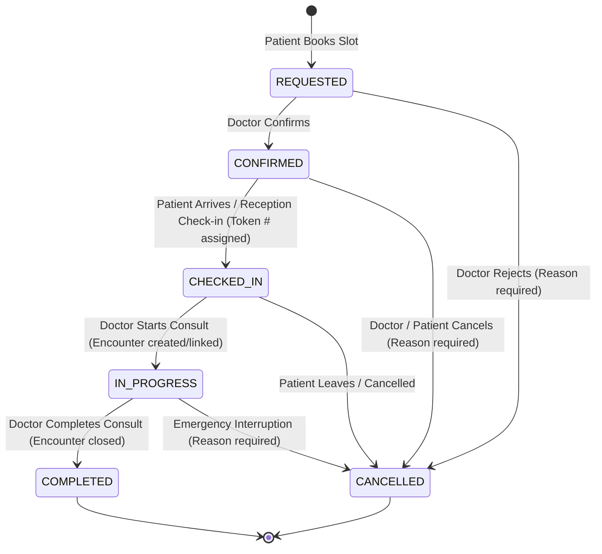

# HealthBridge India — Doctor Appointment Management & Patient Queue System

## 1. Overview & Architecture

The **Doctor Appointment Management & Patient Queue System** (Day 4 Task 02) builds upon the HealthBridge India unified healthcare platform to deliver an intuitive, resilient, and clinically-aligned consultation workflow for verified medical practitioners.

This module guarantees:
1. **Strict State Machine Integrity**: Consultation state transitions are verified server-side with atomic guards, preventing invalid lifecycle mutations.
2. **Dynamic Queue Priority**: Today's clinic intake automatically prioritizes active consultations (`IN_PROGRESS`), followed by arrived patients (`CHECKED_IN`) sorted by wait duration, followed by scheduled consultations.
3. **Double Identification Resolution**: Patient bookings referencing either `DoctorProfile.userId` or `DoctorProfile._id` resolve without dropping records.
4. **ABDM & DPDP Compliance**: Scoped demographic exposure, immutable clinical audit trails (`AuditLog`), and non-blocking asynchronous patient notifications (`Notification`).
5. **Conflict Prevention**: Partial unique index on active appointments `{ doctorId: 1, scheduledAt: 1 }` prevents double bookings while allowing re-use of cancelled slots.

---

## 2. Appointment Lifecycle & State Machine



### Transition Matrix & Enforcement Rules

| Current Status | Target Status | Permitted Action | Triggered Side Effects |
| :--- | :--- | :--- | :--- |
| `REQUESTED` / `SCHEDULED` | `CONFIRMED` | Doctor Confirms | Sets `confirmedBy`, notifies patient, logs audit. |
| `REQUESTED` / `SCHEDULED` | `CANCELLED` | Doctor Rejects | Records `rejectionReason`, releases slot reservation, notifies patient. |
| `CONFIRMED` / `SCHEDULED` | `CHECKED_IN` | Patient Check-in | Allocates sequential daily `queueNumber`, records `checkedInAt`. |
| `CHECKED_IN` / `CONFIRMED` | `IN_PROGRESS` | Start Consult | Creates or activates linked `EncounterModel` (`IN_PROGRESS`), sets `consultationStartedAt`. |
| `IN_PROGRESS` | `COMPLETED` | Complete Consult | Sets `completedAt`, marks linked `EncounterModel` as `COMPLETED` with `endTime`, notifies patient. |
| Active (not Completed) | `CANCELLED` | Cancel Consult | Records `cancellationReason`, releases slot, marks linked Encounter `CANCELLED`, notifies patient. |

---

## 3. Patient Queue Workflow & Prioritization

The patient queue (`/doctor/queue` and `GET /api/v1/doctors/queue`) implements a 4-tier sorting algorithm ensuring doctors always know whom to attend to next:

1. **Active Consultation (`IN_PROGRESS`)**: Priority 1 — always pinned to the top of the clinic view.
2. **Arrived & Checked In (`CHECKED_IN`)**: Priority 2 — ordered by **Waiting Duration descending** (longest wait time attended first).
3. **Confirmed & Scheduled (`CONFIRMED` / `SCHEDULED`)**: Priority 3 — ordered by scheduled start time (`startTime` ascending).
4. **Completed Consultations (`COMPLETED`)**: Priority 4 — relegated to the bottom for audit and billing review.

### Live Waiting Time Calculation
```typescript
const now = Date.now();
const checkedInTime = apt.checkedInAt ? new Date(apt.checkedInAt).getTime() : undefined;
const waitingMinutes = checkedInTime && apt.status === 'CHECKED_IN'
  ? Math.max(0, Math.floor((now - checkedInTime) / 60000))
  : undefined;
```

---

## 4. API Endpoints Specification

All endpoints are authenticated with JWT and restricted to `role: 'DOCTOR'`.

| Method | Endpoint | Description | Validation Schema |
| :--- | :--- | :--- | :--- |
| `GET` | `/api/v1/doctors/appointments/summary` | Consultation counts (`today`, `upcoming`, `pending`, `completed`, `cancelled`, `total`) | — |
| `GET` | `/api/v1/doctors/appointments` | Filterable, paginated consultation list | `doctorAppointmentFilterQuerySchema` |
| `GET` | `/api/v1/doctors/appointments/:appointmentId` | Full consultation detail with patient demographics | `appointmentIdParamSchema` |
| `PATCH` | `/api/v1/doctors/appointments/:appointmentId/confirm` | Confirm pending slot request | `appointmentIdParamSchema` |
| `PATCH` | `/api/v1/doctors/appointments/:appointmentId/reject` | Reject request with optional reason | `rejectAppointmentSchema` |
| `PATCH` | `/api/v1/doctors/appointments/:appointmentId/check-in` | Mark patient arrival & issue queue token | `appointmentIdParamSchema` |
| `PATCH` | `/api/v1/doctors/appointments/:appointmentId/start` | Start consultation & link Encounter | `appointmentIdParamSchema` |
| `PATCH` | `/api/v1/doctors/appointments/:appointmentId/complete` | Complete consultation & finalize Encounter | `appointmentIdParamSchema` |
| `PATCH` | `/api/v1/doctors/appointments/:appointmentId/cancel` | Cancel consultation with mandatory reason | `doctorCancelAppointmentSchema` |
| `GET` | `/api/v1/doctors/queue` | Live prioritized clinic queue | Optional `filter=WAITING\|IN_CONSULTATION\|COMPLETED` |
| `PUT` | `/api/v1/doctors/schedule` | Update working days, hours, slot duration & leaves | `updateDoctorScheduleSchema` |

---

## 5. Frontend Architecture & Routes

### App Router Routes (`apps/web/src/app/(dashboard)/doctor/`)
- `/doctor/appointments`: Main consultation workspace with summary cards, search, multidimensional filters, and paginated cards.
- `/doctor/appointments/today`: Dedicated view for today's consultations.
- `/doctor/appointments/upcoming`: Upcoming scheduled appointments view.
- `/doctor/appointments/history`: Completed, cancelled, and past consultation history.
- `/doctor/appointments/[appointmentId]`: Detailed consultation inspection view with patient demographics, timeline, and contextual actions.
- `/doctor/queue`: Live clinical intake queue with token badges, waiting timers, status tabs, and consultation triggers.
- `/doctor/schedule`: Schedule management with weekly availability matrix and `ScheduleEditor` for operating hours and temporary blocked leave periods.

### Presentation Components (`apps/web/src/components/doctor/appointments/`)
- `QueueStatusBadge.tsx`: Color-coded animated status badges with pulse indicators for active states.
- `AppointmentSummary.tsx`: 5 summary metric cards with quick filter switching.
- `AppointmentHeader.tsx`: Title, clinical actions, and instant manual cache refresh.
- `AppointmentFilters.tsx`: Search input, status tabs, consultation mode dropdown, and date filters.
- `AppointmentCard.tsx`: Consultation card displaying reference, patient, mode, facility, status, and contextual action buttons.
- `AppointmentList.tsx`: Responsive list with pagination controls and skeleton loaders.
- `AppointmentDetails.tsx`: Comprehensive patient profile and consultation record viewer.
- `QueuePatientCard.tsx`: Queue item displaying token number, wait time, arrival time, and workflow action buttons.
- `PatientQueue.tsx`: Live clinic queue view with auto-polling and metrics.
- `ScheduleEditor.tsx`: Form to configure working days, operating hours, slot duration, consultation modes, and blocked slots.
- `DoctorSchedule.tsx`: Master schedule view integrating the weekly matrix and editor.

---

## 6. Concurrency Control & Database Schema

### Appointment Partial Unique Index
```typescript
appointmentSchema.index(
  { doctorId: 1, scheduledAt: 1 },
  {
    unique: true,
    partialFilterExpression: {
      status: {
        $in: ['REQUESTED', 'SCHEDULED', 'CONFIRMED', 'CHECKED_IN', 'IN_PROGRESS'],
      },
    },
  }
);
```
- **Slot Reservation Guarantee**: Holds the specific doctor's slot while in active lifecycle states.
- **Immediate Slot Reclamation**: When an appointment is `CANCELLED`, `COMPLETED`, or `NO_SHOW`, the slot is immediately liberated for re-booking.

---

## 7. Quality Gate Verification

| Test Suite / Gate | Result | Details |
| :--- | :--- | :--- |
| `doctor-appointments.test.ts` | **22 / 22 Passed** | RBAC, summary counts, list filters, details, state transitions, queue priority, schedule updates. |
| Full API Test Suite | **178 / 178 Passed** (20 suites) | Zero regressions across authentication, patient records, laboratory, encounters, profile, and doctor domains. |
| Monorepo Typecheck (`tsc --noEmit`) | **Passed (0 errors)** | Full type safety across `config`, `shared-types`, `validation`, `apps/api`, and `apps/web`. |
| Monorepo Lint (`next lint` / ESLint) | **Passed (0 warnings)** | Clean code standards across all workspace packages. |
| Next.js Production Build | **Passed (44 routes)** | All static and dynamic routes compiled, optimized, and verified. |

