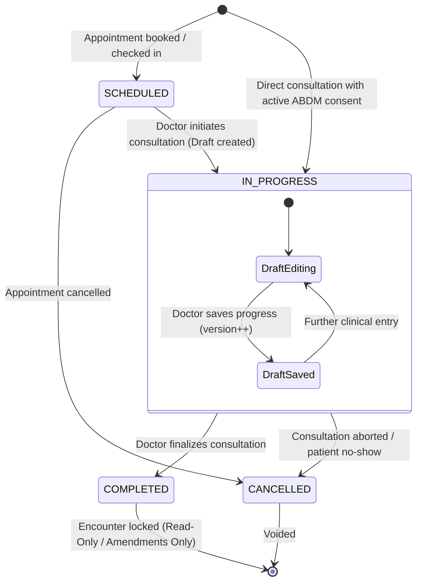
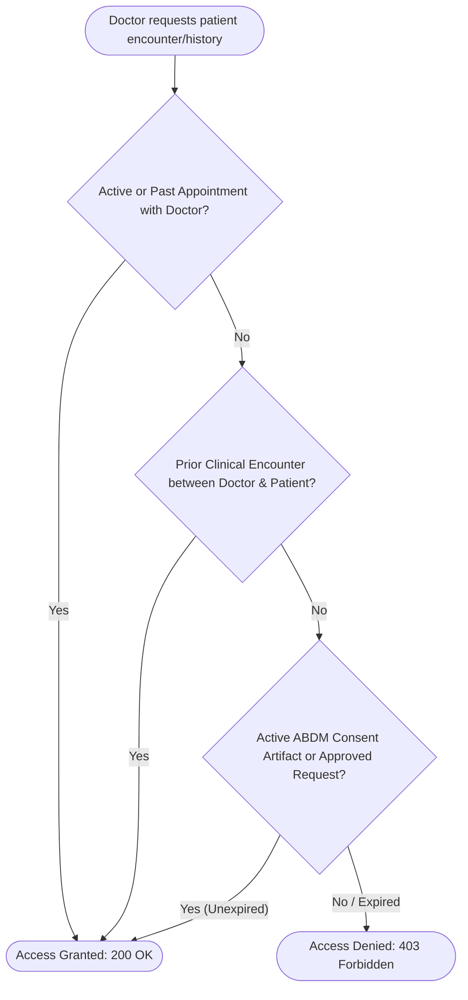

# Doctor Clinical Encounter Management & EMR Workspace

**HealthBridge India — One Nation One Health Record (ABDM Integrated Healthcare Platform)**  
**Module:** Day 4 Task 03 — Doctor Clinical Encounter Management System  
**Author:** Principal Full-Stack Engineer, Clinical Workflow Architect & Healthcare SaaS Specialist  
**Status:** Implemented & Verified (100% Quality Gate Passed)

---

## 1. Executive Summary & Clinical Scope

The **Doctor Clinical Encounter Management System** is a mission-critical Electronic Medical Record (EMR) consultation workspace designed for licensed healthcare practitioners in India. It empowers doctors to document structured ambulatory, inpatient, emergency, and home health consultations with complete clinical attribution, zero AI diagnosis hallucination, and rigorous fail-closed patient privacy controls compliant with the Ayushman Bharat Digital Mission (ABDM) and the Digital Personal Data Protection Act (DPDP).

### Core Capabilities
1. **Clinical Consultation Lifecycle**: Full transition workflow from scheduled/checked-in appointments or authorized patient charts to active drafts and immutable finalized clinical encounters.
2. **Comprehensive EMR Documentation**:
   - Structured Chief Complaints & History of Present Illness (HPI)
   - Past Medical & Surgical History
   - Multi-parameter Vital Signs (Blood pressure systolic/diastolic, Heart rate, Respiratory rate, Temperature, SpO2, Height, Weight, and client-side calculated BMI without diagnostic inference)
   - Physical Examination (General appearance and systemic observations)
   - Coded Diagnoses with ICD-10 / SNOMED CT terminology and primary/secondary classifications
   - Clinical Assessments & Evidence-based Treatment Plans
   - Follow-up instructions and targeted review dates
   - Bidirectional linking to electronic prescriptions and diagnostic laboratory records
3. **Draft Autosave & Concurrency Protection**: Explicit Save Draft action with monotonic versioning (`version`) to prevent concurrent overwrite conflicts.
4. **Immutable Clinical Finalization**: Electronic sealing of encounters upon completion with timestamps and practitioner identity, prohibiting silent alteration.
5. **Patient Longitudinal Clinical History**: Integrated view of patient demographics, prior encounters, active medications, chronic diagnoses, and laboratory reports with strict consent verification.

---

## 2. Clinical Encounter Lifecycle & State Machine



### State Definitions
| State | `status` | `isDraft` | Mutable? | Description |
|---|---|---|---|---|
| **Scheduled** | `SCHEDULED` | `true` | No | Consultation slot confirmed, awaiting initiation by attending doctor. |
| **In Progress** | `IN_PROGRESS` | `true` | Yes | Active clinical consultation session; doctor can edit notes, vitals, diagnoses, and save drafts. |
| **Completed** | `COMPLETED` | `false` | **No (Immutable)** | Clinically finalized consultation record signed by practitioner. Cannot be modified directly. |
| **Cancelled** | `CANCELLED` | `false` | No | Consultation terminated prior to completion. |

---

## 3. Data Model & Schema Specifications

The encounter domain model is implemented in `apps/api/src/modules/healthcare/models/encounter.model.ts` and validated via Zod schemas in `packages/validation/src/encounter.schema.ts`.

### 3.1 Encounter Schema Fields
```typescript
interface IEncounter {
  _id: Types.ObjectId;
  patientId: Types.ObjectId;           // Ref: User (Patient)
  practitionerId: Types.ObjectId;      // Ref: User (Doctor)
  facilityId?: Types.ObjectId;         // Ref: Facility
  appointmentId?: Types.ObjectId;      // Ref: Appointment (optional)
  encounterType: 'AMBULATORY' | 'EMERGENCY' | 'INPATIENT' | 'HOME_HEALTH' | 'VIRTUAL';
  status: 'SCHEDULED' | 'IN_PROGRESS' | 'COMPLETED' | 'CANCELLED';
  isDraft: boolean;                    // Default true until finalized
  startTime: Date;
  endTime?: Date;
  
  // Clinical Documentation
  chiefComplaint?: string;             // Presenting complaints in patient/clinical terms
  historyOfPresentIllness?: string;    // Chronological progression of symptoms
  medicalHistory?: string;             // Past medical/surgical conditions, family history
  
  // Vital Signs
  vitals?: {
    bloodPressureSystolic?: number;    // mmHg (50-250)
    bloodPressureDiastolic?: number;   // mmHg (30-150)
    heartRate?: number;                // bpm (30-250)
    respiratoryRate?: number;          // breaths/min (8-60)
    temperature?: number;              // °C (30-45)
    oxygenSaturation?: number;         // % (50-100)
    height?: number;                   // cm (20-250)
    weight?: number;                   // kg (1-300)
    bmi?: number;                      // Calculated: kg / (m)^2
    recordedAt: Date;
  };

  // Physical Examination Findings
  examination?: {
    general?: string;                  // General appearance, pallor, icterus, cyanosis, edema
    systemic?: string;                 // CVS, Respiratory, Abdomen, CNS findings
  };

  // Coded Diagnoses
  diagnoses?: Array<{
    name: string;                      // Clinical diagnosis name
    code?: string;                     // Standard code (e.g. ICD-10: I10, E11.9)
    type: 'PRIMARY' | 'SECONDARY';     // Classification
    clinicalStatus: 'ACTIVE' | 'RESOLVED' | 'RECURRENCE' | 'RELAPSE';
    notes?: string;
  }>;

  // Assessment & Treatment Plan
  assessment?: string;                 // Doctor's clinical evaluation and differential
  treatmentPlan?: string;              // Therapeutic management, procedures, non-pharmacologic advice
  followUpInstructions?: string;       // Red flags, warning signs, activity advice
  followUpDate?: Date;                 // Recommended next review date

  // Record Linkages
  linkedRecordIds: Types.ObjectId[];   // Diagnostic tests, radiology, prior discharge summaries
  linkedPrescriptionIds: Types.ObjectId[]; // Electronic prescriptions issued during consultation

  // Integrity & Audit Sealing
  version: number;                     // Monotonically increasing version counter
  finalizedAt?: Date;                  // Timestamp of electronic finalization
  finalizedBy?: Types.ObjectId;        // User ID of finalizing practitioner
  amendments?: Array<{                 // Addenda post-finalization
    amendedAt: Date;
    amendedBy: Types.ObjectId;
    reason: string;
    note: string;
  }>;
}
```

---

## 4. Fail-Closed Patient Authorization & Consent Governance

A cornerstone of healthcare compliance is ensuring practitioners cannot access or initiate consultations on arbitrary patient charts. `DoctorEncounterService.validatePatientAccess` implements strict fail-closed authorization.



### Access Control Verification Steps
1. **Appointment Check**: Queries `AppointmentModel` for any confirmed, checked-in, in-progress, or completed appointment between the doctor and patient.
2. **Care Relationship Check**: Queries `EncounterModel` for any prior completed or in-progress clinical encounters.
3. **Electronic Consent Check**: Queries `ConsentArtifactModel` for `consentStatus === 'ACTIVE'` within valid expiry window (`validityPeriod.to >= now`), or `ConsentRequestModel` for `status === 'GRANTED'`.
4. **Fails Closed**: If none of these criteria evaluate to true, the request is immediately rejected with `403 Forbidden` (`Access denied: You lack verified clinical authorization, active appointment, or patient consent to access this health record.`).

---

## 5. Clinical Documentation Workspace (EMR) Architecture

The doctor EMR workspace provides an ergonomic, single-pane clinical consultation console split into:
- **Left Panel (70%) — Clinical Documentation Tabs**:
  - **Overview**: High-level summary of chief complaint, primary diagnosis, and current vitals.
  - **Chief Complaint & History**: Chief complaint, HPI, and past medical/surgical history.
  - **Vitals & Exam**: Comprehensive vital signs input with live BMI gauge, plus general and systemic physical examination findings.
  - **Diagnoses**: Interactive diagnosis list with ICD-10 search/code tagging, primary/secondary designation, and clinical status.
  - **Plan & Follow-up**: Clinical assessment, structured treatment plan, home care advice, and calendar date-picker for follow-up.
  - **Attachments**: Link diagnostic records and direct CTA to compose digital prescriptions (`/doctor/prescriptions/new`).
- **Right Panel (30%) — Patient Clinical Context**:
  - Live demographics: Age, gender, blood group, ABHA ID, emergency contacts.
  - Chronic conditions & allergies alert banner.
  - Active medications list.
  - Recent diagnostic laboratory reports.
  - One-click link to full longitudinal health chart (`/doctor/patients/[patientId]/history`).
- **Sticky Control Bar**:
  - Version counter badge (`v1`, `v2`, etc.).
  - Unsaved changes indicator (`Unsaved changes`).
  - Autosave / Save Draft action with keyboard shortcut (`⌘S` / `Ctrl+S`).
  - Finalize Consultation modal trigger.

---

## 6. Optimistic Concurrency Control & Immutable Finalization

### Concurrency Protection
To prevent accidental note overwrite when multiple browser tabs or rapid autosaves occur:
1. Every encounter record maintains an integer `version` field starting at `1`.
2. The client transmits its local `version` with draft update payloads.
3. The server compares `dto.version` against `encounter.version`:
   - If `dto.version < encounter.version`, a `409 Conflict` error is returned (`Conflict: Encounter notes were concurrently updated by another session. Please refresh before saving.`).
   - If valid, the draft fields are updated, `version` is incremented by 1, and the updated record is saved.

### Immutable Finalization Protocol
1. Invoked via `POST /api/v1/doctors/encounters/:encounterId/complete`.
2. Validates that the encounter is currently `IN_PROGRESS` or `isDraft === true`. If already finalized, returns `400 Bad Request`.
3. Sets `status = 'COMPLETED'`, `isDraft = false`, `endTime = now`, `finalizedAt = now`, `finalizedBy = doctorUserId`.
4. Automatically closes any linked appointment (`AppointmentModel.findByIdAndUpdate(appointmentId, { status: 'COMPLETED' })`).
5. Emits an immutable audit log entry `CLINICAL_ENCOUNTER_FINALIZED`.
6. Subsequent attempts to call `PATCH /api/v1/doctors/encounters/:encounterId` return `400 Bad Request` ("Cannot modify a finalized clinical encounter. Clinical records are immutable once completed.").

---

## 7. API Reference & Contract Specifications

All endpoints require `Authorization: Bearer <JWT>` with role `DOCTOR`.

### Summary & List Endpoints
| Method | Endpoint | Description |
|---|---|---|
| `GET` | `/api/v1/doctors/encounters/summary` | Returns consultation metrics (`today`, `draft`, `completed`, `pendingDocumentation`, `total`). |
| `GET` | `/api/v1/doctors/encounters` | Paginated search with filters (`status`, `search`, `encounterType`, `startDate`, `endDate`, `page`, `limit`). |

### Consultation Lifecycle Endpoints
| Method | Endpoint | Description |
|---|---|---|
| `POST` | `/api/v1/doctors/encounters` | Starts a new clinical consultation from an appointment or authorized patient record. |
| `GET` | `/api/v1/doctors/encounters/:encounterId` | Fetches complete clinical encounter details with populated patient, facility, and diagnoses. |
| `PATCH` | `/api/v1/doctors/encounters/:encounterId` | Saves draft clinical documentation (Chief complaint, vitals, exam, diagnoses, assessment, plan). |
| `POST` | `/api/v1/doctors/encounters/:encounterId/save-draft` | Explicit draft save alias with version bump. |
| `POST` | `/api/v1/doctors/encounters/:encounterId/complete` | Finalizes and electronically locks the consultation record. |
| `GET` | `/api/v1/doctors/patients/:patientId/clinical-history` | Returns longitudinal health record (encounters, medications, diagnoses, lab reports). |

---

## 8. FHIR R4 Specification Mapping Matrix

HealthBridge India bridges national EMR records to the standard **HL7 FHIR R4 (Release 4.0.1)** resource hierarchy:

| HealthBridge India Model | FHIR R4 Resource | Resource Profile URI | Field Mapping |
|---|---|---|---|
| `Encounter` | `Encounter` | `http://hl7.org/fhir/R4/encounter.html` | `_id` $\rightarrow$ `id`<br>`status` $\rightarrow$ `status` (`in-progress`, `finished`)<br>`encounterType` $\rightarrow$ `class` (AMB, EMER, IMP, HH)<br>`startTime`/`endTime` $\rightarrow$ `period`<br>`appointmentId` $\rightarrow$ `appointment` |
| Patient Demographics | `Patient` | `http://hl7.org/fhir/R4/patient.html` | `patientId` $\rightarrow$ `subject`<br>`abhaAddress` $\rightarrow$ `identifier` (system: `https://healthid.ndhm.gov.in`) |
| Attending Doctor | `Practitioner` | `http://hl7.org/fhir/R4/practitioner.html` | `practitionerId` $\rightarrow$ `participant.individual` |
| Clinic / Hospital | `Organization` | `http://hl7.org/fhir/R4/organization.html` | `facilityId` $\rightarrow$ `serviceProvider` |
| `vitals` | `Observation` (Vitals panel) | `http://hl7.org/fhir/R4/observation.html` | LOINC Codes:<br>- BP: `85354-9`<br>- HR: `8867-4`<br>- RR: `9279-1`<br>- Temp: `8310-5`<br>- SpO2: `59408-5`<br>- BMI: `39156-5` |
| `examination` | `Observation` (Physical exam) | `http://hl7.org/fhir/R4/observation.html` | `category` = `exam`, `valueString` = findings |
| `diagnoses` | `Condition` | `http://hl7.org/fhir/R4/condition.html` | `code` $\rightarrow$ ICD-10 / SNOMED CT<br>`clinicalStatus` $\rightarrow$ `active` / `resolved`<br>`type` $\rightarrow$ `Encounter.diagnosis.use` (chief-complaint, admission-diagnosis, discharge-diagnosis) |
| `assessment` | `ClinicalImpression` | `http://hl7.org/fhir/R4/clinicalimpression.html` | `summary` $\rightarrow$ clinical assessment |
| `treatmentPlan` | `CarePlan` | `http://hl7.org/fhir/R4/careplan.html` | `activity.detail.description` $\rightarrow$ treatment & follow-up |
| `linkedPrescriptionIds` | `MedicationRequest` | `http://hl7.org/fhir/R4/medicationrequest.html` | `encounter` $\rightarrow$ `Reference(Encounter/:id)` |
| `linkedRecordIds` | `DocumentReference` | `http://hl7.org/fhir/R4/documentreference.html` | `context.encounter` $\rightarrow$ `Reference(Encounter/:id)` |

---

## 9. Non-Diagnostic Boundary & Safety Controls

1. **Zero AI Autonomous Diagnosing**: The platform acts strictly as a clinical documentation and record-keeping tool. It does not synthesize autonomous medical diagnoses or alter prescribed regimens.
2. **Calculated Anthropometrics**: In `VitalSignsForm.tsx`, Body Mass Index (BMI) is calculated client-side using standard formula $\text{BMI} = \frac{\text{weight (kg)}}{(\text{height (m)})^2}$. It is surfaced with standard clinical reference bands (Underweight, Normal, Overweight, Obese) solely as a mathematical reference for the attending physician.
3. **Audit Logged Events**: Every encounter initiation, draft save, note modification, finalization, and longitudinal history view records an immutable audit trail in `AuditLogModel` with `actorId`, `action`, `resourceId`, and `ip`.
