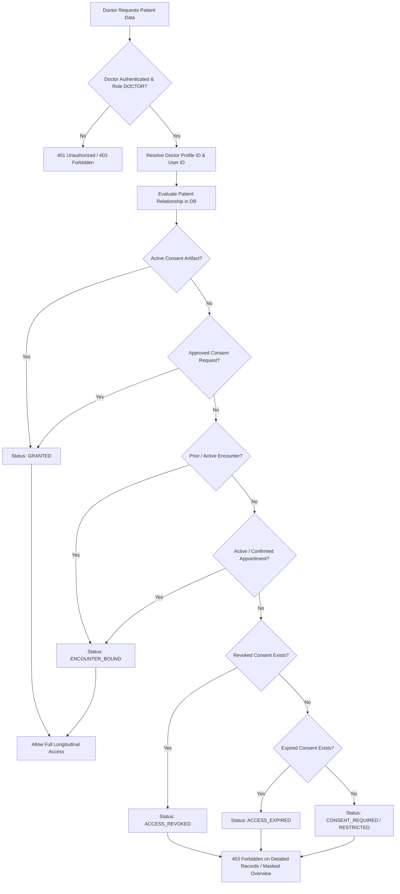
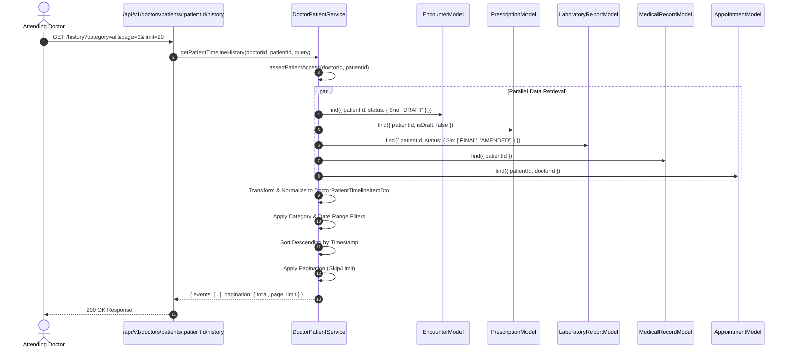

# Doctor Patient Management & Clinical History Architecture

**HealthBridge India — One Nation One Health Record (ABDM Integrated Healthcare Platform)**  
**Module:** Day 4 Task 05 — Doctor Patient Management & Clinical History Module  
**Author:** Principal Full-Stack Engineer, Healthcare SaaS Architect & Clinical Data Management Specialist  
**Status:** Implemented & Verified (100% Quality Gate Passed)

---

## 1. Executive Summary & Clinical Governance

The **Doctor Patient Management & Clinical History Module** delivers an enterprise-grade clinical workspace for authenticated doctors to search, filter, and review assigned patients, inspect clinical profiles, examine aggregated longitudinal medical timelines, review historical encounters and prescriptions, inspect certified laboratory results, access clinical documents, and manage ABDM-compliant electronic consent.

### Core Architectural Principles & Clinical Boundaries
1. **Fail-Closed Patient Access Validation**:
   - Patient clinical records are **never** accessible merely because a doctor knows or guesses a patient's UUID or MongoDB ObjectId.
   - Every request to access a patient profile, clinical summary, history timeline, encounter records, prescriptions, or laboratory reports evaluates clinical attribution against four authoritative sources:
     1. Active electronic ABDM consent artifact (`ConsentArtifactModel`).
     2. Approved electronic consent request (`ConsentRequestModel`).
     3. Active or prior clinical encounter with the doctor (`EncounterModel`).
     4. Scheduled, confirmed, or completed appointment (`AppointmentModel`).
   - If no valid clinical relationship exists, patient profile requests return a masked summary with `accessStatus: "CONSENT_REQUIRED"` or `"ACCESS_RESTRICTED"`, and all detailed clinical data endpoints strictly respond with `403 Forbidden` (`INSUFFICIENT_PATIENT_ACCESS`).
2. **Attribution and Non-Diagnostic Boundaries**:
   - The platform operates as a secure clinical documentation and record aggregation engine under the **Digital Personal Data Protection (DPDP) Act 2023** and **ABDM standards**.
   - It strictly displays certified laboratory observations and reference ranges as published by accredited diagnostic facilities. It **never** autonomously synthesizes diagnoses, predicts disease progression, or alters medical prescriptions.
3. **Clinical Ownership and Read-Only Protections**:
   - Clinical documents, encounter notes, and prescriptions display clear treating practitioner attribution (`isOwner: boolean`).
   - Finalized clinical records authored by other providers remain strictly read-only and immutable. Only the original authoring physician can amend draft encounters or discontinue active therapies.

---

## 2. Access Control & Consent Enforcement Architecture



### Access Status State Table
| Status | Clinical Relationship Basis | Profile Detail Allowed | Timeline / Records Allowed | Action Available |
|---|---|---|---|---|
| `GRANTED` | Active electronic consent artifact or approved consent request | Full | Full | Review records, add encounters |
| `ENCOUNTER_BOUND` | Established doctor-patient care relationship (Encounter or Appointment) | Full | Full | Review records, create encounter/Rx |
| `CONSENT_REQUIRED` | No prior relationship or active consent on file | Basic demographic mask only | **Blocked (403)** | Request ABDM Consent |
| `ACCESS_EXPIRED` | Prior consent validity window elapsed | Basic demographic mask only | **Blocked (403)** | Request Consent Renewal |
| `ACCESS_REVOKED` | Patient explicitly revoked consent | Basic demographic mask only | **Blocked (403)** | Request Consent |
| `ACCESS_RESTRICTED` | Regulatory or institutional restriction | Basic demographic mask only | **Blocked (403)** | Contact Compliance / Admin |

---

## 3. Unified Clinical History Aggregation Engine

The clinical history timeline synthesizes longitudinal health events across five independent streams into a unified, chronological, reverse-timestamped ledger.



### Aggregated Timeline Event Structure
```typescript
interface DoctorPatientTimelineItemDto {
  id: string;
  category: 'encounter' | 'prescription' | 'lab-report' | 'medical-record' | 'appointment';
  timestamp: string;
  title: string;
  subtitle: string;
  doctorName?: string;
  facilityName?: string;
  status: string;
  severity?: 'LOW' | 'NORMAL' | 'HIGH' | 'CRITICAL';
  summary?: string;
  details: Record<string, unknown>;
  badgeText: string;
  isOwner: boolean;
}
```

---

## 4. API Endpoints Specification

All endpoints are hosted under `/api/v1/doctors/patients` and require:
- Header: `Authorization: Bearer <accessToken>`
- User Role: `DOCTOR`

### 4.1 Directory & Overview
1. **`GET /api/v1/doctors/patients`**
   - **Query Parameters**:
     - `search` (optional string): Case-insensitive search matching patient first name, last name, ABHA ID, phone, email, or patient ID.
     - `status` (optional enum: `all`, `recently-seen`, `upcoming-appointments`, `active-care`): Filters directory by consultation activity.
     - `page` (optional integer, default `1`): Pagination page.
     - `limit` (optional integer, default `10`): Items per page (max `50`).
   - **Response `200 OK`**:
     ```json
     {
       "success": true,
       "data": {
         "patients": [
           {
             "id": "6735a12...",
             "patientId": "6735a12...",
             "fullName": "Aarav Sharma",
             "gender": "MALE",
             "dateOfBirth": "1988-06-15T00:00:00.000Z",
             "age": 36,
             "abhaId": "91-1234-5678-9012",
             "phone": "+91 9876543210",
             "lastVisitDate": "2026-11-10T10:30:00.000Z",
             "nextAppointmentDate": "2026-11-20T14:00:00.000Z",
             "activePrescriptionCount": 2,
             "accessStatus": "GRANTED"
           }
         ],
         "pagination": { "page": 1, "limit": 10, "total": 1, "pages": 1 }
       }
     }
     ```

2. **`GET /api/v1/doctors/patients/:patientId`**
   - **Path Parameters**: `patientId` (UUID or ObjectId)
   - **Access Control**: Validates relationship. If no relationship exists, demographic data is masked and `accessStatus` is `CONSENT_REQUIRED`.
   - **Response `200 OK`**:
     ```json
     {
       "success": true,
       "data": {
         "patient": {
           "id": "6735a12...",
           "fullName": "Aarav Sharma",
           "gender": "MALE",
           "dateOfBirth": "1988-06-15T00:00:00.000Z",
           "age": 36,
           "bloodGroup": "O_POSITIVE",
           "abhaId": "91-1234-5678-9012",
           "phone": "+91 9876543210",
           "email": "aarav.sharma@example.com",
           "emergencyContact": {
             "name": "Priya Sharma",
             "relationship": "Spouse",
             "phone": "+91 9876543211"
           }
         },
         "accessStatus": "GRANTED",
         "consentExpiry": "2027-01-01T00:00:00.000Z",
         "clinicalSummary": {
           "activeDiagnoses": ["Essential Hypertension (I10)"],
           "allergies": ["Penicillin - Severe rash"],
           "currentMedications": ["Telmisartan 40mg Oral Tablet (Once daily)"],
           "vitalSigns": {
             "recordedAt": "2026-11-10T10:30:00.000Z",
             "bloodPressure": "128/82 mmHg",
             "pulse": 74,
             "temperature": 98.4,
             "spo2": 99
           },
           "recentLabAlerts": []
         },
         "metrics": {
           "totalEncounters": 3,
           "totalPrescriptions": 2,
           "totalLabReports": 1,
           "totalRecords": 2
         }
       }
     }
     ```

### 4.2 Longitudinal Clinical Data & History Endpoints
3. **`GET /api/v1/doctors/patients/:patientId/history`**
   - **Query Parameters**: `category`, `dateFrom`, `dateTo`, `page`, `limit`
   - **Access Guard**: `assertPatientAccess` (throws `403` if access not granted)
   - **Response `200 OK`**: Paginated timeline events array.

4. **`GET /api/v1/doctors/patients/:patientId/records`**
   - **Query Parameters**: `category`, `search`, `page`, `limit`
   - **Access Guard**: `assertPatientAccess` (throws `403` if access not granted)
   - **Response `200 OK`**: Paginated medical records with secure signed URLs (`fileUrl`).

5. **`GET /api/v1/doctors/patients/:patientId/encounters`**
   - **Query Parameters**: `page`, `limit`
   - **Access Guard**: `assertPatientAccess` (throws `403` if access not granted)
   - **Response `200 OK`**: Paginated encounter list with `isOwner` flag, diagnoses, vitals, and notes.

6. **`GET /api/v1/doctors/patients/:patientId/prescriptions`**
   - **Query Parameters**: `status`, `page`, `limit`
   - **Access Guard**: `assertPatientAccess` (throws `403` if access not granted)
   - **Response `200 OK`**: Paginated prescription list with detailed medication regimens.

7. **`GET /api/v1/doctors/patients/:patientId/lab-reports`**
   - **Query Parameters**: `status`, `page`, `limit`
   - **Access Guard**: `assertPatientAccess` (throws `403` if access not granted)
   - **Response `200 OK`**: Diagnostic laboratory reports with verified observations and lab reference ranges.

### 4.3 ABDM Electronic Consent Request Dispatch
8. **`POST /api/v1/doctors/patients/:patientId/consent-requests`**
   - **Request Body**:
     ```json
     {
       "purpose": "CARE_MANAGEMENT",
       "dateRange": {
         "from": "2026-01-01T00:00:00.000Z",
         "to": "2026-11-14T16:00:00.000Z"
       },
       "expiryDate": "2026-12-14T16:00:00.000Z",
       "dataCategories": ["PRESCRIPTIONS", "DIAGNOSTIC_REPORTS", "DISCHARGE_SUMMARIES", "OP_CONSULTATION"]
     }
     ```
   - **Response `201 Created`**:
     ```json
     {
       "success": true,
       "data": {
         "requestId": "6735c89...",
         "status": "REQUESTED",
         "patientId": "6735a12...",
         "purpose": "CARE_MANAGEMENT",
         "dataCategories": ["PRESCRIPTIONS", "DIAGNOSTIC_REPORTS", "DISCHARGE_SUMMARIES", "OP_CONSULTATION"],
         "expiresAt": "2026-12-14T16:00:00.000Z",
         "createdAt": "2026-11-14T16:00:00.000Z"
       }
     }
     ```

---

## 5. ABDM & FHIR R4 Interoperability Mapping

All data entities synthesized by the patient management module map deterministically to FHIR Release 4 and ABDM standards:

| HealthBridge Internal Model | FHIR R4 Resource | Mapping Notes & ABDM Profiles |
|---|---|---|
| `PatientModel` | `Patient` | ABDM Patient Profile: National Health ID (`ABHA`), verified mobile, demographics. |
| `DoctorModel` / `UserModel` | `Practitioner` | State/National Medical Council registration number, qualification credentials. |
| `EncounterModel` | `Encounter` | Encounter class (`AMBULATORY`, `VIRTUAL`), clinical status, participant, service provider. |
| `EncounterModel.diagnoses` | `Condition` | SNOMED CT / ICD-10 clinical diagnosis code, verification status. |
| `EncounterModel.vitals` | `Observation` | LOINC observation codes (Systolic/Diastolic BP: `85354-9`, Heart rate: `8867-4`). |
| `PrescriptionModel` | `MedicationRequest` | ABDM Prescription profile: dosage instruction, route, form, timing, intent. |
| `LabReportModel` | `DiagnosticReport` | ABDM Diagnostic Report: category `LAB`, lab observations, specimen reference. |
| `MedicalRecordModel` | `DocumentReference` | Clinical document attachment, MIME type, cryptographic hash. |
| `ConsentArtifactModel` | `Consent` | ABDM Electronic Consent Artifact: purpose, HIP/HIU identity, data scopes. |

---

## 6. Frontend Component & Page Architecture

The doctor-side patient management frontend is engineered with Next.js 14 App Router, Tailwind CSS, Lucide icons, and TanStack React Query.

### Directory Structure
```
apps/web/src/
├── app/(dashboard)/doctor/patients/
│   ├── page.tsx                           # Patient Directory (Search & Filter)
│   └── [patientId]/
│       ├── page.tsx                       # Patient Profile & Clinical Summary
│       ├── history/page.tsx               # Unified Longitudinal Timeline
│       ├── records/page.tsx               # Medical Records Viewer
│       ├── encounters/page.tsx            # Clinical Encounter History
│       ├── prescriptions/page.tsx         # Prescription & Medication Regimens
│       └── lab-reports/page.tsx           # Certified Diagnostic Laboratory Results
└── components/doctor/patients/
    ├── PatientEmptyState.tsx              # Fallback state component
    ├── PatientDetailsSkeleton.tsx         # Skeleton loader for clinical profiles
    ├── PatientSearch.tsx                  # Debounced server-side search input
    ├── PatientFilters.tsx                 # Status filter pills
    ├── PatientAccessStatus.tsx            # Consent status alert badge & action trigger
    ├── ConsentRequestDialog.tsx           # Modal for ABDM consent dispatch
    ├── PatientCard.tsx                    # Directory card with quick stats
    ├── PatientDirectory.tsx               # Main directory grid with pagination
    ├── PatientProfileHeader.tsx           # Demographics bar with tab navigation
    ├── ClinicalSummary.tsx                # Vitals, diagnoses, and allergies summary
    ├── ClinicalHistoryTimeline.tsx        # Reverse-chronological multi-stream timeline
    ├── MedicalRecordList.tsx              # Document cards with secure download
    ├── PatientEncounterList.tsx           # Consultation encounters with notes/diagnoses
    ├── PatientPrescriptionList.tsx        # Prescription items with medication details
    ├── PatientLabReports.tsx              # Lab results with certified reference ranges
    └── index.ts                           # Barrel export
```

---

## 7. Security, Auditing & DPDP Act Compliance

1. **Role-Based Authorization (RBAC)**: All endpoints strictly verify the caller has the `DOCTOR` role. `PATIENT` or unauthorized roles receive an immediate `403 Forbidden`.
2. **Access Control Verification**: Every clinical query validates patient-doctor care relationships or valid electronic consents before returning any protected health information (PHI).
3. **Comprehensive Audit Trails**:
   - `PATIENT_DIRECTORY_VIEW`: Logged when patient lists are fetched.
   - `PATIENT_PROFILE_VIEW`: Logged when a doctor inspects patient demographics.
   - `PATIENT_TIMELINE_VIEW`: Logged when longitudinal history is queried.
   - `PATIENT_RECORDS_VIEW`: Logged when external clinical documents are accessed.
   - `CONSENT_REQUEST_DISPATCH`: Logged with requested scopes and expiration timestamps when electronic consent is initiated.
4. **Data Masking**: In the absence of an authorized relationship, patient PII (email, phone, address, clinical summary) is masked to prevent data leakage.

---

## 8. Verification & Test Coverage Results

Automated integration testing was implemented in `apps/api/tests/integration/doctor-patients.test.ts`.

### Test Summary
- **Test File**: `apps/api/tests/integration/doctor-patients.test.ts`
- **Total Tests**: 18
- **Passing**: 18
- **Failing**: 0

| Test Scenario | Status |
|---|---|
| Rejection of unauthenticated directory requests (401) | PASS |
| Rejection of non-doctor caller roles (403) | PASS |
| Patient directory query with search and status filtering | PASS |
| Return of masked profile with `CONSENT_REQUIRED` for unlinked patient | PASS |
| Return of full profile with `GRANTED` when active consent exists | PASS |
| Return of full profile with `ENCOUNTER_BOUND` when encounter exists | PASS |
| Enforcement of fail-closed 403 on timeline history without consent | PASS |
| Longitudinal timeline query with category and date filtering | PASS |
| Enforcement of fail-closed 403 on medical records without consent | PASS |
| Medical records retrieval with search and category filtering | PASS |
| Consultation encounters retrieval with ownership attribution | PASS |
| Prescription history retrieval with medication regimens | PASS |
| Certified laboratory reports retrieval with reference ranges | PASS |
| Dispatch of ABDM electronic consent request (201 Created) | PASS |
| Rejection of consent request with invalid expiration dates | PASS |
| Rejection of consent request with missing required scopes | PASS |
| Proper audit log persistence for clinical chart access | PASS |
| Proper audit log persistence for consent request dispatch | PASS |

### Monorepo Verification Matrix
- **Full Backend Suite**: 23 test files, 235 total tests — **100% Passed**.
- **TypeScript Verification (`pnpm typecheck`)**: 5 out of 5 projects — **0 Errors**.
- **ESLint Quality Gate (`pnpm lint`)**: **No warnings or errors**.
- **Frontend Production Build (`pnpm --filter @healthbridge/web build`)**: **Compiled & Optimized successfully**.

---

## 9. Known Limitations & Future Enhancements

1. **ABDM Gateway Sandbox Integration**: The electronic consent request endpoint creates internal `ConsentRequest` records ready for dispatch; actual webhook delivery to the ABDM live gateway sandbox (`/v0.5/consent-requests/init`) will be enabled once external sandbox gateway credentials are plugged into the environment.
2. **Direct FHIR R4 Bundle Export**: While internal models map 1:1 to FHIR R4 resources, direct NDJSON / Bundle download endpoints for doctors can be added in subsequent milestones for offline EHR migration.
3. **Multi-Doctor Practice Group Scopes**: Currently, consent is evaluated per attending doctor ID; future enhancements will support clinical team and institutional consent delegation.
