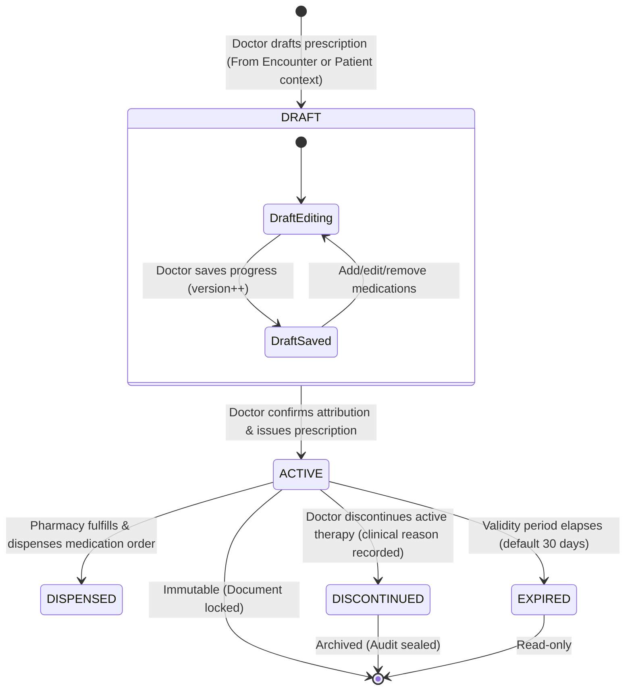
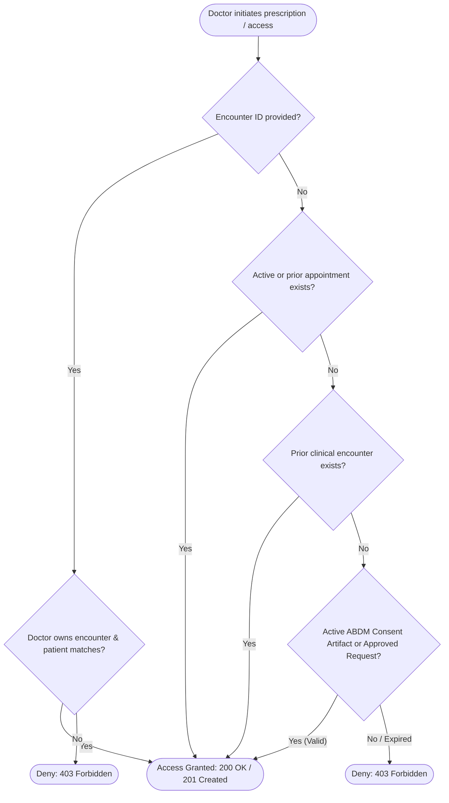

# Doctor Prescription Creation & E-Prescription Management

**HealthBridge India — One Nation One Health Record (ABDM Integrated Healthcare Platform)**  
**Module:** Day 4 Task 04 — Doctor E-Prescription & Medication Management  
**Author:** Principal Full-Stack Engineer, Healthcare Application Architect & Clinical Workflow Specialist  
**Status:** Implemented & Verified (100% Quality Gate Passed)

---

## 1. Executive Summary & Clinical Governance

The **Doctor E-Prescription & Medication Management System** provides a secure, clinically attributed digital prescription lifecycle compliant with the **Ayushman Bharat Digital Mission (ABDM)**, the **Digital Personal Data Protection Act (DPDP)**, and the **National Medical Commission (NMC)** regulations in India.

### Non-Diagnostic Boundary & Safety Mandates
1. **Clinical Attribution**: Every digital prescription is bound strictly to the attending registered medical practitioner (RMP) with verified medical council registration (`doctorRegistrationNumber`).
2. **Zero Autonomous Clinical Decisions**: The platform strictly acts as a documentation and order entry vehicle. It does not calculate dosages automatically, recommend pharmaceuticals based on symptoms, invent drug-drug interactions, or silently alter clinician input.
3. **Structured Pharmacological Representation**: Explicit units and standardized fields (`strength`, `dosage`, `route`, `frequency`, `duration`, `quantity`) are enforced via Zod validation schemas.
4. **Authentic Medication Catalog**: Clinicians search a catalog of approved pharmaceuticals available in India (generic composition, brand name, manufacturer, dosage form, packaging, and regulatory schedule e.g., Schedule H / H1 / OTC).

---

## 2. E-Prescription Lifecycle & State Machine



### Lifecycle States
| Status | `isDraft` | Mutable? | Description |
|---|---|---|---|
| `DRAFT` | `true` | Yes | Unfinalized prescription draft. Doctor can add, reorder, edit dosage, and save drafts. |
| `ACTIVE` | `false` | **No (Immutable)** | Electronically sealed and signed prescription. Ready for pharmacy fulfillment or PDF printing. Cannot be silently altered. |
| `DISPENSED` | `false` | No | Prescribed medications have been fulfilled by a licensed pharmacy. |
| `DISCONTINUED` | `false` | No | Active therapy safely discontinued by attending doctor with clinical reason documented. Individual medication items are set to `DISCONTINUED`. |
| `EXPIRED` | `false` | No | Prescription validity window (`validUntil`) has elapsed. |

---

## 3. Medication Catalog Architecture

To prevent patient-specific prescriptions from being conflated with standard pharmaceutical inventory, HealthBridge India implements a dedicated catalog model:

### 3.1 `MedicationCatalogModel` (`medication_catalog` Collection)
- `name`: Full commercial and strength identifier (e.g., `Paracetamol 500mg Tablet (Crocin)`)
- `genericName`: Active pharmacological ingredient (e.g., `Paracetamol`, `Amoxicillin + Clavulanic Acid`)
- `brandName`: Trade mark (e.g., `Crocin`, `Augmentin`, `Dolo-650`, `Pan-D`, `Telma`)
- `dosageForm`: `TABLET`, `CAPSULE`, `SYRUP`, `INJECTION`, `INHALER`, `OINTMENT`, `DROPS`, `SUSPENSION`, `POWDER`
- `strength`: Quantified potency (e.g., `500 mg`, `625 mg`, `40 mg / 30 mg`, `100 mcg / actuation`)
- `route`: Physiological pathway (e.g., `Oral`, `Topical`, `Inhalation`, `Intravenous`, `Ophthalmic`)
- `manufacturer`: Licensed pharmaceutical company in India (e.g., `GlaxoSmithKline`, `Cipla Ltd`, `Micro Labs Ltd`)
- `packageSize`: Commercial dispensing pack (e.g., `Strip of 10 tablets`, `Bottle of 100 ml`)
- `schedule`: Regulatory schedule under the Drugs and Cosmetics Act (e.g., `Schedule H`, `Schedule H1`, `OTC`)
- `therapeuticClass`: Broad clinical category (e.g., `Analgesic & Antipyretic`, `Broad Spectrum Antibiotic`, `Antihypertensive`)
- `instructionsHint`: Standard manufacturer patient counseling advice
- `isActive`: Boolean flag

---

## 4. Database Schema Specifications

### 4.1 Prescription Schema (`prescriptions` Collection)
```typescript
interface IPrescriptionDocument {
  _id: Types.ObjectId;
  prescriptionNumber: string;         // Unique reference e.g., RX-202611-TEST01
  patientId: Types.ObjectId;          // Ref: User (Patient)
  doctorId: Types.ObjectId;           // Ref: User (Doctor)
  encounterId?: Types.ObjectId;       // Ref: Encounter (optional)
  facilityId?: Types.ObjectId;        // Ref: Facility (clinic or hospital)
  diagnosis?: string;                 // Provisional or clinical diagnosis note
  medications: Array<{
    _id: Types.ObjectId;
    medicationCatalogId?: Types.ObjectId;
    name: string;
    genericName?: string;
    brandName?: string;
    strength: string;
    dosage: string;
    route: string;
    frequency: string;
    duration: string;
    quantity: number;
    instructions?: string;
    startDate: Date;
    endDate?: Date;
    status: 'ACTIVE' | 'COMPLETED' | 'DISCONTINUED';
  }>;
  instructions: string;               // General patient administration advice
  followUpInstructions?: string;      // OPD review timeline or warning signs
  issuedAt?: Date;                    // Finalization timestamp
  issuedBy?: Types.ObjectId;          // Attending clinician ID
  validUntil: Date;                   // Expiry date (default 30 days)
  status: PrescriptionStatus;         // DRAFT | ACTIVE | DISPENSED | CANCELLED | DISCONTINUED | EXPIRED
  isDraft: boolean;                   // Default true for drafts, false once issued
  version: number;                    // Monotonic concurrency counter
  refillEligible: boolean;            // Pharmacy refill permission
  refillsAllowed: number;
  refillsRemaining: number;
  documentUrl?: string;               // Document API route
  discontinuedAt?: Date;              // Discontinuation timestamp
  discontinuedBy?: Types.ObjectId;    // Doctor ID who discontinued
  discontinuationReason?: string;     // Documented clinical rationale
  amendments: Array<{                 // Addenda history
    amendedAt: Date;
    amendedBy: Types.ObjectId;
    reason: string;
    note?: string;
  }>;
}
```

---

## 5. Security & Fail-Closed Access Rules

Prescription creation and document access must strictly protect patient confidentiality:



- **Encounter Bound Check**: If `encounterId` is supplied, the system verifies that the doctor holds clinical ownership of that encounter and the patient ID matches.
- **Fail-Closed Patient Access**: Unauthorized doctors cannot prescribe for patients with whom they have no appointment, no care encounter, and no valid electronic ABDM consent.
- **Role Isolation**: Only authenticated users with role `DOCTOR` can access doctor prescription management endpoints. `PATIENT` users are rejected with `403 Forbidden`.
- **Immutable Locking**: Once `status === 'ACTIVE'`, any call to `PATCH /api/v1/doctors/prescriptions/:id` is blocked with `400 Bad Request` ("Cannot modify an issued prescription. Issued prescriptions are immutable once finalized.").

---

## 6. API Reference & Contract Specifications

All doctor endpoints require `Authorization: Bearer <JWT>` with role `DOCTOR`.

| Method | Endpoint | Description |
|---|---|---|
| `GET` | `/api/v1/doctors/prescriptions/summary` | Aggregate prescription KPIs (`total`, `issued`, `draft`, `recent`). |
| `GET` | `/api/v1/doctors/prescriptions` | Paginated search with filters (`status`, `search`, `patientId`, `startDate`, `endDate`). |
| `POST` | `/api/v1/doctors/prescriptions` | Create prescription draft or issue directly. Links to encounter if specified. |
| `GET` | `/api/v1/doctors/prescriptions/:prescriptionId` | Get detailed prescription document with populated patient and doctor data. |
| `PATCH` | `/api/v1/doctors/prescriptions/:prescriptionId` | Update draft prescription (optimistic concurrency protected via `version`). |
| `POST` | `/api/v1/doctors/prescriptions/:prescriptionId/issue` | Finalize and electronically seal prescription (`confirmAttribution: true` required). |
| `POST` | `/api/v1/doctors/prescriptions/:prescriptionId/discontinue` | Safely discontinue active prescription with clinical reason. |
| `GET` | `/api/v1/doctors/prescriptions/:prescriptionId/document` | Get structured printable prescription document data. |
| `GET` | `/api/v1/medication-catalog` | Search approved pharmaceuticals with pagination and dosage form filters. |
| `GET` | `/api/v1/medication-catalog/:medicationId` | Get single catalog pharmaceutical item. |

---

## 7. Digital Prescription Document & PDF Printing

The printable digital prescription document conforms to Indian hospital guidelines:
- **Header**: HealthBridge India national brand banner, Clinic/Hospital name, address, and city.
- **Clinician Identification**: Attending doctor name, degrees, specialization, and State/National Medical Council registration number (`MCI-REG-VERIFIED`).
- **Patient Banner**: Patient name, age/gender, ABHA address, prescription date, and unique Rx reference number.
- **The Classical ℞**: Prominently displayed symbol marking the prescription schedule.
- **Medications Table**: Multi-column table with Item Number, Medicine Name & Generic, Strength, Dosage, Route, Frequency, Duration, and Total Quantity.
- **Diet & Follow-Up**: Dedicated blocks for clinical instructions and review timeline.
- **Digital Authenticity Footer**: Security verification notice and dashed line for physical endorsement.
- **Draft Watermark**: Clear diagonal watermark for unissued drafts (`DRAFT - NOT ISSUED`) to prevent accidental unauthorized dispensing.
- **Print Optimization**: Clean print media styles (`print:hidden`, `print:p-0`, `print:border-none`) for crisp browser print and native PDF export (`window.print()`).

---

## 8. FHIR R4 Specification Mapping Matrix

HealthBridge India digital prescriptions map directly to **HL7 FHIR R4 (v4.0.1)** resources:

| HealthBridge India Model | FHIR R4 Resource | Resource Profile URI | Field Mapping |
|---|---|---|---|
| `Prescription` | `MedicationRequest` | `http://hl7.org/fhir/R4/medicationrequest.html` | `_id` $\rightarrow$ `id`<br>`prescriptionNumber` $\rightarrow$ `identifier`<br>`status` $\rightarrow$ `status` (`draft`, `active`, `stopped`, `completed`)<br>`intent` $\rightarrow$ `'order'`<br>`issuedAt` $\rightarrow$ `authoredOn`<br>`instructions` $\rightarrow$ `note` |
| `PrescribedMedication` | `Medication` | `http://hl7.org/fhir/R4/medication.html` | `name` $\rightarrow$ `code.text`<br>`genericName` $\rightarrow$ `ingredient.itemCodeableConcept`<br>`strength` $\rightarrow$ `ingredient.strength`<br>`dosageForm` $\rightarrow$ `form` |
| Patient Reference | `Patient` | `http://hl7.org/fhir/R4/patient.html` | `patientId` $\rightarrow$ `subject`<br>`patientAbhaId` $\rightarrow$ `identifier` (`https://healthid.ndhm.gov.in`) |
| Attending Clinician | `Practitioner` | `http://hl7.org/fhir/R4/practitioner.html` | `doctorId` $\rightarrow$ `requester`<br>`doctorRegistrationNumber` $\rightarrow$ `identifier` (`https://nmc.org.in`) |
| Clinical Encounter | `Encounter` | `http://hl7.org/fhir/R4/encounter.html` | `encounterId` $\rightarrow$ `encounter` |
| Clinic / Hospital | `Organization` | `http://hl7.org/fhir/R4/organization.html` | `facilityId` $\rightarrow$ `performer` |
| Attending Attribution | `Provenance` | `http://hl7.org/fhir/R4/provenance.html` | `target` $\rightarrow$ `Reference(MedicationRequest)`<br>`agent.who` $\rightarrow$ `Reference(Practitioner)` |

---

## 9. Frontend Route & Component Hierarchy

### Implemented Routes
- `/doctor/prescriptions`: Main prescription management console ("My Prescriptions").
- `/doctor/prescriptions/new`: Guided 3-panel e-prescription builder.
- `/doctor/prescriptions/[prescriptionId]`: Comprehensive prescription details and document viewer.
- `/doctor/prescriptions/[prescriptionId]/edit`: Active draft editor with immutable lockouts.
- `/doctor/medications`: Pharmaceutical reference catalog index.
- `/doctor/medications/catalog`: Detailed pharmaceutical catalog browser with one-click "Prescribe Medication" action.

### Component Structure (`apps/web/src/components/doctor/prescriptions/`)
- `PrescriptionHeader.tsx`: Title, description, quick refresh, and new prescription CTA.
- `PrescriptionSummary.tsx`: 4 KPI cards (Total, Issued, Draft, Recent).
- `PrescriptionFilters.tsx`: Search, status selector, date pickers, reset.
- `PrescriptionCard.tsx`: Reference badge, patient info, date, medication count, action triggers.
- `PrescriptionList.tsx`: High-density list with server-side pagination and empty states.
- `PrescriptionSkeleton.tsx`: Tailored loading skeletons for dashboard, builder, and details.
- `MedicationCatalogSearch.tsx`: Real-time debounced pharmaceutical search and dosage form filter.
- `MedicationCatalogResults.tsx`: Selectable catalog pharmaceutical items with schedule markers.
- `MedicationEntryForm.tsx`: Structured dosage, route, frequency, duration, quantity, and instructions form.
- `MedicationListEditor.tsx`: Interactive prescribed medication table with edit, remove, and reorder controls.
- `PrescriptionReview.tsx`: Pre-issuance confirmation review modal with explicit clinician attribution checkbox.
- `PrescriptionDocument.tsx`: Printable digital prescription document styled for clinical dispensing and PDF printing.
- `PrescriptionDetails.tsx`: Complete prescription inspection view with discontinuation modal.
- `PrescriptionBuilder.tsx`: Master 3-panel consultation workspace integrating catalog, editor, and review modal.

---

## 10. Verification Quality Gate Summary

- **TypeScript Typecheck**: Passed across all 5 workspace projects (`tsc --noEmit` — 0 errors).
- **Monorepo Lint**: Passed (`✔ No ESLint warnings or errors`).
- **API Test Suite**: 217 / 217 tests passed across all 22 test files (including 22/22 tests in `doctor-prescriptions.test.ts`).
- **Production Build**: 48 / 48 routes compiled and optimized in `apps/web`.
