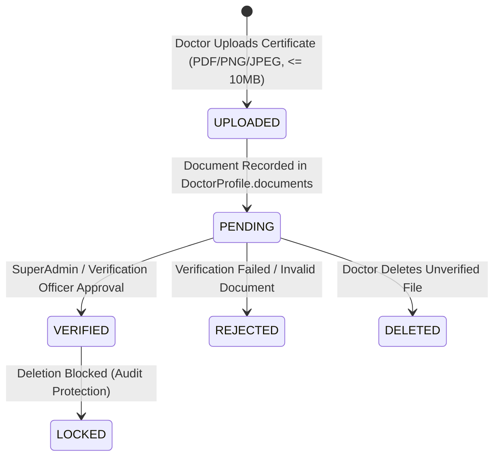

# HealthBridge India — Doctor Profile, Professional Settings & Security Architecture
**Document Version:** 1.0.0  
**Security Classification:** Highly Confidential / Medical Practice Standard  
**ABDM Milestone:** Day 4 Task 07  

---

## 1. Executive Summary

The Doctor Profile and Professional Settings subsystem completes the physician-facing application layer within HealthBridge India. Operating in strict adherence to National Medical Commission (NMC) regulations, Ayushman Bharat Digital Mission (ABDM) guidelines, and Digital Information Security in Healthcare Act (DISHA) requirements, this module provides clinicians with a hardened environment to govern their professional identities, verification credentials, clinical practice constraints, communication channels, and account security.

---

## 2. System Architecture & Component Mapping

```mermaid
graph TD
    Client["Next.js 14 Doctor Portal (App Router)"]
    API["Express 4 RESTful API Engine (Node.js)"]
    DB[(MongoDB Atlas / Document Store)]
    SecStorage["Encrypted Credential Storage (/secure-credentials)"]
    Audit["Cryptographic Audit Trail (AuditLogModel)"]

    Client -->|Bearer JWT + CSRF Protection| API
    API -->|Schema Validation (Zod)| API
    API -->|RBAC Guard (DOCTOR)| API
    API -->|Read / Write| DB
    API -->|Restricted File Streams| SecStorage
    API -->|Tamper-evident Event Logs| Audit
```

### 2.1 Navigation & Route Architecture

| Route | View Component | Operational Purpose |
|---|---|---|
| `/doctor/profile` | `DoctorProfileView` | Read-only professional dossier, verification badges, NMC registration, affiliations |
| `/doctor/settings` | `DoctorSettingsHub` | Quick overview hub directing clinicians to specific sub-settings |
| `/doctor/settings/professional` | `DoctorProfileEditor` | Permitted profile modifications & credential document upload portal |
| `/doctor/settings/practice` | `DoctorPracticeSettingsForm` | Facility affiliations, consultation fee defaults, auto-acceptance rules |
| `/doctor/settings/security` | `DoctorSecuritySettings` | High-entropy password rotation & credential audit log review |
| `/doctor/settings/sessions` | `DoctorActiveSessions` | Real-time session monitoring with remote revocation capabilities |
| `/doctor/settings/notifications` | `DoctorNotificationPreferencesForm` | Multi-channel dispatch controls with mandatory security alerts |

---

## 3. Security Guards & Permitted Profile Editing Rules

To protect clinical integrity and prevent credential spoofing, strict authorization boundaries govern doctor profile updates:

### 3.1 Immutable Clinical Credential Fields
Doctors are **strictly forbidden** from mutating the following fields through self-service APIs:
1. `role`: Bound irreversibly to `DOCTOR`.
2. `registrationNumber`: State Medical Council (SMC) or NMC registration numbers cannot be altered post-verification.
3. `registrationCouncil`: Issuing statutory medical council.
4. `verificationStatus`: Transitions exclusively via Administrative Credential Review (`PENDING` $\rightarrow$ `VERIFIED` or `REJECTED`).
5. `isVerified`: Read-only computed flag.

Attempts to submit these fields are filtered out at the validation layer and discarded by the update service without causing silent corruption.

### 3.2 Permitted Self-Service Fields
Clinicians may maintain:
- `bio` (max 2,000 characters)
- `languages` (spoken languages for patient communication)
- `consultationFee` (INR value for private practice appointments)
- `professionalInterests` (specialized clinical fields, research focus)
- `phone` (practice contact telephone, syncs to core User record)

---

## 4. Credential Document Verification Lifecycle



1. **Storage Isolation:** Uploaded credentials are saved to an isolated, non-public storage volume (`/secure-credentials/doctors/{userId}/{docId}-{filename}`). They are never served via public static URLs.
2. **Review Integrity:** When an uploaded credential is in `PENDING` review, the physician may remove it and replace it.
3. **Audit Immutability:** Once marked `VERIFIED`, clinicians cannot delete the document without formal administrative review.

---

## 5. Practice & Facility Configuration

Physicians operating in multi-facility or hybrid arrangements configure:
- **Default Facility Binding:** Primary healthcare clinic or hospital affiliation verified against registered `FacilityModel` documents.
- **Consultation Modes:** Flags for `IN_PERSON`, `TELECONSULTATION`, or `HOME_VISIT`.
- **Slot Durations & Buffer Times:** Configurable consultation windows (10, 15, 20, 30, 45, 60 minutes) with 5 to 30-minute buffer intervals.
- **Auto-Confirmation Rules:** Automatic acceptance of booked slots or manual clinician triage.
- **Same-Day Notice & Advance Booking Windows:** Minimum cancellation buffer hours (0-48h) and advance booking horizons (1-90 days).

---

## 6. Authentication & Session Management

1. **Active Session Enumeration:** Doctors can inspect active sessions, identifying device type, IP address, operating system, browser, and last active timestamp. Raw JWT tokens and refresh hashes are never transmitted to the frontend.
2. **Individual Session Termination:** Revoking a specific session invalidates its refresh token family in the database.
3. **Global Revocation (`revoke-others`):** Clinicians can purge all sessions except their current active turn in case of suspected device compromise.
4. **Password Security:**
   - Enforces bcrypt hashing with work factor $\ge 12$.
   - Validates entropy: minimum 8 characters with at least one uppercase letter, one lowercase letter, one number, and one special character.
   - Prevents reuse of current password.

---

## 7. Notification Preference Controls & Mandatory Security Policies

Doctors configure multi-channel dispatch preferences (In-App, Email, SMS, WhatsApp) across operational categories:
- `appointmentBookings` (Patient scheduled, cancelled, or rescheduled)
- `patientArrivals` (Patient checked in at clinic queue)
- `labResults` (New diagnostic reports published)
- `prescriptionRefills` (Pharmacy refill requests)

### Mandatory Security Alerts Policy
Under HealthBridge security governance, **Security Alerts** (`securityAlerts.inApp` and `securityAlerts.email`) are **strictly mandatory**. Even if a doctor or API payload attempts to disable security alerts, the backend service forces them to `true`. Security incidents, password updates, and session revocations cannot be silenced.

---

## 8. API Endpoints Catalog

| Method | Endpoint | Authorization | Description |
|---|---|---|---|
| `GET` | `/api/v1/doctors/me` | `DOCTOR` | Retrieve authenticated doctor profile |
| `PATCH` | `/api/v1/doctors/me` | `DOCTOR` | Update permitted profile fields |
| `GET` | `/api/v1/doctors/me/settings/practice` | `DOCTOR` | Retrieve practice settings |
| `PATCH` | `/api/v1/doctors/me/settings/practice` | `DOCTOR` | Update practice settings |
| `GET` | `/api/v1/doctors/me/settings/notifications` | `DOCTOR` | Retrieve notification preferences |
| `PATCH` | `/api/v1/doctors/me/settings/notifications` | `DOCTOR` | Update notification preferences |
| `GET` | `/api/v1/doctors/me/documents` | `DOCTOR` | List uploaded credential documents |
| `POST` | `/api/v1/doctors/me/documents` | `DOCTOR` | Upload credential document |
| `DELETE` | `/api/v1/doctors/me/documents/:docId` | `DOCTOR` | Delete unverified credential document |
| `GET` | `/api/v1/doctors/me/sessions` | `DOCTOR` | List active doctor sessions |
| `DELETE` | `/api/v1/doctors/me/sessions/:sessionId` | `DOCTOR` | Revoke specific session |
| `POST` | `/api/v1/doctors/me/sessions/revoke-others` | `DOCTOR` | Revoke all other active sessions |
| `POST` | `/api/v1/doctors/me/change-password` | `DOCTOR` | Rotate account password |

