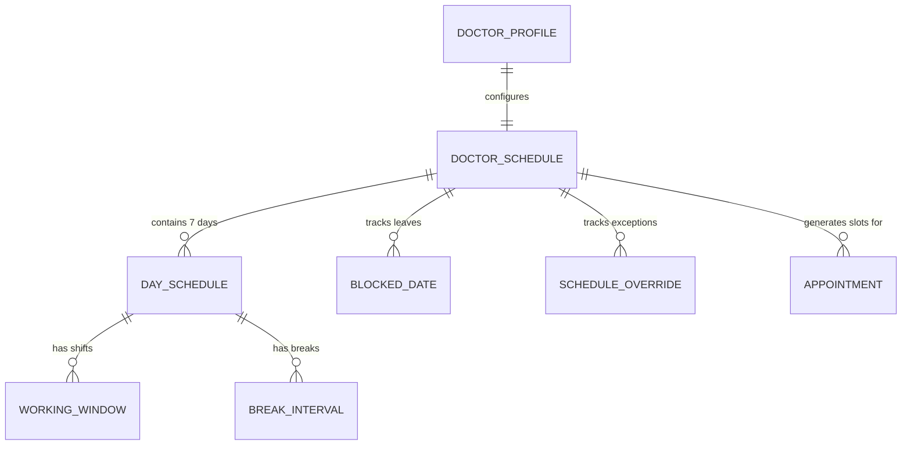
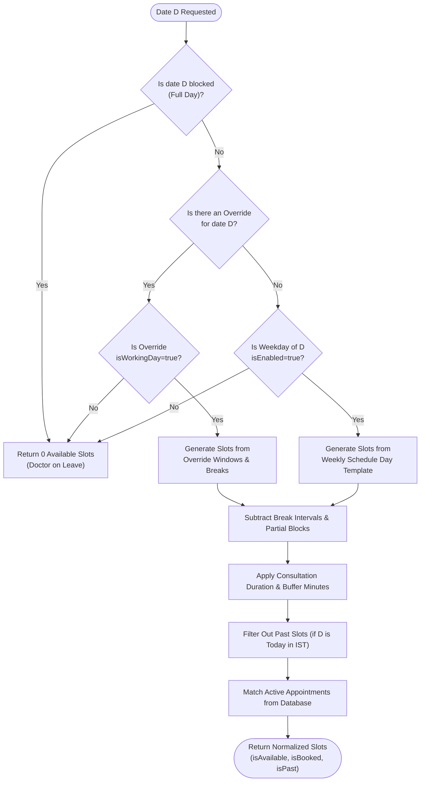

# HealthBridge India — Doctor Schedule & Availability Management System

## 1. Overview & Architecture

The **Doctor Schedule & Availability Management System** (Day 4 Task 06) serves as the authoritative operational scheduling foundation for verified healthcare practitioners on the HealthBridge India platform. 

The scheduling system bridges the gap between doctor autonomy and patient booking integrity:
1. **Authoritative Slot Generation Engine**: Both doctor-facing calendar views and patient-facing appointment wizards query the identical server-side slot calculation algorithm (`DoctorScheduleService.getDoctorAvailabilitySlots`), completely preventing slot drift, time zone discrepancies, or conflicting break policies.
2. **Conflict-Aware Leave & Blocked Date Management**: Setting leave or blocking clinic hours performs an immediate forward-audit against active patient appointments. The system explicitly blocks silent cancellation, returning `409 Conflict` with masked affected appointments until the doctor confirms or reschedules.
3. **Special Working Day Overrides**: Doctors can designate ad-hoc clinic days or custom working hours for specific dates (e.g., weekend camps, national holiday coverage) without altering their recurring weekly template.
4. **Multi-Window & Break Customization**: Daily working hours support multiple working shifts (e.g., morning 09:00–13:00 and evening 17:00–20:00) with granular break intervals (e.g., lunch, rounds) and configurable buffer minutes (0, 5, 10, 15 mins).
5. **ABDM & DPDP Privacy Alignment**: Calendar summaries, availability endpoints, and conflict audits enforce patient identity masking (e.g., `Aarav S.` with age and gender), preventing unauthorized disclosure of patient identities across clinical schedules.
6. **Concurrency & Double-Booking Guards**: Active bookings are guarded by atomic database queries and compound unique constraints (`{ doctorId: 1, scheduledAt: 1 }` where status $\in$ `['REQUESTED', 'CONFIRMED', 'CHECKED_IN', 'IN_PROGRESS']`), rejecting race conditions under concurrent booking requests.

---

## 2. Schedule Data Architecture & Precedence

The scheduling engine is backed by `DoctorScheduleModel` (`doctor_schedules` collection in MongoDB):



### Precedence Hierarchy for Any Given Date ($D$)

When calculating availability for date $D$ (`YYYY-MM-DD`):



---

## 3. Authoritative Slot Generation Algorithm

The slot generator executes sequentially on the server (`DoctorScheduleService.getDoctorAvailabilitySlots`):

```typescript
// 1. Timezone localization (strictly Asia/Kolkata default)
const timezone = schedule.timezone || 'Asia/Kolkata';

// 2. Resolve Day Configuration (Override > Weekly Day Schedule)
const dayOfWeek = getDayOfWeek(dateStr, timezone); // MONDAY..SUNDAY
const override = schedule.scheduleOverrides?.find(o => o.date === dateStr);
const dayConfig = override 
  ? { isEnabled: override.isWorkingDay, workingWindows: override.workingWindows, breaks: override.breaks, ... }
  : schedule.weeklySchedule.find(d => d.day === dayOfWeek);

// 3. Decompose Working Windows into Fixed Time Slices
for (const window of dayConfig.workingWindows) {
  let cursor = parseTimeToMinutes(window.start);
  const end = parseTimeToMinutes(window.end);
  
  while (cursor + slotDurationMinutes <= end) {
    const slotStart = formatMinutesToTime(cursor);
    const slotEnd = formatMinutesToTime(cursor + slotDurationMinutes);
    
    // Check if slot overlaps any break interval
    const overlapsBreak = breaks.some(b => isOverlapping(slotStart, slotEnd, b.start, b.end));
    
    // Check if slot overlaps any partial day block
    const overlapsBlock = partialBlocks.some(b => isOverlapping(slotStart, slotEnd, b.startTime, b.endTime));
    
    if (!overlapsBreak && !overlapsBlock) {
      slots.push({ startTime: slotStart, endTime: slotEnd });
    }
    
    // Increment cursor by (slotDurationMinutes + bufferMinutes)
    cursor += slotDurationMinutes + bufferMinutes;
  }
}

// 4. Correlate with Active Appointments in Database
const activeAppointments = await AppointmentModel.find({
  doctorId: doctorProfile._id,
  scheduledAt: { $gte: startOfDayUtc, $lte: endOfDayUtc },
  status: { $in: ['REQUESTED', 'SCHEDULED', 'CONFIRMED', 'CHECKED_IN', 'IN_PROGRESS'] }
});

// 5. Annotate slots
return candidateSlots.map(slot => {
  const isBooked = activeAppointments.some(a => a.timeSlot === slot.startTime);
  const isPast = isDateToday && isTimeInPast(slot.startTime, timezone);
  return {
    ...slot,
    isAvailable: !isBooked && !isPast,
    isBooked,
    isPast,
  };
});
```

---

## 4. Conflict Detection & Leave Management Workflow

When a practitioner attempts to block dates or declare leave, the backend queries all active appointments scheduled within that date range.

### Conflict Protection Protocol
- **Condition**: If active appointments exist for the blocked period and `forceWithConflicts` is not set to `true`:
  - **HTTP Status**: `409 Conflict`
  - **Response Payload**:
    ```json
    {
      "success": false,
      "error": {
        "code": "SCHEDULE_CONFLICT",
        "message": "Cannot block date range: 2 active appointments will be affected. Please review or reschedule them before blocking, or confirm with forceWithConflicts: true.",
        "details": {
          "hasConflicts": true,
          "affectedAppointments": [
            {
              "appointmentId": "654f1...",
              "scheduledDate": "2026-11-20",
              "timeSlot": "10:30",
              "patientName": "Aarav S.",
              "status": "CONFIRMED"
            }
          ]
        }
      }
    }
    ```
- **Confirmation Action**: The doctor UI displays the `ScheduleConflictDialog` modal presenting all affected consultations. If the doctor explicitly confirms, the request is resent with `{ "forceWithConflicts": true }`, creating the block record and triggering rescheduling notifications.

---

## 5. Doctor Schedule Frontend Architecture

The doctor schedule feature is structured under `apps/web/src/components/doctor/schedule/` and exposed via 5 App Router pages:

| Page Route | Purpose | Key Components |
| :--- | :--- | :--- |
| `/doctor/schedule` | Schedule Management Overview & Metrics | `ScheduleHeader`, `ScheduleSummary`, Next 7 Days Quick Preview |
| `/doctor/schedule/weekly` | 7-Day Working Hours & Breaks Editor | `WeeklyScheduleEditor`, `WorkingDayEditor`, `TimeIntervalEditor` |
| `/doctor/schedule/availability` | Interactive Calendar with Patient Masking | `ScheduleCalendar`, `ScheduleDayView`, `ScheduleWeekView`, `ScheduleMonthView` |
| `/doctor/schedule/blocked-dates` | Leave & Blocked Dates with Conflict Resolution | `BlockedDatesManager`, `ScheduleConflictDialog`, `ScheduleOverrideDialog` |
| `/doctor/schedule/settings` | Consultation Settings & Associated Facilities | `ConsultationSettings`, `FacilitySelector` |

### Key UI Features
1. **Interactive Day / Week / Month Calendar**:
   - Color-coded slots: Available (Blue/Teal), Booked (Amber/Orange with masked patient name), Past/Closed (Muted Gray).
   - Quick date pickers with "Today" snap buttons.
2. **Weekly Shift Editor**:
   - Per-day toggle switch (Working vs Day Off).
   - Add/remove multiple working windows per day (e.g. morning + evening).
   - Add/remove break periods with inline validation (breaks must fall inside active working windows).
   - Validation against backwards intervals (`start >= end`) and overlapping shifts.
3. **Leave & Override Dialogs**:
   - Seamless date pickers, reason inputs, and conflict alerts.
   - Confirmation dialog preventing accidental disruption of confirmed patient visits.

---

## 6. Backend API Specification

All schedule endpoints require `authenticate` and `authorize(['DOCTOR'])`.

| Method | Endpoint | Query / Body Params | Response Description |
| :--- | :--- | :--- | :--- |
| `GET` | `/api/v1/doctors/schedule` | — | Retrieves complete doctor schedule configuration |
| `PUT` | `/api/v1/doctors/schedule` | `UpdateDoctorWeeklyScheduleDto` | Updates weekly working hours, breaks, slot duration, buffer, and timezone |
| `GET` | `/api/v1/doctors/schedule/overview` | — | Summary metrics: total working days, weekly hours, upcoming leaves, overrides |
| `GET` | `/api/v1/doctors/schedule/availability` | `?date=YYYY-MM-DD&type=IN_PERSON` | Authoritative slot availability for a specific day |
| `GET` | `/api/v1/doctors/schedule/calendar` | `?view=week&startDate=YYYY-MM-DD` | Calendar events and slots aggregated for Day, Week, or Month |
| `GET` | `/api/v1/doctors/schedule/blocked-dates` | — | List of blocked dates, holidays, and planned leaves |
| `POST` | `/api/v1/doctors/schedule/blocked-dates` | `BlockDateRequestDto` | Blocks a full or partial date; returns `409 Conflict` if active appointments exist |
| `DELETE` | `/api/v1/doctors/schedule/blocked-dates/:blockId` | — | Unblocks a previously blocked date or leave period |
| `GET` | `/api/v1/doctors/schedule/overrides` | — | List of special working day overrides |
| `POST` | `/api/v1/doctors/schedule/overrides` | `ScheduleOverrideDto` | Creates a date-specific override (e.g., working Sunday) |
| `DELETE` | `/api/v1/doctors/schedule/overrides/:overrideId` | — | Removes a date-specific override |
| `GET` | `/api/v1/doctors/schedule/facilities` | — | Returns facilities associated with the doctor |

---

## 7. Automated Test Matrix

The schedule test suite (`tests/integration/doctor-schedule.test.ts`) covers 19 comprehensive test cases:

```
✓ Role-Based Access Control (RBAC) (2 tests)
  ✓ should reject unauthenticated request to /api/v1/doctors/schedule with 401 UNAUTHORIZED
  ✓ should forbid PATIENT role from accessing doctor schedule endpoints with 403 FORBIDDEN

✓ Doctor Schedule Retrieval & Update (4 tests)
  ✓ should retrieve doctor schedule configuration with default weekly template
  ✓ should update weekly working schedule, durations, and buffers
  ✓ should reject invalid working schedule where window start >= end (422)
  ✓ should reject working schedule where break interval falls outside working hours (422)

✓ Schedule Overview & Metrics (1 test)
  ✓ should calculate schedule overview metrics correctly

✓ Authoritative Slot Generation & Rules Engine (4 tests)
  ✓ should generate consultation slots excluding breaks and buffer times
  ✓ should return 0 slots for disabled / off days
  ✓ should exclude past slots when querying availability for today
  ✓ should mark booked appointments as unavailable in generated slots

✓ Calendar View & Patient Masking (2 tests)
  ✓ should return week calendar view with scheduled appointments and slots
  ✓ should mask patient names in calendar view for DPDP / privacy compliance

✓ Blocked Dates & Conflict Detection (4 tests)
  ✓ should detect conflicts and return 409 when blocking date with active appointments
  ✓ should block date when forceWithConflicts is true even with conflicts
  ✓ should block date without active appointments successfully (201)
  ✓ should delete blocked date and restore availability

✓ Special Working Day Overrides (1 test)
  ✓ should create special override and calculate slots from override definition

✓ Patient Booking Synchronization & Concurrency (1 test)
  ✓ should reflect doctor schedule updates immediately in patient booking availability
```

---

## 8. Verification Results

- **TypeScript Typecheck**: Passed across all 5 workspace projects (`@healthbridge/config`, `@healthbridge/shared-types`, `@healthbridge/validation`, `@healthbridge/api`, `@healthbridge/web`). Zero errors.
- **ESLint**: Passed across all workspace projects (`✔ No ESLint warnings or errors`).
- **Next.js Production Build**: Generated static & dynamic pages (52/52 routes) with zero warnings.
- **Backend Test Suite**: 24/24 test files passed, 254/254 tests passed.

---

## 9. Remaining Limitations & Future Roadmap

1. **Recurring Bi-Weekly / Alternating Schedules**: Currently schedules follow a 7-day recurring weekly cycle. Alternating "Week A / Week B" schedules require date overrides.
2. **External Calendar Sync (iCal / Google Calendar)**: Two-way sync with Google Calendar or Apple Calendar is scheduled for a future integration task.
3. **Automated Patient Rescheduling Wizard**: While the conflict detection accurately warns of disrupted visits, automated bulk rebooking to the doctor's next available slots will be introduced in the Receptionist/Admin module.

