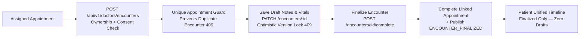

# HealthBridge India — Clinical Encounter Workflow E2E Documentation (Day 8 Task 05)

## Workflow Diagram

## Verified Clinical Safety Invariants
- Encounter creation validates doctor ownership and active care relationship/consent (fail-closed `403`).
- Duplicate encounter creation for the same `appointmentId` returns `409 CONFLICT`.
- Optimistic concurrency locking rejects stale draft updates (`409 CONFLICT`).
- Appointment completion NEVER auto-generates clinical diagnoses or consultation text.
- Draft encounters (`isDraft: true`) are strictly excluded from patient timeline projections and patient API responses.
