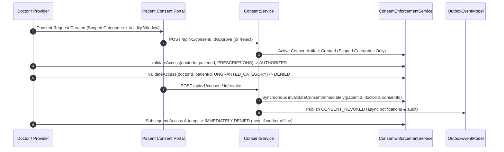

# HealthBridge India — Consent & Authorized Access Workflow E2E Documentation (Day 8 Task 05)

## Workflow Diagram

## Role-Specific Access Validation
- **Doctor:** Requires active appointment, clinical encounter, or non-expired, non-revoked consent matching the requested data category.
- **Pharmacy:** Strictly scoped to issued prescriptions eligible for dispensing and pharmacy-owned orders/inventory; never granted general clinical histories.
- **Laboratory:** Strictly scoped to assigned laboratory orders, samples, and laboratory-owned reports; never granted unrestricted clinical records.
- **Patient:** Full self-access derived strictly from JWT `req.user.userId`; sole authority to approve, reject, or revoke consents.
