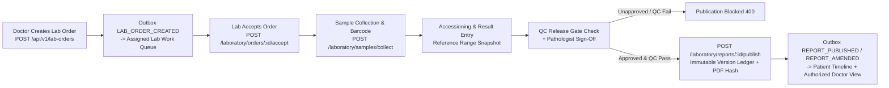

# HealthBridge India — Laboratory Order to Published Report E2E Flow (Day 8 Task 05)

## Workflow Diagram

## Verified Integrity Controls
- Ordering requires `DOCTOR` role and active patient relationship/consent (`PATIENT` role blocked `403`).
- Cross-laboratory report access or publication is blocked (`403`).
- Draft, rejected, and unapproved reports cannot be published (`400 Bad Request`), and failed QC release gates block publication unless an audited supervisor override is recorded.
- Report amendments preserve immutable previous versions in `LabReportVersionModel` and emit a distinct `REPORT_AMENDED` event.
- Doctors view published laboratory reports strictly read-only inside `/doctor/patients/[patientId]/overview`.
