# HealthBridge India — Unified Notification Workflow E2E Documentation (Day 8 Task 05)

## End-to-End Pipeline

```mermaid
flowchart LR
    A[Domain Event<br/>OutboxEventModel] --> B[unifiedNotificationEventHandler]
    B --> C[NotificationRecipientResolver<br/>Role Auth + Admin PHI Boundary]
    C --> D[NotificationTemplateRegistry<br/>Neutral Privacy-Safe Wording]
    D --> E[NotificationPreferenceService<br/>User Prefs + Mandatory SECURITY]
    E --> F[NotificationModel.create<br/>Persist First + SHA-256 Dedupe]
    F --> G[NotificationStreamService<br/>Per-User SSE + dashboard_sync]
    G --> H[Frontend useNotificationStream<br/>Scoped TanStack Query Refresh + Cross-Tab Sync]
```

## Verified Capabilities
- **All 5 Roles Covered:** Dedicated Notification Centers & Preferences pages at `/{patient,doctor,pharmacy,laboratory,admin}/notifications` plus live `<NotificationBell />` in all 5 portal headers.
- **Transport:** One-way SSE (`GET /api/v1/notifications/stream`) authenticated via HTTP-only cookies / Bearer header (URL `?token=` strictly rejected `401`) with `Last-Event-ID` reconnection catch-up and automatic authenticated polling fallback (`15s` when SSE drops, `60s` when connected).
- **Cross-Tab Sync:** `BroadcastChannel` with `localStorage` fallback synchronizes read state, unread count, logout cleanup, and duplicate event suppression across tabs with zero clinical text transmitted.
- **External Channels:** Email and SMS external providers are NOT configured in this environment; `availableChannels` honestly reports `inApp: true, email: false, sms: false`, keeping in-app + SSE fully operational.
