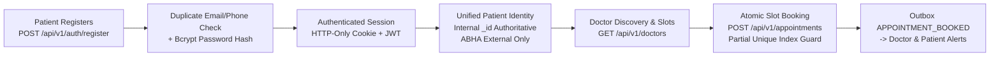

# HealthBridge India — Patient Registration to Appointment Booking E2E Flow (Day 8 Task 05)

## Workflow Diagram

## Synthetic Test Accounts (Zero Real PII)
- **Demo Patient A:** `demo.patient.a@synthetic.test` (Role: `PATIENT`)
- **Demo Patient B:** `demo.patient.b@synthetic.test` (Role: `PATIENT`, cross-tenant isolation actor)
- **Demo Doctor A:** `demo.doctor.a@synthetic.test` (Role: `DOCTOR`)

## Verified Guarantees
- Duplicate registration blocked cleanly (`409 CONFLICT`); passwords hashed with `bcryptjs` and excluded via `select: false`.
- Internal MongoDB `User._id` remains the authoritative patient primary key (`isAuthoritativePrimaryKey: false` for external ABHA associations).
- Concurrent double-booking of the same doctor slot is blocked at the database layer via partial unique index (`11000` -> `409 CONFLICT`), never relying solely on frontend availability checks.
- Rescheduling preserves history; cancellation releases the slot and writes an audit record.
