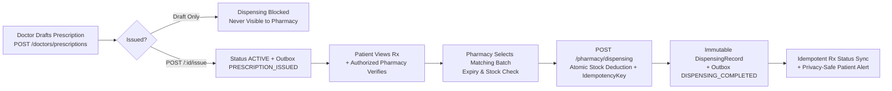

# HealthBridge India — Prescription Issuance & Pharmacy Dispensing E2E Flow (Day 8 Task 05)

## Workflow Diagram

## Verified Integrity Controls
- Pharmacy accounts CANNOT modify clinical prescriptions issued by doctors.
- Draft and cancelled prescriptions cannot be dispensed (`400 Bad Request`).
- Unauthorized medicine substitution is blocked; batch expiry and stock availability are validated before deduction.
- Stock deduction occurs atomically once inside `PharmacyService.dispensePrescription()` with `idempotencyKey` protection; duplicate `DISPENSING_COMPLETED` events NEVER re-deduct stock.
- Partial dispensing accurately tracks remaining outstanding quantities.
