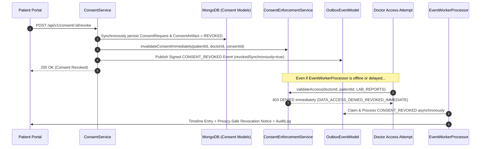

# HealthBridge India — Synchronous Consent Revocation Handling (Day 8 Task 03)

## 1. Zero-Delay Security Invariant

**Consent revocation NEVER depends on an asynchronous event worker to take effect.**

When a patient revokes consent (`ConsentService.revokeConsent`):
1. The `ConsentRequest` and all linked `ConsentArtifact` documents are persisted as `REVOKED` synchronously in MongoDB.
2. `consentEnforcementService.invalidateConsentImmediately(patientId, requesterId, consentId)` records an immediate synchronous revocation barrier BEFORE returning to the caller.
3. `consentEnforcementService.validateAccess(...)` evaluates the synchronous revocation barrier BEFORE reading any artifact or cache, and otherwise queries live MongoDB consent state (fail-closed). Stale caches can NEVER grant access after revocation.
4. ONLY AFTER synchronous persistence + immediate invalidation completes, `CONSENT_REVOKED` is published to the durable outbox for asynchronous notifications, timeline projection, and compliance audit recording.

## 2. Sequence Diagram — Consent Revocation

