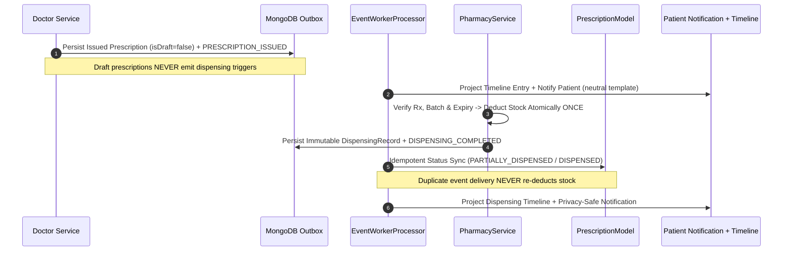
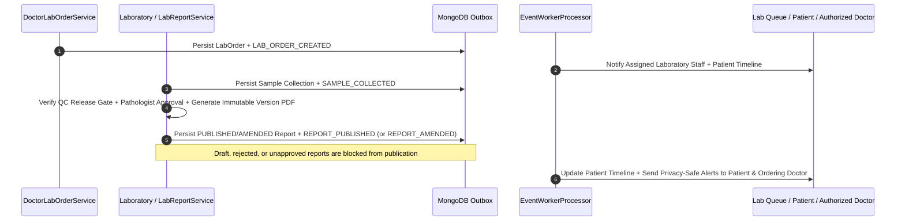

# HealthBridge India — Domain Event Catalogue (Day 8 Task 03)

## 1. Strict Privacy Payload Policy

Every domain event payload is validated via a `.strict()` Zod schema (`packages/validation/src/events.schema.ts`) and scanned by `validateDomainEventPayload()` (`apps/api/src/modules/events/event.schema.ts`).

- **Permitted fields:** Internal ObjectIds, reference numbers (`orderNumber`, `prescriptionNumber`, `reportNumber`), statuses, version numbers, counts, booleans, and ISO-8601 timestamps.
- **Strictly rejected:** Diagnoses, consultation notes, prescription medication instructions, numeric lab values/units (`mg/dL`, `HbA1c`, etc.), 14-digit ABHA numbers, 12-digit Aadhaar numbers, passwords, and Bearer tokens.

## 2. Complete Event Catalogue (31 Events)

| Domain | Event Types | Key Payload Identifiers |
| --- | --- | --- |
| **Appointments** | `APPOINTMENT_BOOKED`, `APPOINTMENT_CONFIRMED`, `APPOINTMENT_RESCHEDULED`, `APPOINTMENT_CANCELLED`, `APPOINTMENT_COMPLETED` | `appointmentId`, `patientId`, `doctorId`, `facilityId`, `scheduledAt`, `slotReleased`, `encounterEligible` |
| **Encounters** | `ENCOUNTER_STARTED`, `ENCOUNTER_FINALIZED`, `ENCOUNTER_AMENDED` | `encounterId`, `appointmentId`, `patientId`, `doctorId`, `isDraft`, `finalizedAt`, `version` |
| **Prescriptions** | `PRESCRIPTION_CREATED`, `PRESCRIPTION_ISSUED`, `PRESCRIPTION_CANCELLED`, `PRESCRIPTION_DISPENSED`, `PRESCRIPTION_PARTIALLY_DISPENSED` | `prescriptionId`, `prescriptionNumber`, `patientId`, `doctorId`, `isDraft`, `pharmacyDiscoverable`, `medicationCount` |
| **Pharmacy** | `STOCK_LOW`, `STOCK_EXPIRED`, `DISPENSING_COMPLETED`, `PHARMACY_ORDER_UPDATED` | `pharmacyId`, `dispensingId`, `prescriptionId`, `inventoryItemId`, `dispensingStatus`, `stockDeductedAtomically` |
| **Laboratory** | `LAB_ORDER_CREATED`, `LAB_ORDER_ACCEPTED`, `SAMPLE_COLLECTED`, `SAMPLE_REJECTED`, `TEST_PROCESSING_STARTED`, `TEST_COMPLETED`, `REPORT_APPROVED`, `REPORT_PUBLISHED`, `REPORT_AMENDED` | `labOrderId`, `sampleId`, `reportId`, `laboratoryId`, `patientId`, `orderingDoctorId`, `qcPassed`, `version`, `previousVersion` |
| **Consent & ABDM** | `CONSENT_GRANTED`, `CONSENT_REVOKED`, `ABHA_LINKED`, `EXTERNAL_RECORD_IMPORTED`, `ABDM_TRANSFER_COMPLETED` | `consentId`, `patientId`, `requesterId`, `revokedSynchronously`, `abhaLinkRecordId`, `importedRecordId`, `hiType`, `isMocked` |

## 3. Sequence Diagram — Prescription Issuance & Pharmacy Dispensing

## 4. Sequence Diagram — Laboratory Order & Report Publication

