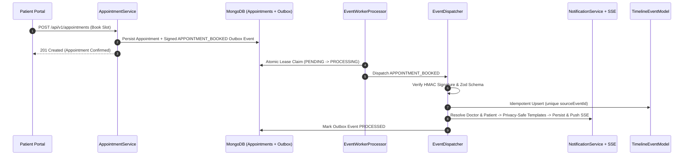

# HealthBridge India — Cross-Module Event-Driven Architecture (Day 8 Task 03)

## 1. Architectural Overview

HealthBridge India coordinates clinical and operational workflows across Patient, Doctor, Pharmacy, Laboratory, Consent, ABDM, Notification, and Administration modules through a **MongoDB-backed Transactional Outbox & Background Worker** architecture (`apps/api/src/modules/events/`).

Critical healthcare state transitions NEVER depend on frontend client orchestration. Backend domain services persist domain mutations and signed outbox events durably in MongoDB, and a background worker dispatches idempotent handlers to update projections, deliver privacy-safe notifications, and record operational audit trails.

### Why No External Message Broker Yet?

The existing stack runs Express + MongoDB Atlas/Mongoose without Kafka, RabbitMQ, or Redis Streams. Introducing an external broker would add dual-write consistency risks and operational overhead that are unnecessary at current scale. Using MongoDB's durable `outbox_events` collection provides:
- Atomic persistence alongside domain writes on replica-set/sharded MongoDB deployments (Atlas).
- Survival across API server restarts with zero extra infrastructure.
- A clean migration seam: `EventWorkerProcessor` can later be swapped to MongoDB Change Streams or a dedicated broker without modifying domain services or handlers.

## 2. Layered Component Separation

| Layer | File(s) | Responsibility |
| --- | --- | --- |
| Contracts & Validation | `packages/shared-types/src/events.types.ts`, `packages/validation/src/events.schema.ts`, `event.schema.ts` | 31 strict Zod payload schemas, PHI leak guard, HMAC-SHA256 signing, admin DTO redaction |
| Event Persistence | `models/outbox-event.model.ts`, `models/event-handler-execution.model.ts`, `models/worker-heartbeat.model.ts`, `event.repository.ts` | Transactional outbox, atomic batch lease claiming, per-handler idempotency locks |
| Internal Publishing | `event.publisher.ts` | Internal-only service API (`publish`, `publishSafe`, `executeTransactional`) — zero public HTTP publish route |
| Processing & Retry | `event.registry.ts`, `event.dispatcher.ts`, `event.retry.ts`, `event.processor.ts` | Signature/schema re-verification, per-handler idempotent dispatch, exponential backoff with jitter, graceful shutdown |
| Dead-Letter Recovery | `event.dead-letter.ts`, `event.service.ts`, `event.controller.ts`, `event.routes.ts` | Admin-only redacted inspection & controlled safe replay |
| Domain Handlers | `handlers/timeline-projection.handler.ts`, `handlers/workflow-automation.handlers.ts`, `notifications/services/notification-event.handler.ts` | Patient timeline projections, pharmacy status sync, privacy-safe notifications, operational audit |

## 3. Sequence Diagram — Appointment Booking Workflow

