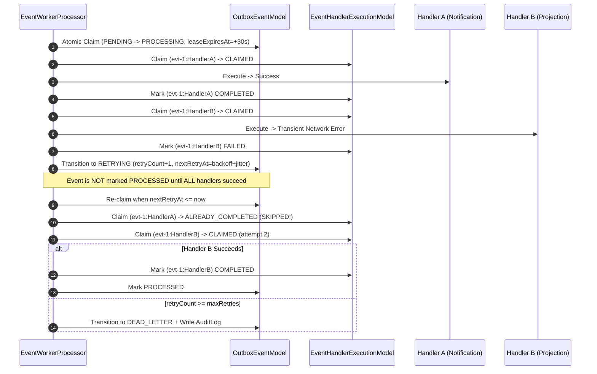

# HealthBridge India — Idempotency, Retry Backoff & Failure Handling (Day 8 Task 03)

## 1. Multi-Layer Idempotency Strategy

1. **Producer Idempotency (`outbox_events.idempotencyKey` unique index):** Duplicate domain transition triggers collide on MongoDB code `11000` and return `{ deduplicated: true }` without creating duplicate outbox records.
2. **Worker Claim Exclusivity (`claimNextBatch` atomic `findOneAndUpdate`):** Concurrent worker instances compete atomically on `{ status: 'PENDING' | 'RETRYING', nextRetryAt <= now }` or expired `{ status: 'PROCESSING', leaseExpiresAt <= now }`. Only one worker obtains the lease.
3. **Per-Handler Execution Ledger (`event_handler_executions.executionKey = "${eventId}:${handlerName}"` unique index):**
   - Before invoking each handler, `EventDispatcher` calls `claimHandlerExecution(...)`.
   - If Handler A already `COMPLETED` for `eventId` and Handler B failed transiently, the subsequent retry skips Handler A (`ALREADY_COMPLETED`) and retries ONLY Handler B.
4. **Downstream Sink Idempotency:**
   - Notifications use SHA-256 `idempotencyKey` unique index in `notifications`.
   - Timeline projections use unique `sourceEventId` (`$setOnInsert` upsert) in `timeline_events`.
   - Pharmacy stock deduction executes strictly once inside `PharmacyService.dispensePrescription()` — event handlers NEVER re-deduct inventory.

## 2. Exponential Backoff with Jitter

Implemented in `apps/api/src/modules/events/event.retry.ts`:

- Base delay: `1,000 ms`, capped ceiling: `300,000 ms` (5 minutes), default `maxRetries: 5`.
- Formula: `ceiling = min(maxDelayMs, baseDelayMs * 2^retryCount)` with uniform jitter in `[0.5 * ceiling, ceiling]` to prevent thundering-herd retries.
- Non-retryable errors (`AUTHENTICITY_ERROR`, `VALIDATION_ERROR`, `AUTHORIZATION_ERROR`, `PERMANENT_ERROR`) move immediately to `DEAD_LETTER`.

## 3. Sequence Diagram — Event Failure, Partial Idempotent Retry & Dead-Letter

