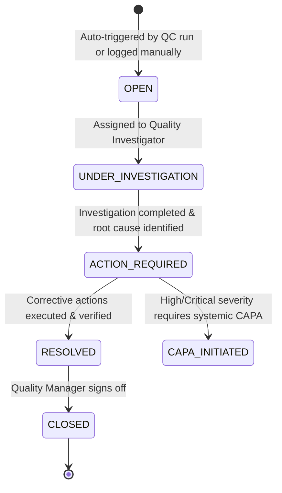

# Laboratory Incidents & Corrective/Preventive Action (CAPA) Workflow

## 1. Overview

HealthBridge India incorporates a closed-loop quality incident and CAPA management module that systematically tracks non-conformities from detection through root-cause analysis, action implementation, verification, and audited effectiveness reviews.

---

## 2. Quality Incident Taxonomy & Lifecycle

### Categories
- `QC_FAILURE`: Automated or manual QC rule violations and control shifts.
- `INSTRUMENT_FAILURE`: Hardware breakdown, optical misalignment, probe crashes.
- `CALIBRATION_FAILURE`: Calibration standard deviation or tolerance exceeded.
- `REAGENT_ISSUE`: Reagent lot contamination, precipitate, or temperature breach.
- `SPECIMEN_ISSUE`: Pre-analytical hemolysis, clotting, insufficient volume.
- `PRE_ANALYTICAL` / `POST_ANALYTICAL`: Barcode mislabeling, report transmission delay.
- `GENERAL`: Facility environmental drift or general laboratory deviation.

### Severities
- `CRITICAL`: Immediate threat to analytical accuracy across multiple tests or patients.
- `MAJOR`: Single test method compromise or significant equipment restriction.
- `MEDIUM`: Contained non-conformity with no released patient reports affected.
- `MINOR`: Incidental procedural deviation with zero diagnostic impact.

### Incident Lifecycle:

---

## 3. Corrective and Preventive Action (CAPA) Plan

When an incident reveals systemic or recurring risk, a formal CAPA plan is initiated:

### Core CAPA Structure:
1. **Problem Statement**: Concise factual description of the failure condition.
2. **Root Cause Analysis (RCA)**: Structured 5-Whys or Ishikawa/Fishbone finding:
   - Root cause category (e.g. `REAGENT_LOT_VARIATION`, `CALIBRATION_DRIFT`, `SOP_DEFECT`).
3. **Immediate Corrective Action**: Technical triage to contain the immediate defect.
4. **Systemic Preventive Action**: Policy, procedural, or engineering controls to prevent recurrence.
5. **Action Checklist**: Discrete action items with assigned owners (`assignedToId`) and strict due dates.
6. **Effectiveness Review**: Mandatory post-implementation audit to verify that the preventive action genuinely eliminated recurrence:
   - Marked as `EFFECTIVE` (closed) or `INEFFECTIVE` (re-opened for revision).
