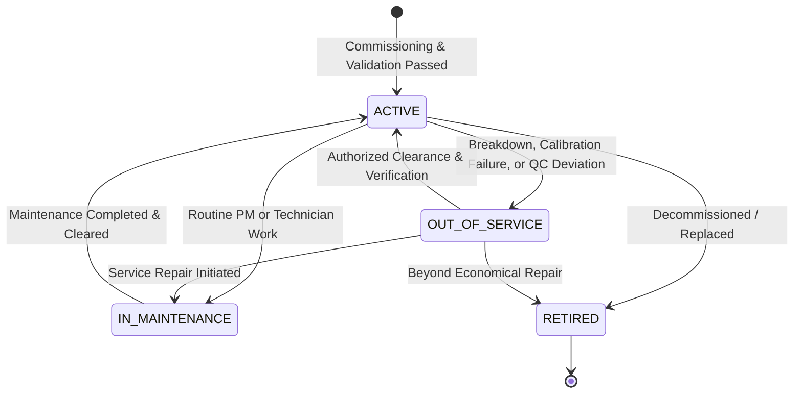

# Laboratory Instrument Management Architecture

## 1. Overview

Laboratory analyzers and diagnostic instruments represent the analytical engine of modern clinical pathology. HealthBridge India enforces lifecycle tracking, operating state transitions, test-to-instrument routing, and operational lockouts to guarantee that patient samples are only analyzed on certified, operational hardware.

---

## 2. Equipment Registry & Metadata

Each diagnostic device is registered with comprehensive identification:
- **Identifier**: Unique lab asset code (e.g. `ROCHE-COBAS-01`, `BECKMAN-DXH-02`).
- **Make & Model**: Manufacturer, commercial model name, serial number.
- **Category**: `ANALYZER`, `CENTRIFUGE`, `MICROSCOPE`, `INCUBATOR`, `REFRIGERATOR`, `SPECTROPHOTOMETER`, `PCR_MACHINE`, `ELECTROPHORESIS`, `OTHER`.
- **Department**: Clinical Biochemistry, Hematology, Microbiology, Molecular Biology.
- **Associated Test Codes**: Array of diagnostic test codes validated to execute on this device (e.g. `["GLUC", "LIPID", "LFT", "RFT"]`).

---

## 3. Operational State Machine

### Safety Enforcement:
- If an instrument's status is anything other than `ACTIVE`, the **Quality Release Gate** automatically halts report sign-off for tests associated with this instrument, preventing publication of results from unverified hardware.
- Status transitions record timestamp, authorizing user ID, and justification notes for permanent audit compliance.
