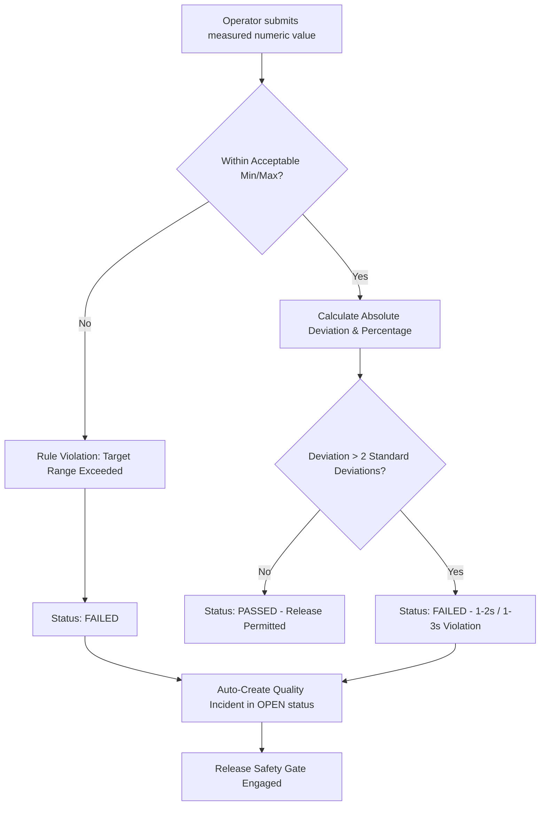

# Laboratory Quality Control (QC) Architecture & Westgard Evaluation

## 1. Overview

Quality Control (QC) ensures that analytical test procedures meet rigorous precision and accuracy standards before patient specimen results are released. HealthBridge India implements multi-level QC profiles, automated multi-rule evaluation algorithms, automated incident generation upon failure, and an investigation workspace.

---

## 2. Configurable QC Profiles

QC profiles define the target metrics and acceptable tolerances for diagnostic tests:

- **Multi-Level Controls**: Supports Level 1 (Low/Normal), Level 2 (Normal/Mid), and Level 3 (High/Pathological) control matrices.
- **Data Types**: Supports both quantitative numeric parameters (with target mean, standard deviation, and acceptable minimum/maximum) and qualitative parameters (expected positive/negative/normal).
- **Run Frequencies**: Configurable for `DAILY`, `EACH_SHIFT`, `PER_BATCH`, `WEEKLY`, or `MONTHLY`.
- **Version Snapshots**: When a target value, control lot, or acceptable limit changes, a new immutable version snapshot is preserved in `versions` array to ensure historical runs remain reproducible.

---

## 3. Server-Side Automated Rule Evaluation

When an operator submits a QC run via `POST /laboratory/quality/runs`, the backend evaluates the analytical result:



### Rule Evaluation Result Object:
```json
{
  "ruleName": "WESTGARD_LIMITS_CHECK",
  "passed": false,
  "explanation": "Measured value 128.5 mg/dL is outside acceptable limits [85 - 115 mg/dL]. Deviation: +28.50 (+28.5%).",
  "deviation": 28.5,
  "deviationPercentage": 28.5
}
```

---

## 4. Automatic Incident Triggering & Investigation Workspace

When a QC run fails:
1. The QC run is saved with `qcStatus = 'FAILED'`.
2. A linked `QualityIncident` is automatically generated with category `QC_FAILURE`, severity `MAJOR`, and title `QC Failure: <TEST_CODE> - Profile <PROFILE_NAME>`.
3. The generated `incidentId` is stored directly on the QC run record for bi-directional traceability.
4. Laboratory supervisors investigate the failure through the **Failure Investigation Workspace**:
   - Categorize root cause (`REAGENT_LOT_VARIATION`, `CALIBRATION_DRIFT`, `OPERATOR_ERROR`, `ENVIRONMENTAL_FLUCTUATION`).
   - Document technical remediation (e.g. flow cell cleaned, fresh calibrator reconstituted, re-run completed).
   - Set resolution status (`RESOLVED`, `UNDER_INVESTIGATION`, `INVALIDATED`).
   - Resolving the failure clears the release block for future patient batches.
