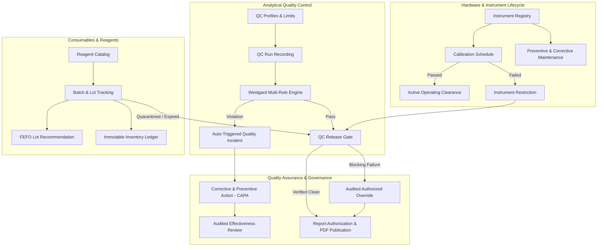

# HealthBridge India — Laboratory Quality Management System (QMS) Architecture

## 1. Executive Summary & Non-Accreditation Disclaimer

The HealthBridge India Laboratory Quality Management System (QMS) provides an enterprise healthcare software foundation for tracking and auditing diagnostic quality activities, equipment fitness, calibration intervals, consumable traceability, and multi-rule analytical evaluation.

> [!IMPORTANT]
> **Operational Software Foundation Disclaimer:**
> HealthBridge India provides an operational software foundation for tracking laboratory quality activities, instrument calibrations, reagent lot validation, and non-conformity remediation. The availability or utilization of these software features does not constitute, certify, or substitute for formal external ISO 15189 accreditation, NABL (National Accreditation Board for Testing and Calibration Laboratories) certification, CAP accreditation, or regulatory licensing. External laboratory certification requires rigorous on-site physical inspection, proficiency testing, personnel competence verification, and compliance with statutory Indian regulatory authorities.

---

## 2. Core Pillars of Laboratory QMS

The QMS architecture integrates seven tightly coupled operational sub-systems:

---

## 3. Data Entities & Schema Topology

The database models are structured under Mongoose / MongoDB with atomic concurrency guarantees:

| Model | Schema Name | Key Responsibilities |
| :--- | :--- | :--- |
| `QCProfileModel` | `qc_profiles` | Test code mapping, control levels (Level 1/2/3), target values, acceptable limits, and version history snapshots. |
| `QCRunModel` | `qc_runs` | Run timestamps, measured numeric/qualitative values, Westgard rule evaluations, operator identity, and incident linkage. |
| `QualityIncidentModel` | `quality_incidents` | Categorized non-conformities (QC failure, instrument malfunction, reagent defect), severities (MINOR, MAJOR, CRITICAL), root cause analysis, and resolution tracking. |
| `CAPAModel` | `capas` | Corrective and preventive action plans, discrete action item checklist, assigned owners, and formal post-implementation effectiveness evaluation. |
| `LabInstrumentModel` | `lab_instruments` | Equipment catalog, operating status (`ACTIVE`, `IN_MAINTENANCE`, `OUT_OF_SERVICE`, `RETIRED`), calibration status, and test mappings. |
| `InstrumentCalibrationModel` | `instrument_calibrations` | Traceable standards used, parameter tolerance checks (pass/fail), certificate numbers, next due dates, and quality manager clearance audits. |
| `InstrumentMaintenanceModel` | `instrument_maintenance` | Preventive, corrective, and emergency breakdown repairs, downtime hours, technician notes, service costs, and parts replaced. |
| `ReagentModel` | `reagents` | Catalog items, storage conditions (2–8°C, ambient, frozen), safety minimum stock alert thresholds, and associated test codes. |
| `ReagentLotModel` | `reagent_lots` | Batch lot numbers, manufacturer, receipt dates, expiry countdown, storage locations, quarantine status, and recall flags. |
| `ReagentTransactionModel` | `reagent_inventory_transactions` | Non-repudiable audit ledger capturing all stock additions, deductions, consumption runs, adjustments, and reversals. |
| `TestInstrumentMappingModel` | `test_instrument_mappings` | Association between diagnostic tests and primary/secondary analytical instruments. |

---

## 4. Quality Release Gate Integration

To ensure patient safety, diagnostic reports cannot be reviewed or published if any analytical prerequisite is violated:

1. **Active QC Failures**: If an active QC run for the ordered test failed and remains unresolved, the release gate blocks report approval with HTTP 400 (`QC_RESTRICTION_ACTIVE`).
2. **Instrument Inoperability**: If the instrument running the test is in `IN_MAINTENANCE` or `OUT_OF_SERVICE` status, release is blocked.
3. **Reagent Compromise**: Expired, quarantined, or recalled reagent lots prevent analytical validity.
4. **Audited Override**: Authorized quality managers or senior biochemists can issue a break-glass override with a mandatory justification, permanently recording the authorized officer's identity and audit timestamp.
