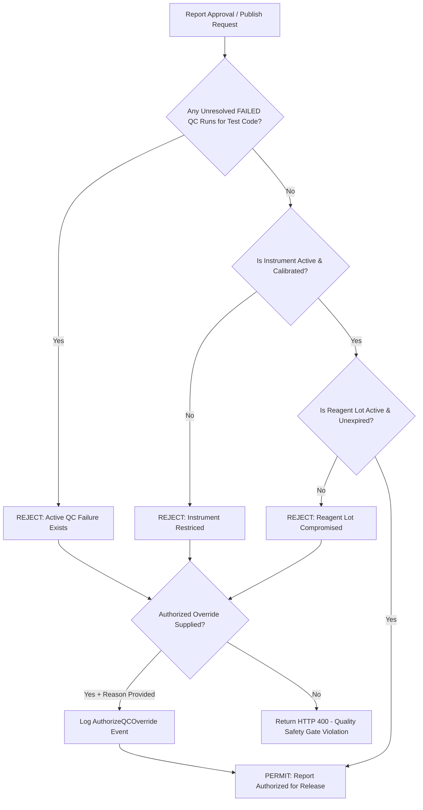

# Laboratory Quality Release Gates & Result Authorization

## 1. Safety Gate Overview

The Quality Release Gate serves as the definitive analytical circuit-breaker between laboratory test processing and report issuance. In high-throughput clinical laboratories, human oversight can inadvertently overlook a failing control run or a restricted analyzer. HealthBridge India enforces programmatic release gates directly inside the report review and publication services.

---

## 2. Programmatic Eligibility Checks

Before any report can be approved or published (`reviewReport` or `publishReport`), the system invokes `QCReleaseGateService.checkQCEligibility(laboratoryId, testCode, instrumentId, lotId)`:



### Response on Violation:
```json
{
  "success": false,
  "error": {
    "code": "QC_RESTRICTION_ACTIVE",
    "message": "Cannot release laboratory report: Test code GLUC has active QC rule violations or equipment lockouts.",
    "details": {
      "testCode": "GLUC",
      "eligible": false,
      "reasons": [
        "Test code GLUC has 1 unresolved failed QC run(s).",
        "Instrument ROCHE-COBAS-01 is OUT_OF_SERVICE."
      ],
      "blockingQCRunId": "67389a...f8",
      "instrumentStatus": "OUT_OF_SERVICE"
    }
  }
}
```

---

## 3. Audited Authorized Overrides

Under critical clinical emergencies (e.g. trauma center STAT request where an alternative method was cross-validated), a laboratory director or authorized quality specialist may override the release gate:

- Requires setting `overrideApproval: true` and providing an audited `overrideReason` (minimum 10 characters).
- The override event is recorded permanently in the report audit trail and logged to the central security audit log.
- Generates a clinical disclaimer flag on the resulting patient report identifying the override authorization.
