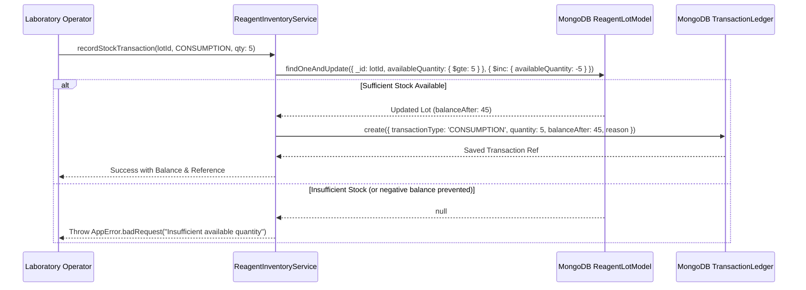

# Reagent & Consumable Inventory Management

## 1. Overview

Diagnostic test accuracy depends directly on chemical reagent viability. HealthBridge India implements an enterprise inventory tracking system featuring cold-chain storage validation, First-Expired-First-Out (FEFO) dispensing, batch lot quarantine/recalls, and an immutable double-entry transaction ledger.

---

## 2. Reagent Catalog & Storage Specifications

Reagents and consumables are categorized into:
- `REAGENT`: Reaction chemistry kits and enzymatic assays.
- `CALIBRATOR`: Analytical standard materials.
- `CONTROL`: Tri-level quality control specimens.
- `BUFFER`: Wash solutions, diluents, and rinse media.
- `STAIN`: Histopathology and hematology stains.
- `CONSUMABLE`: Pipette tips, reaction cuvettes, sample cups.

### Storage Conditions
Storage condition rules are explicitly enforced:
- `REFRIGERATED_2_8C`: Cold room storage (2°C to 8°C).
- `ROOM_TEMPERATURE`: Controlled ambient environment (15°C to 25°C).
- `FROZEN_MINUS_20C`: Freezer storage (-20°C).
- `DEEP_FREEZE_MINUS_80C`: Ultra-low temperature deep freeze (-80°C).

---

## 3. Lot-Level Tracking & FEFO Recommendation

Each received package is tracked as an independent lot:
- `lotNumber`: Manufacturer batch number.
- `expiryDate`: Expiry cutoff timestamp.
- `initialQuantity` & `availableQuantity`: Real-time stock counts.
- `daysToExpiry`: Dynamically computed countdown.
- `status`: `ACTIVE`, `EXPIRED`, `QUARANTINED`, `RECALLED`, `DEPLETED`.

### First-Expired-First-Out (FEFO):
The API endpoint `GET /laboratory/inventory/reagents/:id/fefo` evaluates all active lots for the specified reagent and recommends the lot with the nearest valid expiration date, minimizing shelf-life waste and ensuring optimal reagent turnover.

### Lot Safety Gate Validation:
The endpoint `GET /laboratory/inventory/reagents/lots/:id/validate` validates whether a lot can be used for test runs:
- Returns `{ valid: false, reason: "LOT_EXPIRED" }` if current date > expiryDate.
- Returns `{ valid: false, reason: "LOT_QUARANTINED" }` if quarantined.
- Returns `{ valid: false, reason: "LOT_RECALLED" }` if subject to a manufacturer recall notice.

---

## 4. Immutable Inventory Transaction Ledger

Stock movements are never performed via unrecorded updates. Every addition, consumption, and adjustment is recorded as an immutable transaction document in `reagent_inventory_transactions`:

The atomic `$gte` condition guarantees that concurrent analyzer runs cannot oversell stock or drive available quantity below zero.
