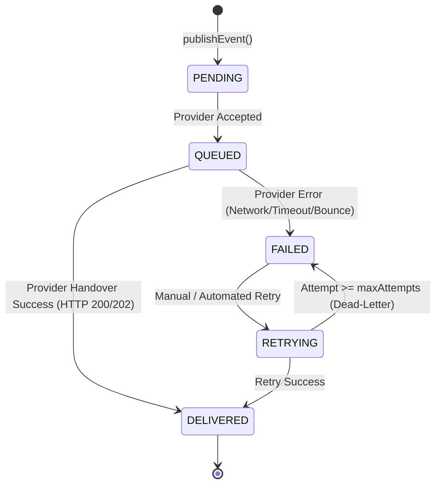

# HealthBridge India — Notification Delivery & Retry Engine

## 1. Overview & Architecture

Notification delivery in HealthBridge India operates through provider boundaries that isolate delivery mechanics from core business logic. Every message dispatched through `notificationService.publishEvent` registers delivery records in `NotificationDeliveryModel`, tracking status, attempts, error diagnostics, and timestamps.



---

## 2. Delivery Channels & Provider Boundaries

### 2.1 In-App Delivery Provider (`IN_APP`)
- **Transport**: Persistent MongoDB document storage + real-time Server-Sent Events push.
- **Provider**: Internal HealthBridge Core Engine.
- **Latency**: Sub-millisecond local DB write; immediate SSE socket dispatch.
- **Reliability**: Synchronous write, guaranteed at least once.

### 2.2 Email Delivery Provider (`EMAIL`)
- **Transport**: SMTP / AWS Simple Email Service (SES) API.
- **Provider Boundary**: `EmailDeliveryProvider` (in `apps/api/src/modules/notifications/services/notification-delivery.service.ts`).
- **Development/Test Mode**: Mock sandbox logger emitting structured JSON diagnostics (`[MOCK EMAIL DISPATCH] Recipient: <email> | Subject: <title>`).
- **Production Mode**: Configured with TLS 1.3, DKIM, and SPF validation.

### 2.3 SMS Delivery Provider (`SMS`)
- **Transport**: Twilio / Government National Informatics Centre (NIC) SMS Gateway.
- **Provider Boundary**: `SmsDeliveryProvider`.
- **Target Use Cases**: Time-sensitive Pickup Codes (`ORDER_READY_FOR_PICKUP`), urgent OTP verifications, security lockouts.
- **Character Limitation**: Enforces GSM-7 standard 160-character budget with transactional headers.

---

## 3. Delivery Record Schema (`NotificationDeliveryModel`)

Every delivery attempt is tracked in `NotificationDeliveryModel` with compound indexing on `{ userId: 1, createdAt: -1 }` and `{ status: 1, attemptCount: 1 }`:

```typescript
interface INotificationDeliveryDocument {
  notificationId: Types.ObjectId;
  userId: Types.ObjectId;
  channel: 'IN_APP' | 'EMAIL' | 'SMS' | 'PUSH';
  provider: string;
  status: 'PENDING' | 'QUEUED' | 'SENT' | 'DELIVERED' | 'FAILED' | 'RETRYING';
  attemptCount: number;
  maxAttempts: number;
  lastAttemptAt?: Date;
  deliveredAt?: Date;
  providerReference?: string;
  failureReason?: string;
  metadata?: Record<string, unknown>;
  createdAt: Date;
  updatedAt: Date;
}
```

---

## 4. Retry Policies & Failure Handling

1. **Attempt Limits**:
   - Standard max retry count: `3 attempts`.
   - After 3 failed attempts, status transitions to terminal `FAILED`.
2. **Idempotent Retries**:
   - Re-dispatching a delivery via `POST /api/v1/notifications/delivery-history/:id/retry` verifies that `status !== 'DELIVERED'` and `attemptCount < maxAttempts`.
   - On retry initiation, `attemptCount` increments, `status` becomes `RETRYING`, and `lastAttemptAt` is refreshed.
3. **Dead-Letter Audit**:
   - Failed transmissions remain queryable by pharmacy administrators and patients under `/pharmacy/notifications/history` with complete failure reasons (e.g. invalid phone format, recipient inbox full, provider rate limit).
