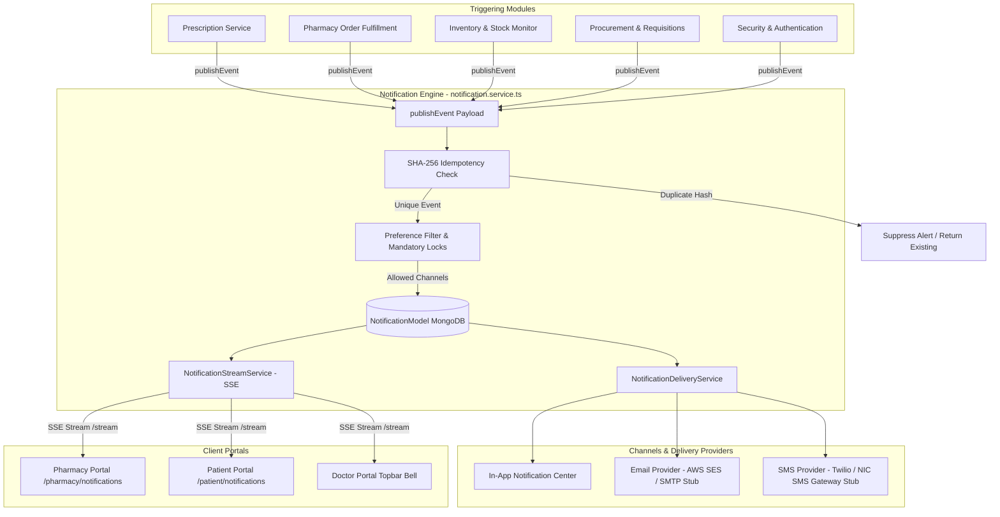

# HealthBridge India — Notification System Architecture

## 1. Executive Architecture Overview

HealthBridge India's Notification Architecture provides a centralized, multi-channel, event-driven notification hub connecting patients, doctors, and pharmacies. The system enforces strict healthcare privacy (zero disclosure of sensitive diagnoses, drug schedules, or clinical notes in notification previews), server-side idempotency, fine-grained user communication preferences, and real-time live streaming over Server-Sent Events (SSE).



---

## 2. Server-Sent Events (SSE) Real-Time Architecture

### 2.1 Connection Handshake & Lifecycle
The real-time streaming endpoint is hosted at `GET /api/v1/notifications/stream`.
- **Response Headers**:
  - `Content-Type: text/event-stream`
  - `Cache-Control: no-cache, no-transform`
  - `Connection: keep-alive`
  - `X-Accel-Buffering: no` (disables NGINX proxy buffering)
- **Authentication**:
  - Supports standard `Authorization: Bearer <token>` and HTTP-only session cookies.
  - Native browser `EventSource` cannot send custom HTTP headers; the `authenticate` middleware explicitly accepts `req.query.token` to enable seamless web client connection.
- **Heartbeat & Keep-Alive**:
  - Every 25 seconds, `NotificationStreamService` broadcasts `:keepalive\n\n` comments across active connections, preventing intermediary load balancers (AWS ALB, Cloudflare, NGINX) from terminating idle connections.
- **Auto-Cleanup**:
  - Node HTTP response `close` events unregister disconnected client streams automatically, preventing memory leaks.
- **Fallback**:
  - The frontend hook `useRealTimeNotificationStream` includes exponential polling fallback with TanStack Query invalidate queries if SSE is interrupted or unsupported.

---

## 3. Communication Preferences & Mandatory Security Rules

### 3.1 Preference Hierarchy
Every user profile maintains a `NotificationPreferenceModel` record governing delivery channels (`inApp`, `email`, `sms`) and category overrides (`PRESCRIPTION`, `ORDER`, `INVENTORY`, `PROCUREMENT`, `SECURITY`).

### 3.2 Mandatory Security Locks
Under healthcare security guidelines and Ayushman Bharat Digital Mission (ABDM) guidelines, security and critical account alerts must **never** be silenced.
- Mandatory categories: `['SECURITY']`.
- If a user attempts to disable `inApp` or `email` notifications for the `SECURITY` category (`PUT /api/v1/notifications/preferences`), the API strictly rejects the request with HTTP 400 Bad Request:
  ```json
  {
    "success": false,
    "message": "Security and account notifications are mandatory for patient safety and cannot be disabled.",
    "code": "BAD_REQUEST"
  }
  ```
- Defaults restoration (`POST /api/v1/notifications/preferences/reset`) instantly re-enables all recommended channels while preserving audit integrity.

---

## 4. Idempotency & Duplicate Suppression

Alert fatigue and redundant SMS/Email dispatches in clinical settings can cause critical oversights. To avoid duplicate notification floods:
- A deterministic SHA-256 idempotency key is computed for each event:
  $$\text{idempotencyKey} = \text{SHA-256}(\text{eventType} \parallel \text{recipientId} \parallel \text{entityId/title})$$
- A compound sparse unique index on `NotificationModel.idempotencyKey` prevents race conditions.
- When an event with an existing key is received within a short interval (e.g. repeated inventory threshold drops or webhook retransmissions), duplicate document creation is suppressed and the existing notification is returned cleanly.

---

## 5. Healthcare Privacy Enforcement

To comply with HIPAA and Indian Digital Personal Data Protection Act (DPDPA), notification payloads emitted across notifications, emails, and SMS contain **neutral, privacy-preserving messaging**:
- **Prohibited in Previews**: Diagnostic codes (ICD-10), clinical encounter notes, specific drug dosages or administration frequencies.
- **Allowed in Previews**: Order status changes, counter pickup codes, general prescription processing state, delivery milestones, low-stock threshold alerts.
- **Detail Access**: Detailed medical content remains gated behind authenticated, role-authorized record views (`/patient/prescriptions/[id]`, `/pharmacy/dispensing/[id]`).
