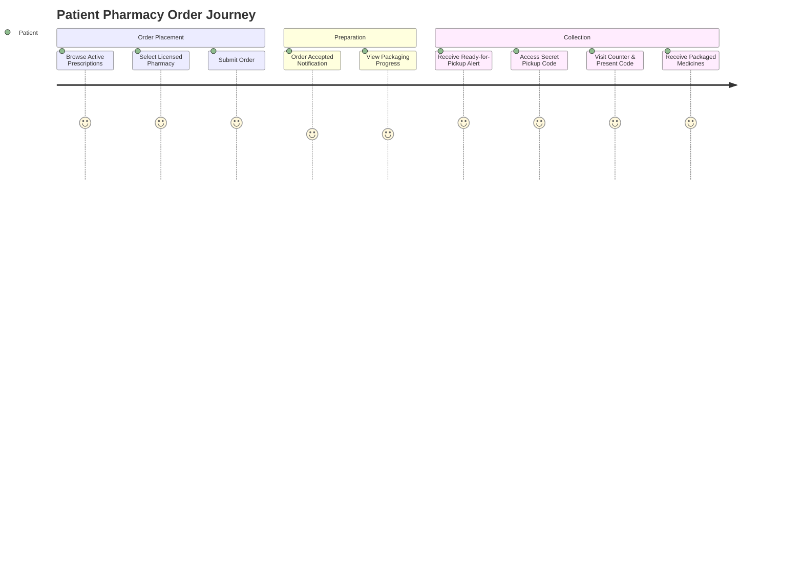

# HealthBridge India — Patient Order Tracking & Privacy Architecture

## 1. Overview & Patient Experience

The **Patient Order Tracking Module** provides authenticated patients with real-time visibility into the fulfillment status of their prescription orders, pickup locations, doctor instructions, and secret verification codes.



---

## 2. Patient Portal Routes

The following Next.js App Router routes power the patient experience:

1. **`/patient/orders`:**
   - Filter tabs: All, Active, Ready for Pickup, Completed, Cancelled.
   - Search by order number, pharmacy name, or prescription reference.
   - Highlights orders ready for collection with active pickup code badges.
   - Direct shortcuts to view tracking timeline or cancel eligible orders.

2. **`/patient/orders/[id]`:**
   - Complete medication item breakdown with prescribed dosage, duration, and meal instructions.
   - Price breakdown (Subtotal, 5% GST, Total Amount).
   - Linked prescription card with direct navigation to the original digital prescription.
   - Pharmacy contact details (pharmacy name, licensed address, phone number).

3. **`/patient/orders/[id]/tracking`:**
   - 5-step visual tracking stepper:
     1. Order Placed (`PENDING`)
     2. Order Reviewed & Accepted (`ACCEPTED`)
     3. Packaging & Preparation (`PROCESSING`)
     4. Ready for Collection (`READY_FOR_PICKUP`)
     5. Handover Completed (`COMPLETED`)
   - Prominent, high-contrast secret pickup code banner displayed only when status is `READY_FOR_PICKUP` or `COMPLETED`.
   - Immutable audit event timeline displaying every status transition, timestamp, and actor role.

---

## 3. Privacy Guards & Patient Protection

Healthcare privacy standards require strict segregation between clinical documentation, internal pharmacy operations, and patient-facing records:

### 1. Stripping Internal Operational Notes
- In `order-fulfillment.service.ts`, `mapToPatientOrderDto` explicitly strips `internalOperationalNotes`:
```typescript
private mapToPatientOrderDto(doc: IPharmacyOrderDocument): PharmacyOrderDto {
  const dto = this.mapToPharmacyOrderDto(doc);
  // PRIVACY ENFORCEMENT: Internal operational notes hidden from patient
  return {
    ...dto,
    internalOperationalNotes: undefined,
  };
}
```
- Pharmacist discussions regarding storage temperatures, distributor batches, or staff shift handovers are never leaked to the patient.

### 2. Multi-Tenant Patient Isolation
- All patient endpoints enforce `query.patientId = req.user.userId`.
- Any attempt to query or track an order belonging to another patient returns `404 Not Found`.

### 3. Prescription Integrity
- Prescribed dosage schedules, frequency, and doctor instructions are displayed read-only as written by the treating physician.
- Pharmacists cannot alter prescription instructions during order fulfillment.

