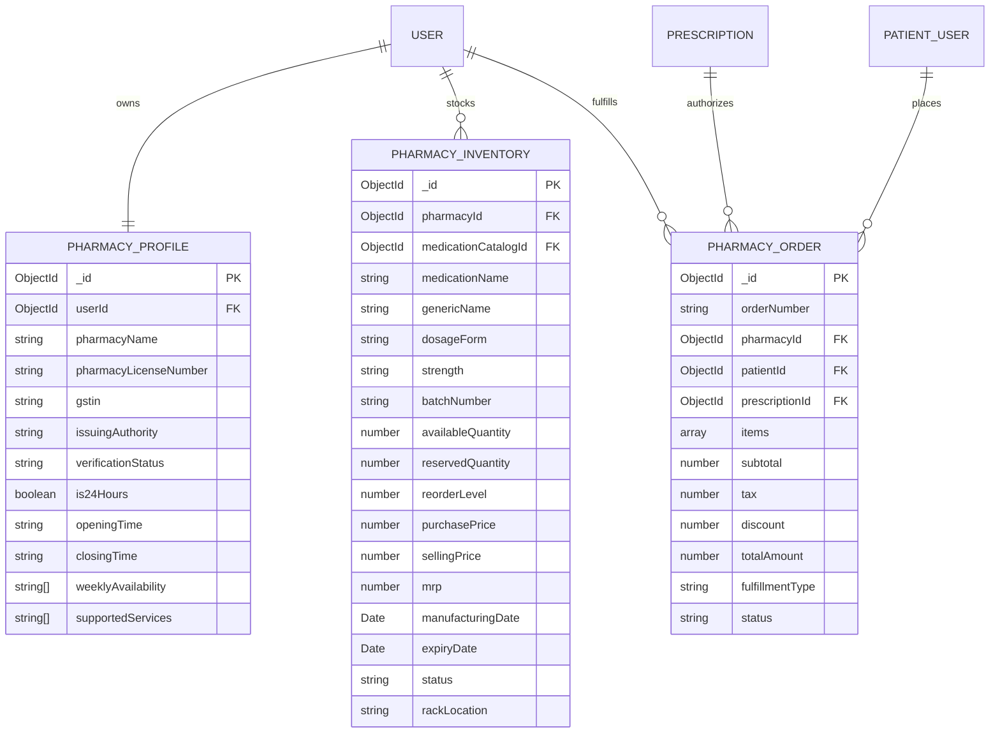

# HealthBridge India — Pharmacy Module Architecture

## 1. Executive Summary & Purpose
The **Pharmacy Module** of HealthBridge India delivers a secure, compliant digital dispensary platform that integrates with the Ayushman Bharat Digital Mission (ABDM) and complies with Central Drugs Standard Control Organization (CDSCO) regulations and the Drugs & Cosmetics Act, 1940.

The module bridges clinical care and pharmaceutical fulfillment, enabling licensed pharmacies to:
- Authenticate and manage licensed pharmacy dispensary profiles with statutory verification.
- Maintain pharmacy-scoped medication inventory with strict batch-level granularity.
- Receive digital electronic prescriptions (`e-Rx`) generated by authorized clinicians with tamper-evident immutability.
- Manage order queues for in-store collection and compliant home delivery.
- Prevent medical and medication dispensing hazards, such as dispensing expired batches, negative inventories, or unapproved alterations to medical directives.

---

## 2. Security & Access Control (RBAC Architecture)

### 2.1 Role Isolation & Multi-Tenancy
- **Exclusive Access**: Only users with `role: 'PHARMACY'` authenticated via signed RS256 JWT access tokens can invoke pharmacy endpoints (`/api/v1/pharmacy/*`).
- **Forbidden Roles**: Non-pharmacy roles (`PATIENT`, `DOCTOR`, `ADMIN`, `LABORATORY`) attempting to access pharmacy routes receive `403 FORBIDDEN` responses.
- **Zero-Trust Identity**: Front-end requests are prohibited from supplying tenant identifiers (`pharmacyId`, `userId`) in payloads or query parameters. The backend extracts `req.user.userId` exclusively from the verified server-side session.

### 2.2 Data Scoping & Multi-Tenancy Boundaries
- **Inventory Scoping**: Every database lookup, insertion, update, and deletion is constrained by `{ pharmacyId: req.user.userId }`. Under no circumstances can Pharmacy A view or modify the inventory records of Pharmacy B.
- **Order Scoping**: Orders are partitioned by `{ pharmacyId: req.user.userId }`.
- **Prescription Access (Data Minimization)**:
  - Pharmacies can view only finalized (`isDraft: false`), active/dispensed prescriptions (`status: { $in: ['ACTIVE', 'COMPLETED', 'DISPENSED'] }`).
  - Draft prescriptions created by doctors are completely hidden.
  - In compliance with the ABDM Health Data Management Policy, patient demographics are minimized strictly to necessary fulfillment attributes (`name`, `age`, `gender`, `phone`). Sensitive patient records (psychiatric history, diagnostic consultation notes, unrelated lab reports) are completely omitted from pharmacy access.
- **Doctor Clinical Directives Immutability**:
  - Doctor instructions, medication dosages, administration routes, and quantities are read-only (`immutable`).
  - Pharmacy personnel cannot alter prescribed dosage regimens.

### 2.3 Statutory Immutability Guard
- State drug licenses (`pharmacyLicenseNumber`), issuing drug authorities, and verification statuses (`verificationStatus`, `isVerified`) cannot be modified through the portal.
- Self-verification is strictly rejected. Only authorized ABDM/CDSCO platform administrators can transition verification states upon document auditing.

---

## 3. Data Architecture & Database Models

### 3.1 Indexes & Optimization
1. **Pharmacy Inventory**:
   - Compound unique index: `{ pharmacyId: 1, batchNumber: 1, medicationName: 1 }`
   - Filter indexes: `{ pharmacyId: 1, status: 1 }`, `{ pharmacyId: 1, expiryDate: 1 }`
2. **Pharmacy Order**:
   - Compound index: `{ pharmacyId: 1, orderNumber: 1 }` (unique)
   - Status tracking index: `{ pharmacyId: 1, status: 1 }`
   - Prescription linkage index: `{ prescriptionId: 1 }`

---

## 4. API Endpoints Specification

| Method | Endpoint | Description | Auth / Role |
| :--- | :--- | :--- | :--- |
| `GET` | `/api/v1/pharmacy/profile` | Retrieve establishment profile & license status | `PHARMACY` |
| `PATCH` | `/api/v1/pharmacy/profile` | Update operational hours, phone, services | `PHARMACY` |
| `GET` | `/api/v1/pharmacy/dashboard/summary` | Real-time KPI metrics, queue preview & alerts | `PHARMACY` |
| `GET` | `/api/v1/pharmacy/inventory` | Filtered list of pharmacy stock batches | `PHARMACY` |
| `POST` | `/api/v1/pharmacy/inventory` | Record intake of newly received batch | `PHARMACY` |
| `GET` | `/api/v1/pharmacy/inventory/:inventoryId`| Inspect batch details & stock balance | `PHARMACY` |
| `GET` | `/api/v1/pharmacy/inventory/alerts` | Urgent alerts (low stock, expiring batches) | `PHARMACY` |
| `GET` | `/api/v1/pharmacy/prescriptions` | Queue of finalized e-prescriptions | `PHARMACY` |
| `GET` | `/api/v1/pharmacy/prescriptions/:prescriptionId` | View e-prescription & immutable instructions | `PHARMACY` |
| `GET` | `/api/v1/pharmacy/orders` | List fulfillment orders (pickup & delivery) | `PHARMACY` |
| `POST` | `/api/v1/pharmacy/orders` | Create pharmacy fulfillment order | `PHARMACY` |
| `GET` | `/api/v1/pharmacy/orders/:orderId` | View itemized invoice and fulfillment info | `PHARMACY` |

---

## 5. Frontend Portal Design System

The Pharmacy Portal interface is built using Next.js App Router, Tailwind CSS, Lucide icons, and Shadcn UI conventions:
- **Theme Palette**: Deep slate/navy headers (`bg-slate-900`), clinical blue & teal accents (`sky-600`, `teal-600`), statutory warning amber (`amber-500`), and critical stock alert rose (`rose-600`).
- **Responsive Layout**:
  - `PharmacySidebar`: Collapsible sidebar on desktop with quick badges and mobile sliding drawer.
  - `PharmacyTopbar`: Contextual page titles, global quick search, real-time alert bell notification badge, and role-scoped profile dropdown.
- **Route Hierarchy**:
  - `/pharmacy` -> Redirects to `/pharmacy/dashboard`
  - `/pharmacy/dashboard` -> Operational overview with KPI cards, e-Rx queue preview, inventory alerts, quick actions, and recent audit activity.
  - `/pharmacy/profile` -> Statutory verification status, drug license info, editable contact info, operating hours, and service capabilities.
  - `/pharmacy/inventory` -> Batch-level inventory catalog with search, status filters, and modal to record new stock batches.
  - `/pharmacy/prescriptions` -> Doctor e-prescription queue with item preview and detailed inspection modal displaying immutable clinical directives.
  - `/pharmacy/orders` -> Order tracking with status tabs, fulfillment types (In-Store Pickup vs Home Delivery), and itemized billing invoices.
  - `/pharmacy/dispensing` -> Foundation console explaining batch deduction workflows and preparing for Task 02.
  - `/pharmacy/notifications` -> Real-time alert list highlighting near-expiry batches and stock deficits.
  - `/pharmacy/settings` -> Configuration hub linking to profile, notifications, and central IAM authentication.

