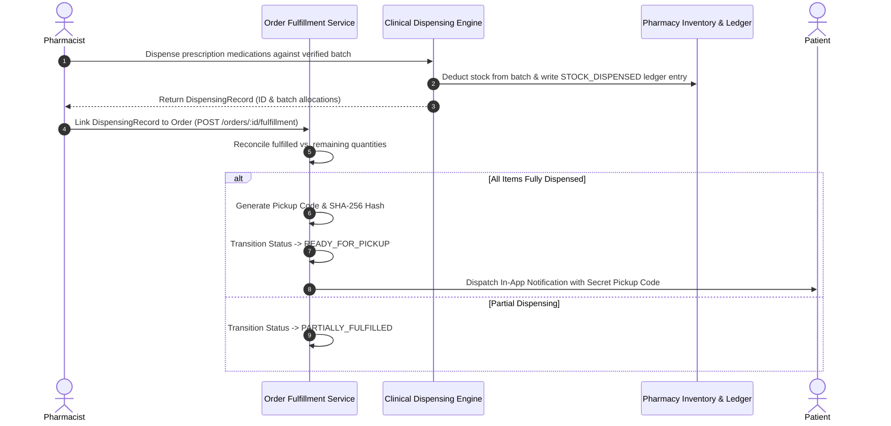
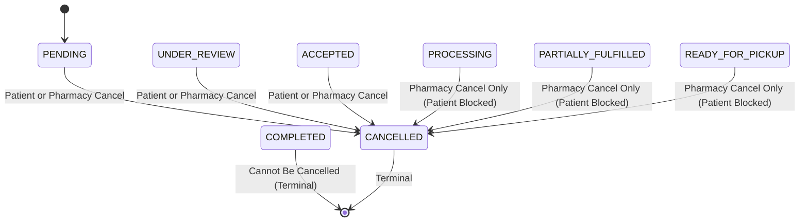

# HealthBridge India — Pharmacy Order Fulfillment & Pickup Handover

## 1. Dispensing Integration & Inventory Control

In adherence to statutory healthcare guidelines under India's **Drugs and Cosmetics Rules, 1945**, the pharmacy order fulfillment module **never** performs direct, unverified batch deductions from UI clicks.

Instead, order fulfillment strictly integrates with the clinical dispensing module (`DispensingRecordModel`):

### Stock Deduction Guarantees
- The order fulfillment module links existing `dispensingRecordId` references without executing secondary stock subtractions.
- Every physical medicine departure maps to a unique `STOCK_DISPENSED` entry in `PharmacyInventoryTransactionModel`.
- If an order is cancelled after partial dispensing, existing dispensing records and deducted stock remain in the immutable audit ledger. Inventory is not automatically restored to active shelves without an authorized formal return/adjustment workflow.

---

## 2. Zero-Knowledge Pickup Code Verification

To prevent unauthorized medication interception or internal staff impersonation, the system implements a **Zero-Knowledge Pickup Verification** protocol:

### Code Generation & Storage
- When an order transitions to `READY_FOR_PICKUP`, the backend generates a cryptographically random, unpredictable pickup code:
$$\text{Code} = \text{PKUP-} + \text{crypto.randomBytes}(3).\text{toString}('hex').\text{toUpperCase}()$$
*(e.g., `PKUP-A4F9E2`)*
- The database stores only the **SHA-256 one-way hash** of this code (`pickupCodeHash`):
$$\text{pickupCodeHash} = \text{SHA-256}(\text{Code})$$
- The plaintext code is sent exclusively to the patient via secure in-app notification and authenticated dashboard portal.
- **Zero-Knowledge Privacy:** Prior to physical counter verification, the pharmacy API deliberately strips `pickupReference` from all pharmacy staff responses. Staff cannot read the code in advance.

### Handover Authorization & Brute-Force Lockout
- At the pharmacy counter, the patient presents their secret pickup code.
- Pharmacy staff enters the code via `/pharmacy/orders/[id]/pickup`.
- The backend normalizes the submitted string, computes its SHA-256 hash, and compares it against `pickupDetails.pickupCodeHash`:
  - **Success:** Handover recorded; status transitions to `COMPLETED`; `collectedAt`, `handedOverBy`, and `handedOverByName` are permanently logged.
  - **Mismatch:** The attempt counter (`verificationAttempts`) increments by 1. The remaining attempts count is returned in the error response.
  - **Brute-Force Defense:** If `verificationAttempts >= 5`, automated verification is permanently locked (`403 Forbidden`). Staff must verify physical government ID (Aadhaar / Voter ID) and request supervisory authorization.
  - **Expiration:** Pickup codes expire after 7 days (`expiresAt`). Expired codes cannot be verified.

---

## 3. Order Cancellation Rules & State Guards

Order cancellation follows strict clinical governance:

1. **Patient Cancellation Window:**
   - Allowed in: `PENDING`, `UNDER_REVIEW`, `ACCEPTED`.
   - Prohibited in: `PROCESSING`, `PARTIALLY_FULFILLED`, `READY_FOR_PICKUP`, `COMPLETED`. Once pharmacy staff begins packing medications or has staged them for pickup, patients cannot cancel online without contacting the pharmacy directly.
2. **Pharmacy Operational Cancellation:**
   - Permitted before final handover if packaging fails, batches are damaged, or supervisory recall occurs.
   - Requires mandatory cancellation reason explanation.
3. **Completed Orders Are Non-Cancellable:**
   - Once counter verification succeeds and medications are physically handed over (`COMPLETED`), the order can never transition to `CANCELLED`.

