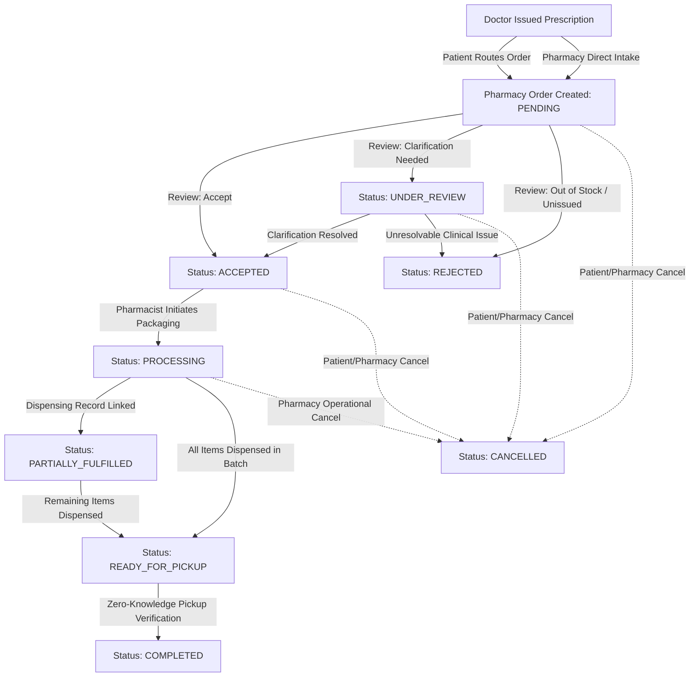

# HealthBridge India — Pharmacy Order Management System

## 1. Overview & Architecture

The **Pharmacy Order Management System** coordinates prescription-backed order intake, review, clinical clarification, and fulfillment workflows across HealthBridge India's distributed healthcare infrastructure. 

### Key Architectural Tenets
1. **Prescription Invariance:** Orders derive strictly from authenticated, non-expired, active doctor prescriptions (`PrescriptionModel`). The pharmacy order never substitutes or overrides the doctor's clinical prescription.
2. **Duplicate Order Prevention:** The system strictly prevents duplicate active orders for the same prescription at the same pharmacy (`prescriptionId + pharmacyId + status not in [CANCELLED, REJECTED]`).
3. **Multi-Tenancy Isolation:** All pharmacy queries filter strictly by `pharmacyId: req.user.userId`. Pharmacy staff cannot access orders or patient records assigned to another licensed pharmacy.
4. **Data Privacy Guardrails:** Internal operational notes (`internalOperationalNotes`) and clinical clarification discussions are withheld from patient-facing API responses.

---

## 2. Order Lifecycle & State Machine

The order lifecycle follows strict finite-state transitions enforced by the domain layer:

| Status | Permitted Next Transitions | Initiator | Description |
| :--- | :--- | :--- | :--- |
| `PENDING` | `UNDER_REVIEW`, `ACCEPTED`, `REJECTED`, `CANCELLED` | Patient / Pharmacy | Order placed from issued prescription; awaiting pharmacy queue review. |
| `UNDER_REVIEW` | `ACCEPTED`, `REJECTED`, `CANCELLED` | Pharmacy | Pharmacist flagged a clinical discrepancy or stock check; awaiting clarification. |
| `ACCEPTED` | `PROCESSING`, `CANCELLED` | Pharmacy | Pharmacist confirmed medication availability; scheduled preparation. |
| `PROCESSING` | `PARTIALLY_FULFILLED`, `READY_FOR_PICKUP`, `CANCELLED` | Pharmacy | Pharmacy staff picking, labeling, and packing prescribed drugs. |
| `PARTIALLY_FULFILLED`| `PROCESSING`, `READY_FOR_PICKUP`, `CANCELLED` | Pharmacy | Some items dispensed via clinical dispensing module; remainder pending. |
| `READY_FOR_PICKUP` | `COMPLETED`, `DISPATCHED`, `CANCELLED` | Pharmacy | Medications packaged, sealed, and staged at counter with pickup hash. |
| `DISPATCHED` | `COMPLETED`, `CANCELLED` | Pharmacy | Handed to delivery driver (if delivery fulfillment mode is enabled). |
| `COMPLETED` | *Terminal (None)* | Patient & Staff | Secret pickup reference code verified and medications physically handed over. |
| `REJECTED` | *Terminal (None)* | Pharmacy | Pharmacy declined order with mandatory reason code and explanation. |
| `CANCELLED` | *Terminal (None)* | Patient / Pharmacy | Order terminated with audit trail; dispensed stock preserved in ledger. |

---

## 3. Order Review & Clinical Clarification Workflow

Pharmacists review incoming prescription orders via `/pharmacy/orders/[id]`:

### Acceptance
- Pharmacist inputs estimated readiness time (`estimatedReadiness: ISO string`) and internal packaging instructions (`notes`).
- Status transitions to `ACCEPTED`.
- In-app notification is dispatched to the patient.

### Rejection
- Mandatory rejection reason code (`reasonCode`):
  - `STOCK_UNAVAILABLE`
  - `PRESCRIPTION_EXPIRED`
  - `CLINICAL_CLARIFICATION_NEEDED`
  - `DOSAGE_DISCREPANCY`
  - `OTHER`
- Mandatory explanation (`reason`): Minimum 3 characters detailing the clinical or stock reason.
- Status transitions to `REJECTED`.
- In-app notification informs the patient to choose another partner pharmacy or contact their doctor.

### Clinical Clarification
- Pharmacist logs queries regarding ambiguous doctor instructions or dosage schedules without altering prescription records.
- Status transitions to `UNDER_REVIEW`.
- Flag `clarificationRequested: true` is displayed prominently on dashboard cards.

---

## 4. Financial Calculations & Item Management

Order items are mapped automatically from prescription line items:
- Requested quantity (`requestedQuantity`), fulfilled quantity (`fulfilledQuantity`), and remaining quantity (`remainingQuantity`) are tracked per medication.
- Standard 5% GST on scheduled medicines is calculated server-side:
$$\text{Subtotal} = \sum (\text{item.requestedQuantity} \times \text{item.unitPrice})$$
$$\text{Tax} = \text{round}(\text{Subtotal} \times 0.05)$$
$$\text{Total Amount} = \text{Subtotal} + \text{Tax} - \text{Discount}$$
- Doctor instructions (frequency, duration, meal timing) are immutably preserved on each order item.

---

## 5. Pharmacy Order Analytics & Metrics

Endpoint `GET /api/v1/pharmacy/orders/metrics` computes real-time operational KPIs:
- **Total Orders & Status Distribution:** Breakdown across `PENDING`, `UNDER_REVIEW`, `ACCEPTED`, `PROCESSING`, `READY_FOR_PICKUP`, `COMPLETED`, `REJECTED`, `CANCELLED`.
- **Today's Revenue:** Sum of completed order totals closed today.
- **Average Turnaround Time:** Elapsed duration from order creation to counter pickup handover:
$$\text{Avg Turnaround} = \frac{\sum (\text{order.updatedAt} - \text{order.createdAt})}{\text{Count}(\text{Completed Orders})}$$

