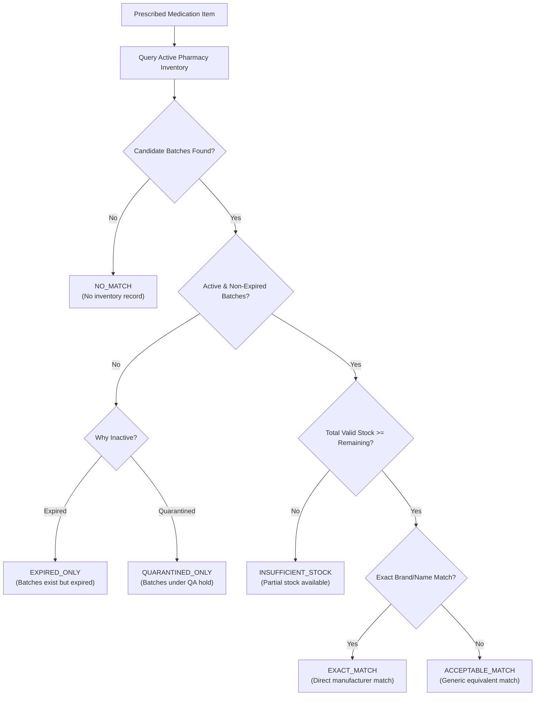

# HealthBridge India — Pharmacy Prescription Verification & Matching Architecture

## 1. Overview & Regulatory Context

In compliance with the **Drugs and Cosmetics Act, 1940**, **Drugs and Cosmetics Rules, 1945**, **Pharmacy Act, 1948**, and **Ayushman Bharat Digital Mission (ABDM) Health Data Management Policy**, digital prescriptions dispensed through the HealthBridge India platform must undergo rigorous multi-point verification before any medication can be dispensed.

Pharmacies are strictly prohibited from modifying doctor dosages, instructions, or performing silent drug substitutions. The system enforces cryptographic authenticity, practitioner identity verification, validity window checks, and patient privacy through minimal necessary data exposure.

---

## 2. Seven-Point Verification Architecture

When a pharmacy initiates verification (`GET /api/v1/pharmacy/prescriptions/:prescriptionId/verify`), the engine evaluates seven mandatory gates:

| # | Verification Gate | Condition Enforced | Failure Status Code |
|---|---|---|---|
| **1** | **Prescription Existence** | Prescription must exist in MongoDB registry | `404 Not Found` |
| **2** | **Finalized Status** | `isDraft === false` (Must not be doctor work-in-progress draft) | Ineligible / Rejected |
| **3** | **Prescribing Doctor Identity** | Doctor reference exists and practitioner profile is active | Ineligible / Rejected |
| **4** | **Patient Identity Verification** | Patient user account exists with authorized consent artifact | Ineligible / Rejected |
| **5** | **Validity Window** | `validUntil > now` (Prescription validity has not expired) | `EXPIRED` |
| **6** | **Cancellation / Revocation Check** | `status !== 'CANCELLED' && status !== 'DISCONTINUED'` | `REVOKED` |
| **7** | **Dispensing Status & Balance** | Total remaining units > 0 across prescribed medications | `ALREADY_DISPENSED` |

### Minimum Necessary Data Disclosure

To comply with ABDM patient privacy norms:
- Prescriptions displayed in the pharmacy portal do **not** expose sensitive clinical notes or unrelated diagnoses.
- Only prescribing doctor credentials (name, specialization, MCI/SMC registration number), attending facility, and prescribed items with frequency and dosage are revealed.
- Patient phone number and age are displayed only for identity cross-verification at the dispensing counter.

---

## 3. Medicine Matching Engine & Status Classification

For each medication line item in an authorized prescription, the pharmacy inventory engine matches items against the pharmacy's active batch inventory (`PharmacyInventoryModel`):



### Match Status Matrix

| Match Status | Definition | Dispensing Permitted |
|---|---|---|
| `EXACT_MATCH` | Inventory batch medication name or brand matches prescribed name exactly. | Yes |
| `ACCEPTABLE_MATCH` | Matching generic active ingredient and matching strength/dosage form. Flagged explicitly to prevent silent substitution. | Yes (Pharmacist Confirmation) |
| `INSUFFICIENT_STOCK` | Matching inventory exists, but total valid quantity is less than remaining prescribed quantity. Supports partial dispensing. | Yes (Up to available stock) |
| `EXPIRED_ONLY` | Matching inventory batches exist, but all available batches have passed expiry date. | Strictly No |
| `QUARANTINED_ONLY` | Matching batches exist, but all are under QA or regulatory quarantine hold. | Strictly No |
| `NO_MATCH` | Pharmacy holds zero inventory corresponding to generic or brand name. | Strictly No |

---

## 4. FEFO (First Expiry, First Out) Algorithm

To prevent expired medication accumulation and comply with CDSCO Good Pharmacy Practice guidelines, candidate batches are sorted using First Expiry, First Out:

1. Query active batches matching `pharmacyId: req.user.userId`.
2. Filter out batches with `status === 'DISCONTINUED'`, `isQuarantined === true`, or `expiryDate <= now`.
3. Sort batches ascending by `expiryDate: 1`, secondary descending by `availableQuantity: -1`.
4. The first eligible batch with `availableQuantity > 0` receives the flag `isFefoSuggested: true`.
5. The UI automatically highlights this recommended batch with a priority tag and pre-selects it for one-click dispensing.

---

## 5. API Endpoints

### 1. Verify Prescription
`GET /api/v1/pharmacy/prescriptions/:prescriptionId/verify`

**Sample Response:**
```json
{
  "success": true,
  "message": "Prescription verified successfully",
  "data": {
    "prescriptionId": "6af872692e3e8eda3421fe5d",
    "prescriptionNumber": "RX-202611-0042",
    "isEligibleForDispensing": true,
    "verificationStatus": "VERIFIED",
    "verificationChecks": {
      "prescriptionExists": true,
      "isNotDraft": true,
      "doctorExists": true,
      "patientExists": true,
      "notExpired": true,
      "notCancelled": true,
      "notFullyDispensed": true,
      "pharmacyPermitted": true
    },
    "verificationErrors": [],
    "patient": {
      "id": "6af872692e3e8eda3421fe47",
      "name": "Rohit Verma",
      "age": 39,
      "gender": "MALE",
      "phone": "9876543210"
    },
    "doctor": {
      "id": "6af872692e3e8eda3421fe46",
      "name": "Dr. Suresh Deshmukh",
      "specialization": "Cardiology",
      "licenseNumber": "MCI-1994-04921"
    },
    "facilityName": "Apollo Hospital",
    "issueDate": "2026-11-14T14:00:00.000Z",
    "validUntil": "2026-11-29T14:00:00.000Z",
    "prescriptionStatus": "ACTIVE",
    "instructions": "Take medicines after meals with warm water.",
    "items": [
      {
        "prescribedMedicationId": "med-1",
        "medicationName": "Paracetamol 650mg",
        "genericName": "Paracetamol",
        "strength": "650mg",
        "dosageForm": "Tablet",
        "dosage": "1 tab",
        "frequency": "1-0-1",
        "duration": "5 days",
        "prescribedQuantity": 10,
        "previouslyDispensedQuantity": 0,
        "remainingQuantity": 10,
        "isFullyDispensed": false,
        "instructions": "After food"
      }
    ],
    "totalItemsCount": 1,
    "totalPrescribedUnits": 10,
    "totalRemainingUnits": 10
  }
}
```

### 2. Match Prescription Inventory
`GET /api/v1/pharmacy/prescriptions/:prescriptionId/match-inventory`

