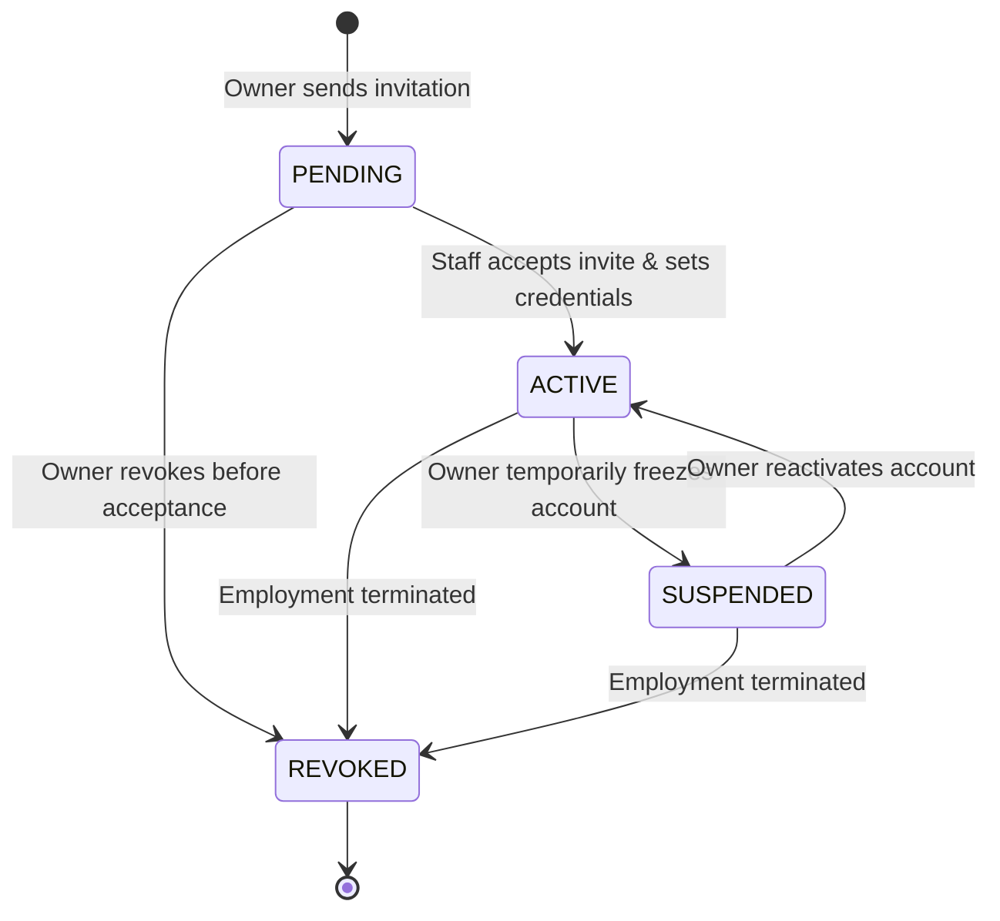

# HealthBridge India — Pharmacy Staff Management Architecture

## 1. Overview & Operational Model

Healthcare dispensing operations require segregation of duties among clinical and administrative staff members. In hospital pharmacies and large retail dispensaries, inventory stockers, billing clerks, and procurement agents must not possess unmonitored dispensing authority or the ability to alter statutory settings.

The Pharmacy Staff Management module provides a tenant-scoped Identity and Access Management (IAM) framework tailored to pharmacy workflows:
- **Tenant Isolation:** Staff members are explicitly attached to a specific `PharmacyProfile` record.
- **Granular Permissions Matrix:** 10 discrete permissions mapped to clinical and supply chain operations.
- **Cryptographic Invitation Lifecycle:** Secure token generation with 7-day expiration for staff onboarding.
- **Active State Machine:** Seamless transition between `ACTIVE`, `SUSPENDED`, and `REVOKED` states with automatic session invalidation upon suspension or revocation.

---

## 2. Staff Roles & Permission Matrix

The system defines 6 pharmacy-scoped roles:
1. `PHARMACY_OWNER`: Ultimate facility administrator with root control over licensing, bank accounts, and staff.
2. `PHARMACY_MANAGER`: Operational lead managing day-to-day dispensing, procurement, and staff status.
3. `PHARMACIST`: Registered clinical professional authorized to verify prescriptions, match batches, and dispense drugs.
4. `INVENTORY_STAFF`: Stock room personnel handling stock-in, transfers, and inventory reconciliations.
5. `PROCUREMENT_STAFF`: Purchasing team managing suppliers, purchase orders, and goods receiving.
6. `ORDER_STAFF`: Counter personnel handling in-store pickup, packaging, and delivery fulfillment.

### 10 Granular Permissions
- `DISPENSE_MEDICINE`: Authority to match prescription lines and record dispensing events.
- `MANAGE_INVENTORY`: Authority to perform stock-in, write-offs, and batch edits.
- `VIEW_INVENTORY`: Read-only access to catalogue, batches, and current stock levels.
- `MANAGE_PURCHASE_ORDERS`: Authority to create, edit, and approve vendor purchase orders.
- `MANAGE_SUPPLIERS`: Authority to onboard and edit vendor profiles and catalogues.
- `MANAGE_ORDERS`: Authority to manage patient orders, packing, and fulfillment.
- `VIEW_REPORTS`: Access to inventory valuation, sales reports, and turnover analytics.
- `MANAGE_SETTINGS`: Authority to alter operating hours, delivery radius, and service capabilities.
- `MANAGE_STAFF`: Authority to invite, suspend, update, or revoke dispensary personnel.
- `VIEW_PRESCRIPTIONS`: Read-only access to doctor prescriptions routed to the dispensary.

### Role-to-Permission Mapping Table

| Permission | OWNER | MANAGER | PHARMACIST | INVENTORY | PROCUREMENT | ORDER_STAFF |
|---|:---:|:---:|:---:|:---:|:---:|:---:|
| `DISPENSE_MEDICINE` | ✅ | ✅ | ✅ | ❌ | ❌ | ❌ |
| `VIEW_PRESCRIPTIONS` | ✅ | ✅ | ✅ | ❌ | ❌ | ✅ |
| `MANAGE_INVENTORY` | ✅ | ✅ | ❌ | ✅ | ❌ | ❌ |
| `VIEW_INVENTORY` | ✅ | ✅ | ✅ | ✅ | ✅ | ✅ |
| `MANAGE_PURCHASE_ORDERS` | ✅ | ✅ | ❌ | ❌ | ✅ | ❌ |
| `MANAGE_SUPPLIERS` | ✅ | ✅ | ❌ | ❌ | ✅ | ❌ |
| `MANAGE_ORDERS` | ✅ | ✅ | ✅ | ❌ | ❌ | ✅ |
| `VIEW_REPORTS` | ✅ | ✅ | ❌ | ❌ | ❌ | ❌ |
| `MANAGE_SETTINGS` | ✅ | ❌ | ❌ | ❌ | ❌ | ❌ |
| `MANAGE_STAFF` | ✅ | ❌ | ❌ | ❌ | ❌ | ❌ |

---

## 3. Database Model & Integrity Constraints

Staff records are maintained in `PharmacyStaffModel` (`apps/api/src/modules/pharmacy/models/pharmacy-staff.model.ts`):

```typescript
export interface IPharmacyStaff extends Document {
  pharmacyId: Types.ObjectId;
  userId?: Types.ObjectId; // Bound upon invite acceptance
  staffId: string;        // Human-readable identifier (e.g. STF-001)
  name: string;
  email: string;
  phone: string;
  role: PharmacyStaffRole;
  permissions: PharmacyPermission[];
  status: PharmacyStaffStatus; // 'PENDING' | 'ACTIVE' | 'SUSPENDED' | 'REVOKED'
  registrationNumber?: string; // State pharmacy council registration if pharmacist
  invitationToken?: string;
  invitationExpiresAt?: Date;
  invitedAt: Date;
  joinedAt?: Date;
  lastActiveAt?: Date;
}
```

### Unique Indexing Rules
1. `{ pharmacyId: 1, email: 1 }`: Unique compound index ensuring an email can only be invited once per pharmacy while allowing legitimate multi-pharmacy employment across distinct facilities.
2. `{ pharmacyId: 1, staffId: 1 }`: Unique human-readable staff code within each dispensary.
3. `{ invitationToken: 1 }`: Sparse unique index enabling instant O(1) lookup during onboarding token verification.

---

## 4. Staff Lifecycle & Session Revocation



### Automatic Session Invalidation
When an administrator suspends or revokes a staff member:
1. `PharmacyStaffModel.updateOne` transitions status to `SUSPENDED` or `REVOKED`.
2. If the staff member has a linked `userId`, `RefreshTokenModel.updateMany({ userId, isRevoked: false }, { isRevoked: true, revokedAt: new Date() })` immediately invalidates all active refresh tokens.
3. The auth middleware immediately blocks subsequent API requests made with existing tokens, preventing unauthorized actions post-suspension.

---

## 5. Security & Boundary Defenses

1. **Cross-Pharmacy Tenant Isolation:** Every staff API query enforces `{ pharmacyId: req.pharmacy._id }`. An authenticated pharmacy attempting to inspect or alter staff IDs belonging to another dispensary receives `404 Not Found`.
2. **Duplicate Protection:** Attempting to invite an existing active or pending email within the same pharmacy triggers `409 Conflict`.
3. **Invitation Expiry:** Tokens carry a 7-day TTL (`Date.now() + 7 * 24 * 3600 * 1000`). Expired tokens are rejected with `400 Bad Request`.
4. **Audit Logging:** Every invite, role change, status update, suspension, and revocation generates an immutable `AuditLogModel` entry recording the acting user, target staff ID, and timestamp.
