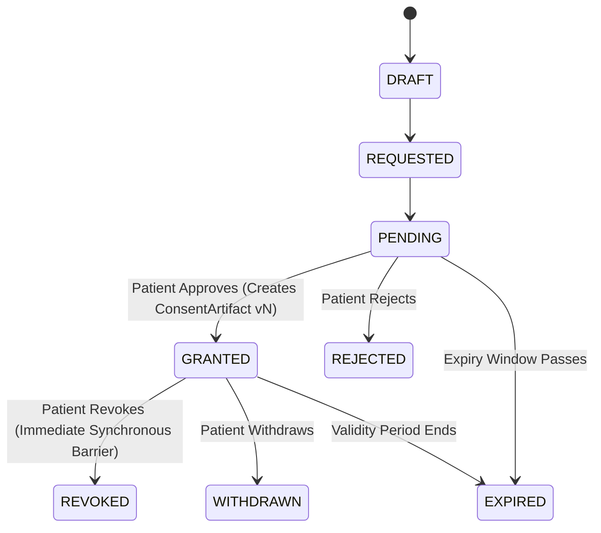

# HealthBridge India — Centralized Consent Governance (Day 9 Task 02)

**Reused Authoritative Models (Zero Duplicate Consent Collections):**
- `apps/api/src/modules/consent/models/consent-request.model.ts`
- `apps/api/src/modules/consent/models/consent-artifact.model.ts`
- `apps/api/src/modules/consent/services/consent-enforcement.service.ts`
- `apps/api/src/security/consent.adapter.ts`

---

## 1. Consent Lifecycle States

---

## 2. Consent Governance Extensions Applied in Day 9 Task 02

Without creating a second consent collection, `ConsentRequestModel` and `ConsentArtifactModel` were safely extended with:
- `consentVersion` (monotonic integer >= 1, preserving versioned consent history without overwriting prior records)
- `permittedOperations` (e.g., `['VIEW']`)
- `sourceOfConsent` (`PATIENT_PORTAL` | `ABDM_GATEWAY` | `CLINICAL_WORKFLOW`)
- `receiptNumber` & `transactionReference`
- Explicit `'DRAFT'` and `'WITHDRAWN'` states alongside `PENDING`, `REQUESTED`, `APPROVED`, `GRANTED`, `REJECTED`, `DENIED`, `EXPIRED`, and `REVOKED`.

---

## 3. Core Privacy Guarantees

1. **No Blanket Consent on Registration:** Creating a HealthBridge patient account never grants doctors, pharmacies, labs, or external systems blanket permission to view medical records.
2. **Granular, Purpose-Bound, Time-Bound Artefacts:** Every `ConsentArtifact` captures `patientId`, `requesterId`, `organization`, `purpose`, `permittedDataTypes`, and `validityPeriod.{from, to}`.
3. **Immediate Synchronous Revocation:** Revoking a consent immediately registers the consent ID in `ConsentEnforcementService.invalidateConsentImmediately(...)`, blocking subsequent access synchronously without waiting for async event workers.
4. **Immutable Consent History:** Prior consent requests and artefacts remain preserved in `consentRequests` and `consentArtifacts` for patient inspection and regulatory auditability.
