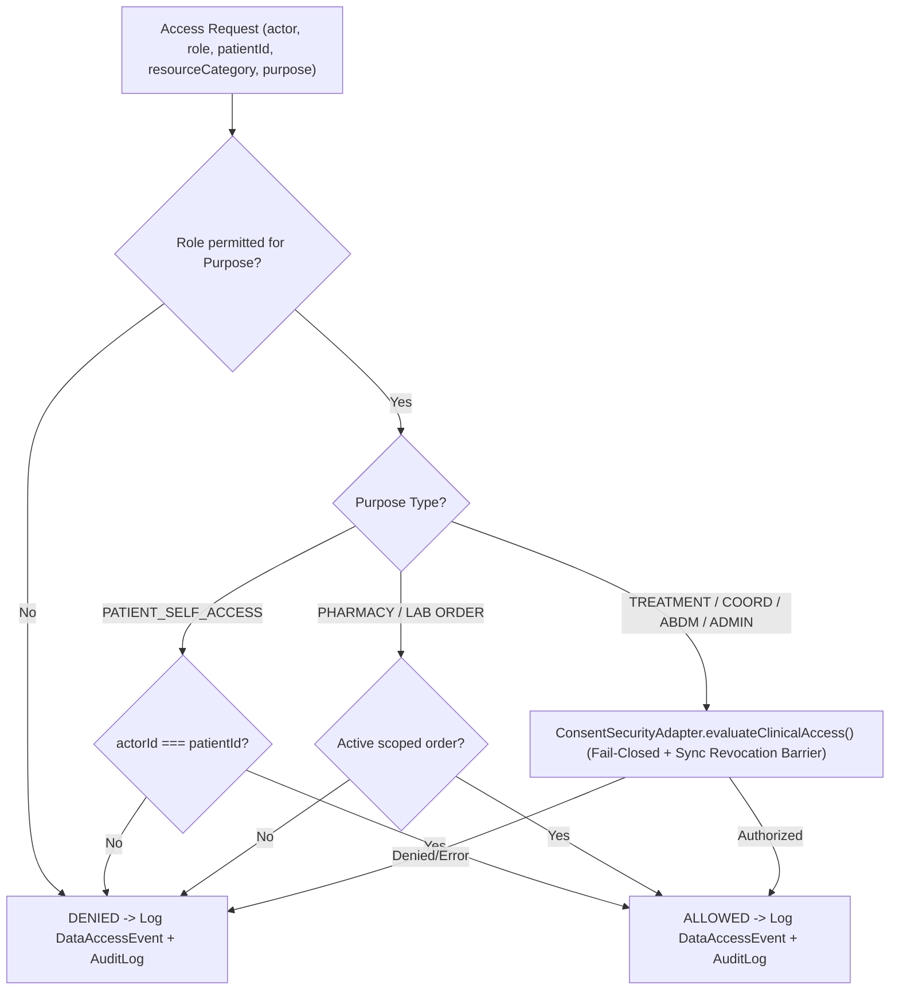

# HealthBridge India — Purpose-Based Access Control (Day 9 Task 02)

**Authoritative Engine:** `apps/api/src/modules/privacy/purpose-access.policy.ts` (`PurposeBasedAccessService`)

---

## 1. Supported Access Purposes & Lawful Basis Matrix

HealthBridge explicitly distinguishes workflows governed by **patient self-access**, **active care-order fulfillment**, **explicit patient consent**, and **audited administrative governance** — rather than forcing every operational workflow onto consent where a separate lawful or clinical basis applies.

| Access Purpose | Permitted Actor Roles | Lawful Basis | Additional Requirement | Fail-Closed Behavior |
|---|---|---|---|---|
| `PATIENT_SELF_ACCESS` | `PATIENT` | `PATIENT_SELF_ACCESS` | `actorId === patientId` | Any cross-patient ID denied (`DENIED` logged). |
| `TREATMENT` | `DOCTOR` | `EXPLICIT_PATIENT_CONSENT` | Active, non-expired, non-revoked consent matching `resourceCategory` | Missing, expired, revoked, or category-mismatched consent denied. |
| `HEALTHCARE_COORDINATION` | `DOCTOR` | `EXPLICIT_PATIENT_CONSENT` | Active consent or care relationship verified via `ConsentSecurityAdapter` | Denied if authorization cannot be verified. |
| `ABDM_HEALTH_INFORMATION_EXCHANGE` | `DOCTOR` | `EXPLICIT_PATIENT_CONSENT` | Explicit ABDM consent artefact + synchronous revocation check | Denied immediately on revocation or expiry. |
| `PHARMACY_FULFILLMENT` | `PHARMACY` | `ACTIVE_CARE_ORDER_FULFILLMENT` | `hasActiveCareOrderScope === true` (assigned/eligible prescription order) | Unscoped pharmacy access denied (`DENIED` logged). |
| `LABORATORY_SERVICE` | `LABORATORY` | `ACTIVE_CARE_ORDER_FULFILLMENT` | `hasActiveCareOrderScope === true` (assigned diagnostic lab order) | Unscoped lab access denied (`DENIED` logged). |
| `ADMINISTRATIVE_OPERATIONS` | `ADMIN` | `AUDITED_ADMINISTRATIVE_GOVERNANCE` | Explicit `adminBreakGlassReason` (>= 10 chars) for any clinical inspection | Denied by default (`ADMIN` has zero automatic unrestricted clinical access). |

---

## 2. Evaluation Flow

