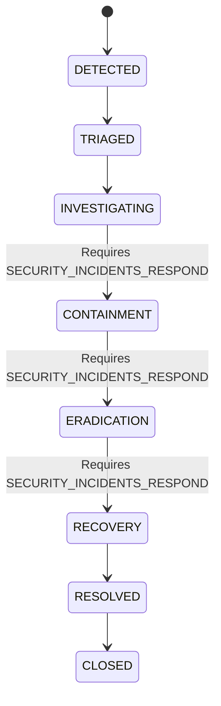

# HealthBridge India — Security Incident Management (Day 9 Task 04)

**API:** `GET/POST /api/v1/admin/security/incidents`, `GET/PATCH /api/v1/admin/security/incidents/:id`  
**Consoles:** `/admin/security/incidents`, `/admin/security/incidents/[id]`

---

## 1. Formal Incident Lifecycle

- **Separation of Duties:** Analysts with `SECURITY_INCIDENTS_MANAGE` can open incidents, triage, link alerts, and add investigation notes, but transitions to `CONTAINMENT`, `ERADICATION`, or `RECOVERY` (or logging containment actions) strictly require `SECURITY_INCIDENTS_RESPOND` (`403 FORBIDDEN` otherwise).
- **No Auto-Resolution:** Resolving or dismissing a linked alert never automatically closes an open incident.
- **Immutable Timeline:** Every transition appends an entry (`timestamp`, `actorId`, `fromStatus`, `toStatus`, `note`) to `incident.timeline` and records `SECURITY_INCIDENT_UPDATED` in `AuditLogModel`.
