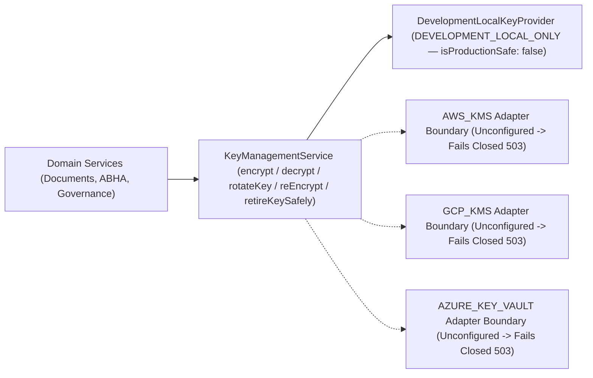

# HealthBridge India — Encryption Key Management Architecture (Day 9 Task 03)

**Primary Module:** `apps/api/src/security/data-protection/key-management.service.ts`

---

## 1. Centralized KMS Interface & Provider Boundaries

- **Strict Dev vs. Prod Separation:** `DevelopmentLocalKeyProvider` explicitly sets `providerKind: 'DEVELOPMENT_LOCAL_ONLY'` and `isProductionSafe: false`, surfaced visibly on `/admin/security/data-protection`.
- **Fail-Closed Cloud Boundaries:** `UnconfiguredCloudKmsAdapter` fails closed with HTTP `503` if a cloud KMS provider is selected without runtime credentials/SDK integration.
- **Zero Key Leakage:** `listKeyMetadata()` and `/api/v1/admin/data-protection/status` return only `keyId`, `version`, `status`, timestamps, and `provider` — **never** `keyMaterial`. Keys are absent from Git, frontend bundles, and Pino logs.

---

## 2. Compromised-Key & Recovery Policy

1. **Suspected Key Compromise:** Immediately trigger `rotateKey()` to mint a new active key version, execute priority batch re-encryption via `KeyRotationOrchestrator` across all affected encrypted records, audit all recent decryption events, and revoke IAM permissions on the compromised KMS key version once migration and legal-hold checks complete.
2. **Preventing Accidental Key Loss:** Production cloud KMS keys must enable deletion-protection waiting periods (`>= 30 days`) and multi-region key replication; never destroy a historical key while encrypted production records or retained disaster-recovery backups still depend on it.
