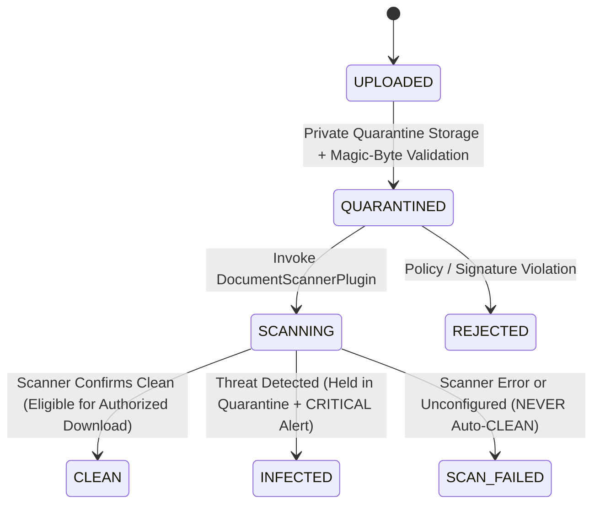

# HealthBridge India — Malware Scanning & Quarantine Architecture (Day 9 Task 03)

**Implementation:** `apps/api/src/security/data-protection/document-storage.service.ts` (`DocumentScannerPlugin`, `SecureDocumentStorageService`)

---

## 1. Quarantine & Scanning State Machine

- **Fail-Closed Guarantee:** If the scanner errors or is unconfigured (`UNCONFIGURED_SCANNER_BOUNDARY`), the document transitions to `SCAN_FAILED` and is **blocked** from download release (`403 FORBIDDEN`) rather than silently marked `CLEAN`.
- **Threat Alerting:** `INFECTED` verdicts emit a `CRITICAL` `MALWARE_SCAN_ALERT` incident via `keyManagementService.recordIncident` and `securityAuditMonitor`.

---

## 2. Honest Operational Limitation

**No live antivirus/malware scanner (ClamAV daemon, AWS GuardDuty Malware Protection, or GCP Cloud AV) is configured in this local/offline environment.** Only the quarantine state machine, fail-closed `UnconfiguredDocumentScanner`, and mock-scanner unit tests are operational today. Provisioning a real scanner engine is a mandatory pre-production deployment blocker.
