# HealthBridge India — Unified Security Architecture (Day 9 Task 01)

**Date:** 2026-11-18  
**Core Location:** `apps/api/src/security/` (Backend) & `apps/web/next.config.mjs`, `apps/web/src/lib/security/` (Frontend)

---

## 1. Architectural Principles

1. **Strict Separation of Authentication & Authorization:**
   - **Authentication (`apps/api/src/middleware/authenticate.ts`)** answers *who* the actor is (verifying JWT signature, expiry, issuer, audience, active account status, and rejecting URL query tokens).
   - **Authorization (`apps/api/src/security/authorization.policy.ts`, `permissions.registry.ts`, `consent.adapter.ts`)** answers *what* the actor may access or mutate (combining role permissions, resource ownership, facility scope, and consent state).
2. **Reuse Existing Core Controls (Zero Parallel Security Systems):**
   - `apps/api/src/security/` wraps and unifies existing `ConsentEnforcementService`, `AuditLogModel`, `logger`, and `AppError` rather than replacing or duplicating them.
3. **Fail-Closed Defaults:**
   - Unverifiable consent, missing tokens, disallowed search types, invalid file signatures, and untrusted cross-site cookie mutations are rejected by default (`400`/`401`/`403`).
4. **Never Rely on Frontend Visibility Alone:**
   - Next.js `<ProtectedRoute>` improves UX; authoritative security decisions execute strictly on `apps/api`.

---

## 2. Backend Security Layer (`apps/api/src/security/`)

| File | Responsibility |
|---|---|
| `permissions.registry.ts` | Authoritative 5-role permission registry (`ROLE_PERMISSION_REGISTRY`) enforcing least privilege and zero unrestricted clinical access for `ADMIN`. |
| `authorization.policy.ts` | `requirePermission(...)` middleware, `assertResourceOwnership(...)`, `assertFacilityScope(...)`, and `hasUnrestrictedClinicalAccess(...)`, automatically logging denials to `securityAuditMonitor`. |
| `consent.adapter.ts` | Fail-closed `ConsentSecurityAdapter` wrapping `ConsentEnforcementService` with immediate synchronous revocation (`invalidateImmediately`) and audited compliance-justification gate for any `ADMIN` clinical inspection. |
| `input-security.middleware.ts` | Global `nosqlSanitizerMiddleware` (blocks `$` MongoDB operators and `__proto__`/`constructor`/`prototype`), `hppGuardMiddleware`, and `pickAllowedFields` mass-assignment guard. |
| `csrf.middleware.ts` | Global `csrfProtectionMiddleware` validating `Sec-Fetch-Site`, `Origin`, and `Referer` for cookie-authenticated state-changing requests (`POST`/`PUT`/`PATCH`/`DELETE`), while exempting signed ABDM webhooks. |
| `file-security.service.ts` | Clinical document security: MIME/extension validation, binary magic-byte inspection (`%PDF-`, PNG, JPEG, WebP), actual decoded size cap (`10MB`), path-traversal filename sanitization, UUID storage IDs, and honest `MalwareScannerAdapter` boundary (`SCAN_NOT_CONFIGURED`). |
| `security-audit.monitor.ts` | Centralized PHI-free, credential-redacted security audit emitter writing structured logs to Pino and append-only records to `AuditLogModel`. |

---

## 3. Request Security Pipeline (`apps/api/src/app.ts`)

```mermaid
flowchart LR
  R["HTTP Request"] --> ID["requestIdMiddleware"]
  ID --> H["Helmet (frameguard DENY, nosniff, referrerPolicy, prod HSTS)"]
  H --> C["Strict CORS (CORS_ORIGIN + credentials + Last-Event-ID)"]
  C --> B["Body & Cookie Parsers (10MB cap + signed cookies)"]
  B --> HPP["hppGuardMiddleware"]
  HPP --> NOSQL["nosqlSanitizerMiddleware ($ / __proto__ blocked)"]
  NOSQL --> CSRF["csrfProtectionMiddleware (cookie mutations)"]
  CSRF --> RL["Tiered Rate Limiters (auth/login/reset/search/api)"]
  RL --> AUTHN["authenticate (Bearer / Cookie; ?token= rejected 401)"]
  AUTHN --> AUTHZ["authorize / requirePermission / Ownership / Consent"]
  AUTHZ --> ZOD["Zod Request Validation"]
  ZOD --> HANDLER["Domain Controller & Service"]
  HANDLER --> ERR["Centralized Safe errorHandler"]
```

---

## 4. Frontend Security Controls (`apps/web/`)

- **HTTP Security Headers (`apps/web/next.config.mjs`):** `X-Frame-Options: DENY`, `X-Content-Type-Options: nosniff`, `Referrer-Policy: strict-origin-when-cross-origin`, `Permissions-Policy`, `X-DNS-Prefetch-Control: off`, `Strict-Transport-Security`, `Content-Security-Policy`, and `poweredByHeader: false`.
- **Zero Persistent Token or PHI Storage:** Verified via full codebase grep — `localStorage` stores only UI theme preference (`healthbridge-theme`) and an immediately-removed cross-tab sync pulse; zero tokens or clinical records are written to `localStorage`/`sessionStorage`.
- **Account Switching & Logout Cleanup (`apps/web/src/features/auth/hooks/use-auth.ts`):** `queryClient.clear()` executes on login, logout, and logout-all, with `BroadcastChannel` `LOGOUT` broadcast across browser tabs.
- **Safe Redirect Protection (`apps/web/src/lib/security/safe-redirect.ts`):** `sanitizeRedirectPath` rejects external origins, protocol-relative (`//evil.com`), backslash, and `javascript:` URLs.
