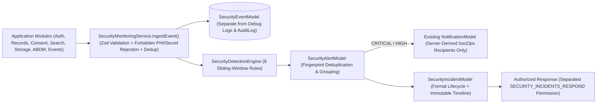

# HealthBridge India — Security Monitoring & Operations Architecture (Day 9 Task 04)

**Primary Module:** `apps/api/src/modules/security-monitoring/`  
**Admin Consoles:** `/admin/security/overview`, `/admin/security/alerts`, `/admin/security/incidents`, `/admin/security/vulnerabilities`, `/admin/security/data-protection`

> **Operational Honesty:** Current monitoring runs as an in-process event collection, sliding-window detection, and periodic CI scanning foundation (`monitoringMode: 'IN_PROCESS_EVENT_PIPELINE_AND_PERIODIC_CHECKS'`). It is **not** a 24×7 managed external SIEM/SOC until production log shipping (OpenSearch/Datadog/Chronicle/Splunk) and external paging channels are provisioned.

---

## 1. End-to-End Monitoring Pipeline

---

## 2. Granular SecOps Access Control Matrix

SecOps permissions are **NEVER granted automatically to every `ADMIN` user**. `requireSecurityOpsPermission(...)` verifies both `req.user.role === 'ADMIN'` AND explicit presence of the required permission in `AdminProfileModel.permissions`:

| Permission | Scope |
|---|---|
| `SECURITY_EVENTS_READ` | Read `/api/v1/admin/security/overview` & `/events` |
| `SECURITY_ALERTS_READ` | Read `/alerts` & `/alerts/:id` |
| `SECURITY_ALERTS_MANAGE` | Acknowledge, investigate, assign, resolve, or dismiss alerts |
| `SECURITY_INCIDENTS_READ` | Read `/incidents` & `/incidents/:id` |
| `SECURITY_INCIDENTS_MANAGE` | Create incidents, triage, update notes/resolution |
| `SECURITY_INCIDENTS_RESPOND` | **Separated Responder Privilege:** Execute `CONTAINMENT`, `ERADICATION`, and `RECOVERY` actions |
| `SECURITY_VULNERABILITIES_READ` | Read `/vulnerabilities` |
| `SECURITY_VULNERABILITIES_MANAGE` | Log advisories, update remediation status, record `ACCEPTED_RISK` justifications |
