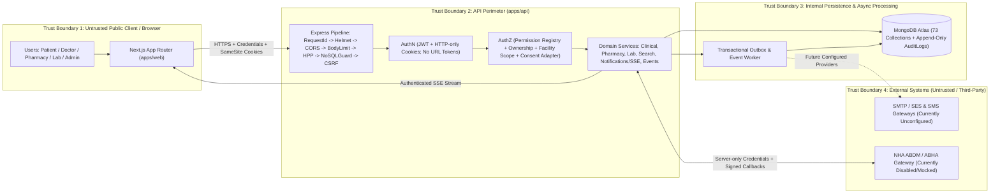

# HealthBridge India — Comprehensive STRIDE Threat Model (Day 9 Task 01)

**Date:** 2026-11-18  
**Methodology:** STRIDE (Spoofing, Tampering, Repudiation, Information Disclosure, Denial of Service, Elevation of Privilege)  
**Scope:** End-to-end HealthBridge India platform (`apps/web`, `apps/api`, MongoDB Atlas, ABDM/ABHA gateway boundary, SSE streams, outbox event workers, and clinical document storage).

> **Compliance Disclaimer:** Technical controls in this threat model establish defense-in-depth engineering foundations aligned with Indian healthcare privacy principles (ABDM / DISHA / DPDP). They do **not** constitute legal compliance or formal NHA/CERT-In regulatory certification without independent legal review, accredited penetration testing, and live NHA milestone certification.

---

## 1. System Architecture & Trust Boundaries

---

## 2. Critical Assets, Actors & Entry Points

### Primary Assets
1. **Protected Health Information (PHI):** Patient profiles, clinical encounters, diagnoses, prescriptions, diagnostic lab reports, uploaded clinical PDFs/images, unified health timelines.
2. **Identity & Authentication Material:** `passwordHash`, JWT signing secrets, `RefreshToken` hashes, `VerificationToken` hashes, ABHA numbers/addresses, ABDM client secrets.
3. **Consent Artefacts & Audit Trails:** Patient consent grants/revocations, append-only `AuditLog` records, domain event outbox logs.
4. **Operational Clinical Integrity:** Pharmacy batch stock/dispensing logs, laboratory sample barcodes, pathologist report sign-offs.

### Potential Threat Actors
- Unauthenticated internet attackers (credential stuffing, injection, scraping, DoS).
- Malicious or compromised authenticated patients attempting horizontal IDOR access to other patients.
- Compromised clinician, pharmacy, or laboratory accounts attempting cross-tenant or non-consented clinical reads.
- Malicious or compromised administrator attempting unauthorized clinical record inspection or audit tampering.
- Compromised external webhook sender attempting forged ABDM callbacks or replay attacks.

### Primary Entry Points
- Public endpoints: `/api/v1/auth/login`, `/register`, `/forgot-password`, `/reset-password`, `/verify-email`, `/api/v1/health`, `/api/v1/docs`.
- Authenticated REST & SSE endpoints: `/api/v1/records`, `/patients`, `/doctors`, `/appointments`, `/prescriptions`, `/pharmacy`, `/laboratory`, `/lab-orders`, `/lab-reports`, `/consent`, `/search`, `/notifications/stream`, `/events`, `/audit`, `/users`.
- External callback boundary: `/api/v1/abdm/webhooks/*`.

---

## 3. Prioritized STRIDE Threat Register

| ID | Threat Scenario | STRIDE | Severity | Likelihood | Impact | Existing Mitigation | Recommended Mitigation | Verification Method |
|---|---|---|---|---|---|---|---|---|
| **T-01** | **Cross-Patient Horizontal IDOR (Unauthorized Patient Record Access)** | Information Disclosure / EoP | **CRITICAL** | High | Catastrophic PHI breach | Server-derived `req.user.userId`, ownership checks in `record.service.ts`, `assertResourceOwnership`, `ROLE_SEARCH_PERMISSION_MATRIX`, user-scoped SSE/notifications. | Add automated multi-tenant DB-backed E2E tests against every new export/detail route. | `records.test.ts`, `global-search.test.ts`, `unified-notifications.test.ts`, `security-architecture.test.ts` |
| **T-02** | **Consent Bypass / Stale Access After Revocation** | EoP / Info Disclosure | **CRITICAL** | Medium | Illegal clinical access after patient revokes consent | Synchronous `ConsentEnforcementService.invalidateConsentImmediately` barrier + fail-closed `ConsentSecurityAdapter`. | Back revocation barrier with Redis pub/sub when scaling `apps/api` to multiple replicas. | `security-architecture.test.ts`, `consent.test.ts`, `day8-patient-journey.e2e.test.ts` |
| **T-03** | **Unrestricted Administrator Clinical Data Access** | EoP / Info Disclosure | **HIGH** | Medium | Insider misuse of sensitive patient PHI | `ROLE_PERMISSION_REGISTRY` denies unrestricted clinical permissions to `ADMIN`; `ConsentSecurityAdapter` requires audited break-glass justification; Admin blocked from clinical global search. | Enforce formal DPO dual-approval ticket workflow before enabling admin clinical inspection in prod. | `security-architecture.test.ts`, `global-search.test.ts` |
| **T-04** | **Stolen Access / Refresh Tokens & URL Token Leakage** | Spoofing / Info Disclosure | **HIGH** | High | Full account takeover | Short-lived JWT (`15m`), HTTP-only cookies, refresh token rotation + reuse detection revoking all sessions; **Day 9 fix:** global `?token=` rejection (`401`) in `authenticate.ts`. | Add device-binding anomaly alerts & short idle session revocation in production. | `auth-security.test.ts`, `security-architecture.test.ts`, `unified-notifications.test.ts` |
| **T-05** | **Cross-Site Request Forgery (CSRF) Against Cookie Sessions** | Spoofing / Tampering | **HIGH** | Medium | Forged prescriptions, consent grants, or record uploads | `SameSite=Lax` cookies + **Day 9 fix:** `csrfProtectionMiddleware` enforcing `Origin`/`Referer`/`Sec-Fetch-Site` on cookie-authenticated mutations. | Consider double-submit CSRF token header for cross-subdomain deployments. | `security-architecture.test.ts` |
| **T-06** | **NoSQL Operator Injection & Prototype Pollution** | Tampering / Info Disclosure | **HIGH** | High | Auth bypass or mass data dump | Zod schema validation + **Day 9 fix:** global `nosqlSanitizerMiddleware` blocking `$` operator keys and `__proto__`/`constructor`/`prototype` + `hppGuardMiddleware`. | Maintain zero raw `req.body` pass-through to Mongoose queries via code review / SAST. | `security-architecture.test.ts` |
| **T-07** | **Malicious Clinical File Uploads (Spoofed MIME / XSS / Executables / Traversal)** | Tampering / Info Disclosure | **HIGH** | High | Stored XSS, server compromise, or client malware infection | **Day 9 fix:** `FileSecurityService` verifying binary magic bytes (`%PDF-`, PNG, JPEG, WebP), actual decoded byte size, extension match, path-traversal filename sanitization, `X-Content-Type-Options: nosniff`. | Integrate dedicated ClamAV/cloud antivirus scanning & isolated private S3/GCS bucket with short-lived pre-signed URLs before production. | `security-architecture.test.ts`, `records.test.ts` |
| **T-08** | **Unprotected Administrative / Scaffold Endpoints** | EoP / Info Disclosure | **HIGH** | Medium | Unauthorized access to `/audit`, `/users`, `/prescriptions` | **Day 9 fix:** Discovered and locked down Day 2 scaffold routes (`/api/v1/audit`, `/api/v1/users`, `/api/v1/prescriptions`) with `authenticate` + `requirePermission`/`authorize`. | Add automated route-inventory CI assertion ensuring every non-public route registers `authenticate`. | `security-architecture.test.ts` |
| **T-09** | **Cross-Tenant Pharmacy / Laboratory / Doctor Access** | EoP / Info Disclosure | **HIGH** | Medium | Competitor or unauthorized facility accessing another facility's orders/inventory | Facility-scoped queries + `assertFacilityScope` + role-scoped route guards. | Enforce facility ID composite indexes and cross-tenant integration tests on all new facility modules. | `pharmacy-*.test.ts`, `laboratory-*.test.ts`, `security-architecture.test.ts` |
| **T-10** | **API Abuse, Brute-Force Login & Enumeration** | Denial of Service / Spoofing | **HIGH** | High | Account compromise or service exhaustion | `loginRateLimiter` (5/15m), `passwordResetRateLimiter` (3/hr), `authGeneralLimiter`, `apiLimiter`, `searchRateLimiter` (90/min), `10mb` JSON cap; **Day 9 fix:** added rate limits to `/refresh`, `/reset-password`, `/verify-email`. | Move in-memory rate-limit counters to Redis before horizontal scaling; add WAF/CDN DDoS shielding. | `rate-limit.test.ts`, `auth-security.test.ts` |
| **T-11** | **Event Injection / Replay & Notification Spoofing** | Tampering / Repudiation | **HIGH** | Medium | Fake critical lab alerts or duplicate dispensing | No public event-publish endpoint (`POST /api/v1/events` -> `404`), `POST /notifications/events` restricted to `ADMIN`, `idempotencyKey` deduplication in outbox. | Add dead-letter alerting and anomaly rate monitoring on Admin replay actions. | `event-workflows.test.ts`, `unified-notifications.test.ts` |
| **T-12** | **Audit Log Tampering / Repudiation** | Repudiation | **MEDIUM** | Low | Covering up unauthorized PHI reads | Append-only `AuditLogModel` blocking `updateOne`, `updateMany`, `findOneAndUpdate`, `deleteOne`, plus **Day 9 fix:** `deleteMany` and `findOneAndDelete` hooks. | Stream immutable copies of `auditLogs` to external WORM / SIEM storage in production. | `audit-log.model.ts`, `security-architecture.test.ts` |
| **T-13** | **Database Exposure / Credential Leak** | Information Disclosure | **CRITICAL** | Low | Full database compromise | `passwordHash` `select: false`, `tokenHash` stripped in `toJSON`/`toObject`, env-based URI masked in logs, no committed `.env` secrets. | Enforce MongoDB Atlas TLS-only, IP allow-list/VPC peering, least-privilege DB user, KMS encryption at rest. | `database-security.md`, `secret-management.md` |
| **T-14** | **External ABDM Gateway / Webhook Compromise** | Spoofing / Tampering | **HIGH** | Low | Forged health records or consent callbacks | Server-side-only credentials, webhook signature/secret validation, replay nonce tracking, provenance tags (`ABDM_INGESTION`), `ABDM_ENABLED=false` fail-safe. | Complete NHA sandbox certificate pinning & formal M1/M2/M3 security audit before go-live. | `abdm-*.test.ts` |
