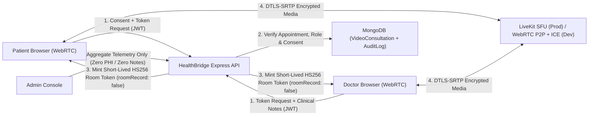

# HealthBridge India — Video Consultation Architecture

## 1. Repository Audit Summary

Before designing the telemedicine module, the existing HealthBridge India monorepo was audited:

- **Backend (`apps/api`):** Express + TypeScript + Mongoose with JWT (`authenticate`), strict role authorization (`authorize`), Zod validation, Pino structured logging, append-only `AuditLogModel`, and SSE notifications.
- **Appointment Model (`AppointmentModel`):** Already supports `consultationType: 'IN_PERSON' | 'TELECONSULTATION'`, statuses (`REQUESTED`, `SCHEDULED`, `CONFIRMED`, `CHECKED_IN`, `IN_PROGRESS`, `COMPLETED`, `CANCELLED`), and `encounterId`.
- **Doctor Prescriptions (`apps/web/src/app/(dashboard)/doctor/prescriptions/new/page.tsx`):** Already accepts `patientId`, `patientName`, and `encounterId` query parameters, allowing seamless zero-duplication reuse from the video consultation workspace.
- **Security Headers (`apps/web/next.config.mjs`):** Previously blocked `camera=()` and `microphone=()` via `Permissions-Policy`; updated to `camera=(self), microphone=(self)` and added `media-src 'self' blob:` plus optional `NEXT_PUBLIC_VIDEO_WS_ORIGIN` in CSP `connect-src`.

---

## 2. Video Infrastructure Provider Evaluation

| Criterion | **LiveKit (Recommended Production SFU)** | Jitsi Meet (Self-Hosted) | Daily.co (Managed SaaS) |
| :--- | :--- | :--- | :--- |
| **Architecture** | Open-source Go WebRTC SFU + Managed Cloud | XMPP + JVB + Prosody multi-service stack | Proprietary managed WebRTC API |
| **India Data Residency (DPDP)** | Self-hostable in AWS Mumbai (`ap-south-1`) / Hyderabad or LiveKit Cloud | Self-hostable in India | Limited India region control on lower tiers |
| **Token Security** | Standard HS256 JWT `VideoGrant` with `roomRecord: false` | JWT via Prosody plugin | REST API room tokens |
| **Operational Overhead** | Low (single binary or managed cloud) | High (Prosody + Jicofo + JVB + Coturn) | Lowest |
| **Cost Profile** | Open-source self-hosted or low per-minute cloud | Server infra + maintenance cost | Higher per-minute SaaS pricing |
| **Decision** | **Primary Production Adapter (`VIDEO_PROVIDER=livekit`)** | Not selected (heavy multi-daemon ops) | Alternative managed fallback |

To support zero-cost local development and verification without external credentials, HealthBridge also includes **`WEBRTC_DIRECT`** — an authenticated participant-only WebRTC peer-to-peer signaling adapter using the existing backend API + TTL-expiring MongoDB signal documents.

---

## 3. System Architecture Diagram

---

## 4. Data & Privacy Architecture

1. **`VideoConsultationModel` (`videoConsultations` collection):**
   - One-to-one with `Appointment` (`appointmentId` unique index).
   - Opaque cryptographic `roomName` (`hb-vc-<24 hex chars>`) containing **zero patient/doctor PII or diagnosis text**.
   - `recordingEnabled` defaults strictly to `false` and is enforced server-side on every token mint.
   - `patientConsent` captures explicit informed consent version (`HB-TELEMED-V1`), timestamp, hashed IP, and non-emergency disclaimer acknowledgement.
   - `consultationNotes` is writable and readable **only by the assigned Doctor** and syncs into the linked `Encounter` when present.
   - `technicalMetrics` tracks anonymized reconnects, failures, audio-only fallbacks, and duration for Admin operational observability.
2. **`VideoSignalMessageModel` (`videoSignalMessages` collection):**
   - Ephemeral SDP/ICE signaling relay with a **1-hour MongoDB TTL auto-expiry index**.
   - Every signal send/poll verifies a valid, unexpired, room-bound, user-bound `X-Video-Room-Token`.

---

## 5. Role-Based Access Boundaries

| Capability | Patient (Assigned) | Doctor (Assigned) | Other Patient / Doctor | Pharmacy / Lab | Admin |
| :--- | :---: | :---: | :---: | :---: | :---: |
| Load consultation session | Yes (own) | Yes (assigned) | `403` | `403` | `403` |
| Grant telemedicine consent | Yes | `403` | `403` | `403` | `403` |
| Mint short-lived room token | Yes (after consent) | Yes | `403` | `403` | `403` |
| Save consultation notes | `403` | Yes | `403` | `403` | `403` |
| Accept / Reject teleconsult | `403` | Yes | `403` | `403` | `403` |
| View aggregate telemetry & config | `403` | `403` | `403` | `403` | Yes (Zero PHI) |
