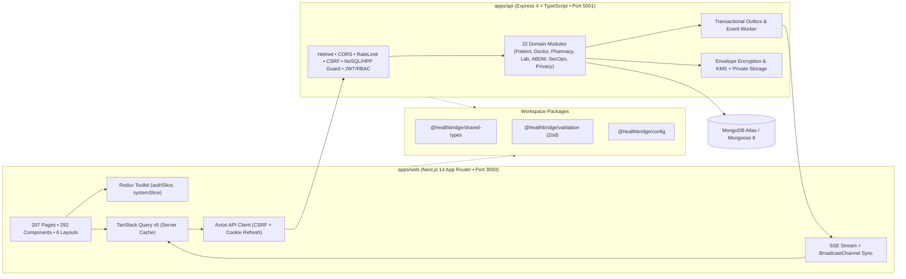

# HealthBridge India — Current Architecture Analysis (Phase 01)

> **Scope:** Exact architecture of the frontend (`apps/web`), backend (`apps/api`), shared packages (`packages/*`), state management, real-time synchronization, and security boundaries as currently implemented.

---

## 1. High-Level System Architecture



---

## 2. Frontend Architecture (`apps/web`)

### Rendering & Routing Model
- **Framework:** Next.js `14.2.35` using the **App Router** (`apps/web/src/app/`).
- **Client Component Dominance:** `531` files across `apps/web/src/` carry `'use client'` — including `apps/web/src/app/page.tsx` (the entire public landing page) and every authenticated dashboard layout and page. Only `app/layout.tsx`, `app/not-found.tsx`, and a handful of pure utility modules execute without `'use client'`.
- **Route Groups:**
  - `src/app/` — Public landing (`/`) and `/privacy-policy`.
  - `src/app/(auth)/` — 6 authentication routes (`/login`, `/register`, `/forgot-password`, `/reset-password`, `/verify-email`, `/verify-phone`).
  - `src/app/(dashboard)/` — Shared `/dashboard` role redirector + `/dashboard/search`, plus 5 role-specific route subtrees (`patient/`, `doctor/`, `pharmacy/`, `laboratory/`, `admin/`), each wrapped in its own `layout.tsx`.
- **Error & Loading Boundaries:**
  - `src/app/error.tsx` (1 global client error boundary) and `src/app/not-found.tsx` (1 root 404 page).
  - **0 `loading.tsx` files** anywhere in the route tree; loading states are handled ad-hoc inside individual components via `animate-pulse` divs (94 occurrences) or `animate-spin` icons (115 occurrences).

### Provider Composition (`src/providers/`)
Root layout (`apps/web/src/app/layout.tsx`) injects an inline synchronous FOUC-prevention script before React hydration to apply the `.dark` class on `<html>` based on `localStorage['healthbridge-theme']` or `prefers-color-scheme`, then mounts:

```text
RootLayout
 └── AppProviders (src/providers/app-providers.tsx)
      ├── ReduxProvider (src/store/index.ts: authSlice, systemSlice)
      ├── QueryProvider (@tanstack/react-query QueryClientProvider)
      └── ThemeProvider (light | dark | system context + DOM .dark class sync)
```

### State Management & Data Layer
| Layer | Implementation | Responsibility |
| :--- | :--- | :--- |
| **Global Auth & System UI State** | Redux Toolkit (`src/store/slices/auth-slice.ts`, `system-slice.ts`) | Authenticated user profile, role, bootstrap status, and system health telemetry. Zero JWTs or PHI persisted in `localStorage`. |
| **Server State & Caching** | TanStack Query v5 (`src/features/*/hooks/*.ts`) | Queries, mutations, optimistic updates, and role-scoped cache invalidation. Full `queryClient.clear()` executed on login and logout to prevent cross-account cache bleed. |
| **HTTP Transport** | Axios (`src/lib/api/client.ts` & `src/lib/api-client.ts`) | `withCredentials: true`, automatic CSRF header injection, silent refresh-token retry queue on `401`, and normalized API error handling (`src/lib/api/error-handler.ts`). |
| **Real-Time Sync** | `src/features/notifications/hooks/use-notifications.ts`, `lib/dashboard-sync.ts`, `lib/cross-tab-sync.ts` | Server-Sent Events (SSE) notification stream mapped to automatic TanStack Query invalidation keys + `BroadcastChannel` synchronization across browser tabs. |
| **Route Protection** | `src/features/auth/components/protected-route.tsx` | Verifies authentication state and `allowedRoles` (`PATIENT`, `DOCTOR`, `PHARMACY`, `LABORATORY`, `ADMIN`), redirecting unauthenticated users via `safe-redirect.ts` (open-redirect hardened). |

### Styling & Theming Architecture
- **Tailwind CSS `3.4.19`** configured in `apps/web/tailwind.config.ts` with `darkMode: ['class']`.
- **Semantic HSL CSS Variables** defined in `apps/web/src/app/globals.css` for `:root` (light) and `.dark` (dark): `--background`, `--foreground`, `--card`, `--popover`, `--primary`, `--secondary`, `--muted`, `--accent`, `--destructive`, `--border`, `--input`, `--ring`, `--radius`.
- **Custom Brand Palette:** `brand.blue` (`#0B4F8A`), `brand.teal` (`#0E9F8B`), `brand.cyan` (`#06B6D4`), `brand.indiaOrange` (`#FF9933`), `brand.indiaGreen` (`#138808`).
- **Critical Architectural Divergence:** `patient/layout.tsx`, `doctor/layout.tsx`, and `admin/layout.tsx` use semantic theme tokens (`bg-background text-foreground`), whereas `pharmacy/layout.tsx` and `laboratory/layout.tsx` hardcode light-only classes (`bg-slate-50/70 text-slate-900`, `bg-white` footer), breaking dark mode across 97 routes.

---

## 3. Backend Architecture (`apps/api`)

- **Runtime:** Express `4.22.3` + TypeScript `5.9.3` + Mongoose `8.24.9` (MongoDB Atlas).
- **Modular Monolith:** 22 cohesive domain modules under `apps/api/src/modules/` exposing versioned REST endpoints under `/api/v1/*` plus SSE notification streaming.
- **Security Pipeline (`apps/api/src/app.ts` & `middleware/`):**
  - `helmet@8.3.0`, strict CORS allowlist, per-route rate limiting, CSRF double-submit verification, NoSQL operator injection sanitization, HPP parameter pollution protection, Zod request validation, JWT access + HTTP-only refresh token cookies, 5-role RBAC + SecOps sub-role checks.
  - **Privacy & Consent Enforcement:** Consent verification middleware, purpose-based access controls, audit logging, and patient data rights workflows (export, correction, account deletion).
  - **Data Protection (`apps/api/src/security/`):** Application-level AES-256-GCM envelope encryption, KMS provider abstraction, key rotation runbooks, private encrypted document storage with signed short-lived access tokens.
  - **Event Processing & SecOps (`modules/events/`, `modules/security-monitoring/`):** Transactional outbox pattern, idempotent event consumers, dead-letter queue (DLQ) replay, detection rules, alert/incident lifecycle, and vulnerability register.

---

## 4. Security Boundaries Relevant to Phase 02 UI Enhancement

When upgrading the frontend UI/UX in Phase 02+, the following existing security guarantees **must remain intact**:
1. **Strict CSP (`apps/web/next.config.mjs`):**
   - `default-src 'self'`, `frame-ancestors 'none'`, `img-src 'self' data: blob:`, `font-src 'self' data:`, `connect-src 'self' <apiOrigin>`.
   - **Impact on UI:** Never load third-party CDN fonts, CDN scripts, or external remote image URLs without explicit CSP review. Use `next/font/google` (which self-hosts fonts under `'self'`) and local/inline SVG assets.
2. **Cookie-Based Auth & Zero LocalStorage PHI:** Never store access tokens, refresh tokens, ABHA numbers, or clinical records in `localStorage` / `sessionStorage`. Only non-sensitive UI preferences (theme, reduced-motion override, sound/haptic toggle, sidebar collapse state) belong in `localStorage`.
3. **API & Schema Immutability:** All UI upgrades must bind to existing `src/features/*/api/*` and `src/features/*/hooks/*` contracts without altering backend routes or database schemas.
